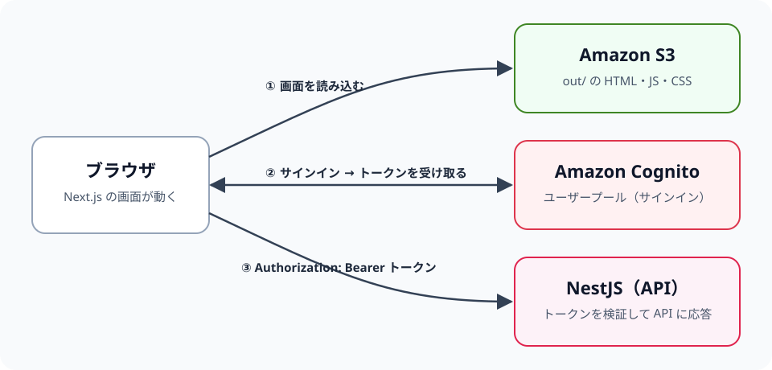

# Next.js × NestJS × Cognito ハンズオン

Next.js（SSG）で作った画面から、NestJS で作った BFF（Backend for Frontend）を呼び出し、Amazon Cognito でサインインしたユーザーだけが使えるアプリを、**1 つのプロジェクトを少しずつ育てながら** 作るハンズオンです。

- **フロントエンド** — Next.js の静的書き出し（SSG）。ビルドすると HTML・JS・CSS だけになるので、Amazon S3 のような静的ファイルの置き場にそのまま置けます
- **BFF** — NestJS。フロントエンド専用の API で、Cognito が発行したトークンを検証してから応答します
- **認証** — Amazon Cognito のユーザープール。サインインの画面は Amplify の部品を使います
- **開発環境** — Podman。フロントエンドと BFF をコンテナで動かします

## 進め方

各節のページは「その節でやること → 手順（コードの差分）→ 動かして確かめる → この節を終えたときのディレクトリ」の順に並んでいます。ページの最後には、その節を終えた状態のプロジェクトを ZIP でダウンロードできるボタンがあります。途中の節から始めたいときや、手元のコードと見比べたいときに使ってください。

詳しくは [進め方](./sections/README.md) を見てください。

## このハンズオンで作るもの

### 01. 基本的な環境構築

Node.js と Podman を入れます。Node.js は 26 が使えれば、公式サイトのインストーラーでもバージョン管理ツール（nvm など）でもかまいません。

### 02. Hello World

Next.js と NestJS のプロジェクトを作り、それぞれ「Hello World」を表示します。Next.js は静的ファイルに書き出す設定にし、`out/` にできたファイルがそのまま S3 に置けることを確かめます。NestJS で使う `@Controller()` のようなデコレーターが、TypeScript の標準ではなく NestJS が前提にしている書き方であることも押さえます。BFF は curl と Postman で呼び出します。

### 03. Podman

フロントエンドと BFF をコンテナで動かします。`compose.yaml` を書いて、`podman compose up` 1 つで両方が起動し、ファイルを保存すると反映される開発環境を作ります。

### 04. 簡単な REST API

BFF にメモの API（一覧・作成・更新・削除）を作り、入力チェックを入れます。Next.js の画面からメモを読み書きできるようにします。

### 05. Next.js と Cognito の連携

Cognito のユーザープールを作り、Next.js の画面にサインインとサインアップを付けます。サインインすると、ユーザーの情報とトークンを取り出せるようになります。

### 06. NestJS で認証と認可

BFF がトークンを検証し、サインインしていないリクエストを断るようにします（認証）。さらに、自分のメモしか触れない・管理者グループだけが全員のメモを見られる、という決まりを入れます（認可）。

### 07. OpenAPI

BFF の API を OpenAPI（YAML）で書きます。VS Code の拡張機能でプレビューと検証をしながら書き、OpenAPI から TypeScript の型を生成する設定を入れます。

### 08. OpenAPI とアプリケーションの連携

生成した型を BFF とフロントエンドの両方で使い、API の形が食い違ったらビルドで気づけるようにします。フロントエンドは型付きのクライアントで BFF を呼び出します。

### 09. ミドルウェアを使った最適化

コントローラーごとに書いていた認証・認可を、アプリケーション全体・パス単位の仕組みに寄せます。エラーの形をそろえ、リクエストごとのログを出します。

### 10. テスト

BFF の単体テスト（Vitest）、BFF を丸ごと HTTP で呼ぶ結合テスト（Vitest と supertest）、ブラウザで画面を操作する E2E テスト（Playwright）を書きます。テストでの認証は、決め打ちのトークンで行います（本来の方法には触れません）。

## ドキュメントサイト

各節の解説は GitHub Pages で読めます: <https://seekseep.github.io/nest-js-and-cognito-handson/>

## 過去のハンズオン

これまでに作ったハンズオンの一覧は [過去のハンズオン](./sections/PAST-HANDSON.md) にあります。

## ライセンス・注意事項

- 学習用リポジトリです
- Cognito のユーザープール ID などの実値はリポジトリに含めていません。各自の AWS アカウントで作り、`.env` / `.env.local` に書いてください
