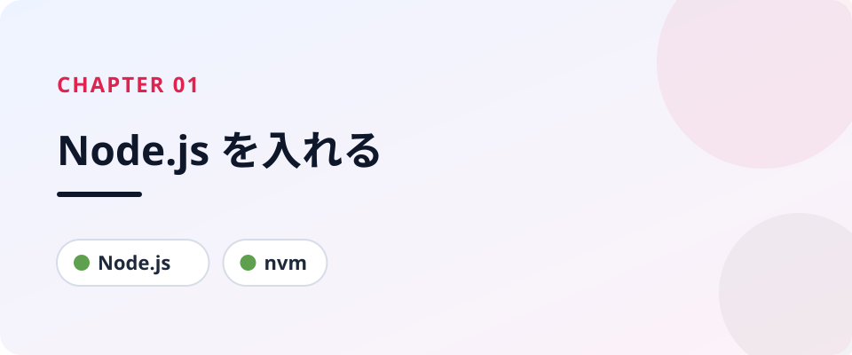

# Node.js と VS Code を入れる



NestJS は Node.js の上で動きます。この節では、**Node.js 26（LTS）** と、エディタの **VS Code** を入れます。Node.js 26 が使えれば、入れ方は問いません。

:::notice
LTS（Long Term Support）は長期サポート版のことです。偶数番号のバージョンが毎年 10 月ごろに LTS になり、約 3 年間セキュリティ修正が届きます。仕事で使うなら LTS を選びます。
:::

## お使いの OS を選ぶ

手順が OS で分かれるところでは、選んだ OS の手順だけを表示します。最初に、お使いの OS を選んでください。あとから、ページの上のナビゲーションバーの選択欄でも変えられます。

::platform-choice

:::::platform
::::macos
macOS では、ターミナル（「アプリケーション」→「ユーティリティ」→「ターミナル」）で進めます。
::::
::::windows
Windows では、**PowerShell 7** で進めます。コマンドの書き方が macOS・Linux と違うところは、Windows の書き方を表示します。

**必要なスペック**

| 項目 | 必要なもの |
|---|---|
| OS | Windows 10 または Windows 11（Home・Pro どちらでも） |
| CPU | 64 ビット |
| シェル | PowerShell 7（下で入れます） |
| メモリ | 8 GB 以上をすすめます（エディタとブラウザと API を同時に開くため） |
| ディスクの空き | 5 GB 以上をすすめます（Node.js・VS Code・`node_modules`） |

数字は目安です。NestJS の API はとても軽いので、ふだん使っているパソコンなら、たいてい足ります。

**PowerShell 7 を入れる**

Windows に最初から入っている「Windows PowerShell」（5.1）ではなく、新しい PowerShell 7 を使います。5.1 では、`&&` でコマンドをつなげない・`curl` が別のコマンドになっている、など、このハンズオンのコマンドがそのままでは動かないためです。

スタートメニューから「Windows PowerShell」を開き、次のコマンドで入れます。

```powershell
winget install --id Microsoft.PowerShell --source winget
```

入れたら、スタートメニューから **PowerShell 7**（`pwsh`）を開きます。以降のコマンドは、すべて PowerShell 7 で実行します。

```powershell
$PSVersionTable.PSVersion
```

`7.` から始まる番号が出れば大丈夫です。
::::
::::linux
Linux では、ふだんのターミナルで進めます。パッケージを入れる手順は、Ubuntu のコマンド（`apt`）で書いています。
::::
:::::

## すでに入っているか確かめる

```bash
node -v
```

`v26.` から始まる番号が出れば、Node.js 26 はもう入っています。次の「[npx を確かめる](#npx-を確かめる)」に進んでください。`command not found` と出るときや、ほかのバージョンが出るときは、次のどちらかの方法で入れます。

| 方法 | 向いている人 |
|---|---|
| 公式サイトから入れる | Node.js を使うのはこのハンズオンだけ、という人 |
| バージョン管理ツール（nvm など）で入れる | プロジェクトごとに Node.js のバージョンを切り替えたい人 |

## 公式サイトから入れる

[Node.js のダウンロードのページ](https://nodejs.org/ja/download) を開き、バージョンに **v26（LTS）** を選びます。

:::::platform
::::macos
macOS 用のインストーラー（`.pkg`）をダウンロードして開き、画面の案内に従って進めます。
::::
::::windows
Windows 用のインストーラー（`.msi`）をダウンロードして開き、画面の案内に従って進めます。winget で入れることもできます。

```powershell
winget install OpenJS.NodeJS.LTS
```

`OpenJS.NodeJS.LTS` は、その時点の LTS を入れます。2026 年 10 月から 2027 年 10 月までは Node.js 26 です。
::::
::::linux
OS に **Linux** を選び、表示されたコマンドをターミナルで実行します。Ubuntu の `apt install nodejs` で入る Node.js は古いことが多いので、使いません。
::::
:::::

入れたら、ターミナル（Windows では PowerShell 7）を開き直して「[バージョンを確かめる](#バージョンを確かめる)」に進みます。

## バージョン管理ツールで入れる

プロジェクトごとに必要な Node.js のバージョンが違うことは、よくあります。バージョン管理ツールを使うと、`nvm use 26` のように 1 行でバージョンを切り替えられます。ここでは **nvm** を例にします（fnm・Volta・mise など、ほかのツールでもかまいません）。

:::::platform
::::macos
ターミナルで nvm のインストールスクリプトを実行します。

```bash
curl -o- https://raw.githubusercontent.com/nvm-sh/nvm/v0.41.0/install.sh | bash
```

スクリプトは、nvm を読み込む設定を、シェルの設定ファイル（`~/.zshrc`）に書き足します。

設定を反映するため、**ターミナルを開き直して** から確かめます。

```bash
nvm --version
```

```text
0.41.0
```

:::warning
`nvm: command not found` と出るときは、ターミナルを開き直したか確かめてください。それでも出るときは、`~/.zshrc` の末尾に `NVM_DIR` から始まる行が書き足されているか確かめます。
:::

Node.js 26 を入れます。

```bash
nvm install 26
nvm alias default 26
```

`nvm alias default 26` で、新しくターミナルを開いたときに Node.js 26 が使われるようにします。
::::
::::linux
ターミナルで nvm のインストールスクリプトを実行します。

```bash
curl -o- https://raw.githubusercontent.com/nvm-sh/nvm/v0.41.0/install.sh | bash
```

スクリプトは、nvm を読み込む設定を、シェルの設定ファイル（`~/.bashrc`）に書き足します。

設定を反映するため、**ターミナルを開き直して** から確かめます。

```bash
nvm --version
```

```text
0.41.0
```

:::warning
`nvm: command not found` と出るときは、ターミナルを開き直したか確かめてください。それでも出るときは、`~/.bashrc` の末尾に `NVM_DIR` から始まる行が書き足されているか確かめます。
:::

Node.js 26 を入れます。

```bash
nvm install 26
nvm alias default 26
```

`nvm alias default 26` で、新しくターミナルを開いたときに Node.js 26 が使われるようにします。
::::
::::windows
nvm は macOS・Linux 向けのツールで、Windows では動きません。Windows で切り替えたいときは、Windows でも動く fnm や Volta を使ってください（使い方はそれぞれのドキュメントを見てください）。迷ったら、上の「公式サイトから入れる」で入れれば十分です。
::::
:::::

## バージョンを確かめる

```bash
node -v
npm -v
```

```text
v26.13.1
11.12.1
```

`v26.` から始まっていれば大丈夫です（細かい番号は入れた日によって違います）。npm は Node.js といっしょに入るパッケージマネージャーで、NestJS などのライブラリを入れるときに使います。

## npx を確かめる

npm には、パッケージをインストールせずに一度だけ実行する `npx` というコマンドが付いています。02 章で NestJS のプロジェクトを作るときに使います。

```bash
npx --version
```

`npm -v` と同じ番号が出れば大丈夫です。

## VS Code を入れる

エディタには [Visual Studio Code](https://code.visualstudio.com/)（VS Code）を使います。TypeScript の補完が最初から効き、コードの編集と同じウィンドウでターミナルを開けます。06 章では、OpenAPI を書くための拡張機能も入れます。

:::::platform
::::macos
[ダウンロードのページ](https://code.visualstudio.com/download) から macOS 用をダウンロードし、開いてできた **Visual Studio Code** を「アプリケーション」フォルダに移します。Homebrew を使っているなら、次でも入れられます。

```bash
brew install --cask visual-studio-code
```

VS Code を開き、コマンドパレット（Cmd + Shift + P）で **Shell Command: Install 'code' command in PATH** を実行すると、ターミナルから `code` で開けるようになります。
::::
::::windows
[ダウンロードのページ](https://code.visualstudio.com/download) から Windows 用のインストーラーをダウンロードして開きます。winget でも入れられます。

```powershell
winget install --id Microsoft.VisualStudioCode --source winget
```

インストーラーは、`code` コマンドを `PATH` に足します。入れたあとに開いた PowerShell から使えます。
::::
::::linux
[ダウンロードのページ](https://code.visualstudio.com/download) から、使っているディストリビューション用のパッケージ（Ubuntu なら `.deb`）をダウンロードして入れます。

```bash
sudo apt install ./code_*.deb
```
::::
:::::

ターミナルで確かめます。

```bash
code --version
```

番号が出れば大丈夫です。フォルダを VS Code で開くときは、そのフォルダで `code .` を実行します。VS Code の中では、`` Ctrl + ` ``（バッククォート）でターミナルが開きます。

## 参考にした公式ドキュメント

この節は、次の公式ドキュメントをもとに書いています。

- [Node.js: ダウンロード](https://nodejs.org/ja/download) … 入れ方（インストーラー・パッケージマネージャー）
- [Node.js: Previous Releases](https://nodejs.org/en/about/previous-releases) … LTS の決まりと、各バージョンのサポート期間
- [nvm（README）](https://github.com/nvm-sh/nvm) … nvm の入れ方と `nvm install` / `nvm alias default`
- [Microsoft Learn: Windows への PowerShell のインストール](https://learn.microsoft.com/ja-jp/powershell/scripting/install/installing-powershell-on-windows) … winget で PowerShell 7 を入れる方法
- [npm Docs: npx](https://docs.npmjs.com/cli/v11/commands/npx) … `npx` の働き
- [VS Code: Visual Studio Code on macOS](https://code.visualstudio.com/docs/setup/mac) … macOS での入れ方と、`code` コマンドを `PATH` に足す方法
- [VS Code: Visual Studio Code on Windows](https://code.visualstudio.com/docs/setup/windows) … Windows のインストーラーと `PATH`
- [VS Code: Visual Studio Code on Linux](https://code.visualstudio.com/docs/setup/linux) … `.deb` パッケージでの入れ方

:::faq

### Homebrew で入れてもいい？

かまいません。`brew install node@26` で入れられます。`node -v` で `v26.` から始まる番号が出れば、この節の手順は終わりです。

### Node.js を 2 つの方法で入れてしまった

公式サイトのインストーラー・Homebrew・nvm などで重ねて入れると、どれが使われているか分かりにくくなります。`which node`（Windows の PowerShell では `Get-Command node`）で、使われている Node.js の場所を確かめてください（nvm なら `~/.nvm/` の下です）。使わないほうをアンインストールするか、`PATH` の順番を見直します。

### 会社のネットワークで `curl` が失敗する

プロキシの設定が必要なことがあります。社内の案内に従って `HTTPS_PROXY` を設定してから実行してください。

### Node.js 26 ではなく 24 でも動く？

このハンズオンで使う NestJS 12 は Node.js 24 でも動きます。ただし、手順やエラーメッセージは Node.js 26 で確かめています。迷ったら 26 を使ってください。

:::
