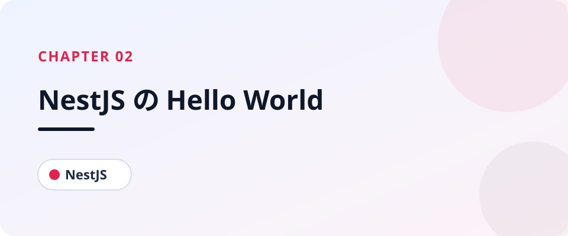

# NestJS の Hello World



この節では、**NestJS** のプロジェクトを作り、「Hello World!」を返す API を動かします。このハンズオンでは、このプロジェクトに節ごとに機能を足していき、最後にはメモを読み書きする REST API にします。

NestJS は、Node.js で API を作るためのフレームワークです。URL ごとの処理（コントローラー）と、処理の中身（サービス）を分けて書き、それらをモジュールにまとめる、という決まった形で書きます。決まった形があるので、API が大きくなっても、どこに何を書けばよいか迷いにくくなります。

## NestJS のプロジェクトを作る

作業用のフォルダ（たとえば `~/handson/`）を作り、その中で Nest CLI を使ってプロジェクトを作ります。

```bash
mkdir handson
cd handson
npx @nestjs/cli@12 new api --package-manager npm
```

| 指定 | 意味 |
|---|---|
| `@nestjs/cli@12` | Nest CLI の 12 系を、インストールせずに 1 回だけ使う |
| `api` | 作るフォルダの名前 |
| `--package-manager npm` | パッケージマネージャーに npm を使う（聞かれずに済む） |

`api/` ができ、必要なライブラリのインストールまで行われます。`api/` の中では `git init` も済んでいて、`.gitignore` も入っています。

主なファイルは次のとおりです。

| ファイル | 役割 |
|---|---|
| `src/main.ts` | アプリを起動する入り口。ポート番号もここで決める |
| `src/app.module.ts` | モジュール。コントローラーとサービスをまとめる |
| `src/app.controller.ts` | コントローラー。URL とメソッドに応じて処理を呼ぶ |
| `src/app.service.ts` | サービス。実際の処理（ここでは文字列を返すだけ） |
| `src/*.spec.ts`・`test/` | テスト（Vitest）。`npm test` で動く |

以降のコマンドは、`api/` の中で実行します。VS Code で `api/` を開いておくと便利です。

```bash
cd api
code .
```

## 動かす

```bash
npm run start:dev
```

```text
[Nest] 53212  - 2026/11/20 11:37:13     LOG [NestFactory] Starting Nest application...
[Nest] 53212  - 2026/11/20 11:37:13     LOG [InstanceLoader] AppModule dependencies initialized +4ms
[Nest] 53212  - 2026/11/20 11:37:13     LOG [RoutesResolver] AppController {/}:
[Nest] 53212  - 2026/11/20 11:37:13     LOG [RouterExplorer] Mapped {/, GET} route
[Nest] 53212  - 2026/11/20 11:37:13     LOG [NestApplication] Nest application successfully started
```

`Mapped {/, GET} route` は「`GET /` を受け付ける」という意味です。ブラウザで <http://localhost:3000> を開くと `Hello World!` と表示されます。

`start:dev` はファイルの変更を見張っていて、保存すると自動で再起動します。止めるときは、ターミナルで Ctrl + C を押します。

ポート番号は `src/main.ts` で決まっています。

:::code{filepath="api/src/main.ts"}
```ts
import { NestFactory } from '@nestjs/core';
import { AppModule } from './app.module.js';

async function bootstrap() {
  const app = await NestFactory.create(AppModule);
  await app.listen(process.env.PORT ?? 3000);
}
await bootstrap();
```
:::

`process.env.PORT ?? 3000` は「環境変数 `PORT` があればその値、無ければ 3000」という意味です。

## リクエストが届くまで

`GET /` が届くと、NestJS は次の順で処理します。

1. `AppModule` に登録された `AppController` の中から、`@Get()` が付いたメソッドを探す
2. `getHello()` を呼ぶ。コントローラーは `AppService` の `getHello()` を呼ぶ
3. 返した文字列がレスポンスの本文になる

:::code{filepath="api/src/app.controller.ts"}
```ts
@Controller()
export class AppController {
  constructor(private readonly appService: AppService) {}

  @Get()
  getHello(): string {
    return this.appService.getHello();
  }
}
```
:::

`constructor(private readonly appService: AppService)` と書くだけで、NestJS が `AppService` のインスタンスを作って渡してくれます。これを **依存性の注入（DI）** と呼びます。コントローラーは「URL とメソッドの受け付け」、サービスは「処理の中身」と役割を分けておくと、あとで処理を差し替えたりテストしたりしやすくなります。

:::notice
NestJS 12 のプロジェクトは ES Modules で書かれています。`import { AppService } from './app.service.js'` のように、TypeScript のファイルでも import の末尾は `.js` にします（ビルド後のファイル名に合わせるため）。
:::

## ビルド・lint・テスト

`nest new` は、よく使うコマンドを `package.json` の `scripts` に用意しています。このハンズオンでは、節の終わりに次の 3 つが通ることを確かめています。

```bash
npm run build   # TypeScript をコンパイルして dist/ に書き出す
npm run lint    # oxlint でコードを調べる
npm test        # Vitest でテストを動かす
```

```text
 Test Files  1 passed (1)
      Tests  1 passed (1)
```

## 参考にした公式ドキュメント

この節は、次の公式ドキュメントをもとに書いています。

- [NestJS: First steps](https://docs.nestjs.com/first-steps) … `nest new` で作るプロジェクトのファイルと `main.ts`、`npm run start:dev`
- [NestJS: Controllers](https://docs.nestjs.com/controllers) … `@Controller()`・`@Get()` とルートの決まり方
- [NestJS: Providers](https://docs.nestjs.com/providers) … サービスとコンストラクターでの依存性の注入

## この節を終えたときのディレクトリ

::tree

:::download
[この節を終えた状態をダウンロード](./project.zip)
:::

:::faq

### `npm run start:dev` で `EADDRINUSE: address already in use :::3000` と出る

3000 番ポートを別のプログラムが使っています。前に起動した API が残っていないか確かめてください。使っているプログラムは、macOS・Linux なら `lsof -i :3000`、Windows の PowerShell なら `Get-Process -Id (Get-NetTCPConnection -LocalPort 3000).OwningProcess` で分かります。別のポートで動かしたいときは、環境変数 `PORT` を指定します（macOS・Linux は `PORT=3001 npm run start:dev`、PowerShell は `$env:PORT=3001; npm run start:dev`）。

### ZIP をダウンロードして始めたら動かない

ZIP には `node_modules/` が入っていません。展開した `api/` で `npm install` を実行してから動かしてください。

:::
