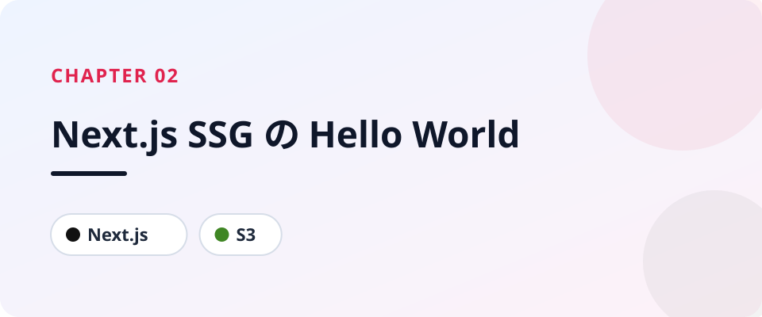
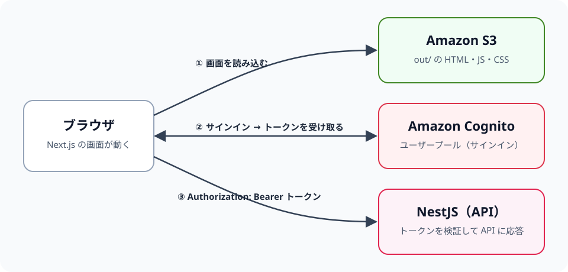
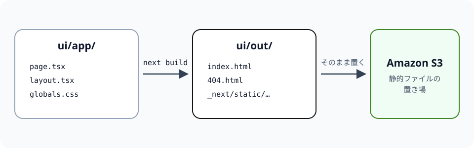

# Next.js SSG の Hello World



このハンズオンでは、次の構成のアプリを作ります。



画面は Next.js で作り、**静的ファイル（HTML・JS・CSS）に書き出して** 配ります。これを SSG（Static Site Generation）と呼びます。画面がデータを必要とするときは、ブラウザから NestJS の API を呼び出します。

この節では、Next.js のプロジェクトを作って「Hello World」を表示し、静的ファイルに書き出すところまでを行います。

## プロジェクトのフォルダを作る

ハンズオンを通して育てるフォルダを作ります。名前は何でもかまいません。ここでは `my-app` にします。

```bash
mkdir my-app
cd my-app
```

このフォルダの中に、UI（`ui/`）と API（`api/`、次の節）を並べていきます。

## Next.js のプロジェクトを作る

`create-next-app` で Next.js のプロジェクトを作ります。

```bash
npx create-next-app@16 ui --yes --use-npm --disable-git
```

| オプション | 意味 |
|---|---|
| `ui` | 作るフォルダの名前 |
| `--yes` | 質問にすべておすすめの答えで進む（TypeScript・ESLint・Tailwind CSS・App Router） |
| `--use-npm` | パッケージマネージャーに npm を使う |
| `--disable-git` | `ui/` の中で `git init` しない（`my-app` 全体を 1 つのプロジェクトとして扱うため） |

しばらく待つと `ui/` ができます。主なファイルは次のとおりです。

| ファイル | 役割 |
|---|---|
| `app/page.tsx` | トップページ（`/`）の中身 |
| `app/layout.tsx` | すべてのページを囲むレイアウト（`<html>` や `<body>`） |
| `app/globals.css` | 全体のスタイル。Tailwind CSS を読み込んでいる |
| `next.config.ts` | Next.js の設定 |
| `package.json` | 使うライブラリと、`npm run dev` などのコマンド |

## 開発サーバーで動かす

```bash
cd ui
npm run dev
```

ブラウザで <http://localhost:3000> を開くと、Next.js の初期画面が表示されます。開発サーバーは、ファイルを保存すると画面に自動で反映します。止めるときはターミナルで `Ctrl + C` を押します。

## Hello World にする

`app/page.tsx` の中身を、すべて次のように置き換えます。

:::code{filepath="ui/app/page.tsx"}
```tsx
export default function Home() {
  return (
    <main className="mx-auto flex w-full max-w-2xl flex-1 flex-col gap-4 px-6 py-16">
      <h1 className="text-3xl font-bold">Hello World</h1>
      <p className="text-zinc-600 dark:text-zinc-400">
        Next.js の静的書き出し（SSG）で作ったページです。
      </p>
    </main>
  );
}
```
:::

`className` に並んでいるのは Tailwind CSS のクラスです。`text-3xl` は文字の大きさ、`font-bold` は太字、`px-6` は左右の余白を表します。

ページのタイトルと言語も変えておきます。`app/layout.tsx` の `metadata` と `<html>` の `lang` を書き換えます。

:::code{filepath="ui/app/layout.tsx" offset=15 newOffset=15}
```tsx
 export const metadata: Metadata = {
-  title: "Create Next App",
-  description: "Generated by create next app",
+  title: "メモアプリ",
+  description: "Next.js × NestJS × Cognito ハンズオン",
 };
 
 export default function RootLayout({ children }: LayoutProps<"/">) {
   return (
     <html
-      lang="en"
+      lang="ja"
       className={`${geistSans.variable} ${geistMono.variable} h-full antialiased`}
     >
```
:::

開発サーバーが動いていれば、保存するとブラウザに「Hello World」が表示されます。

## 静的ファイルに書き出す

Next.js は、既定ではサーバー（`next start`）の上で動かす前提でビルドします。静的ファイルとして書き出すには、`next.config.ts` に `output: "export"` を足します。

:::code[cacheComponents と partialPrefetching の 2 行は消す]{filepath="ui/next.config.ts" offset=1 newOffset=1}
```ts
 import type { NextConfig } from "next";
 
 const nextConfig: NextConfig = {
   /* config options here */
-  cacheComponents: true,
-  partialPrefetching: true,
+  output: "export",
   turbopack: {
     rules: {
       "*.css": {
```
:::

:::warning
`create-next-app` が書く `cacheComponents: true` は、ページの一部をリクエストのたびにサーバーで作る機能（Partial Prerendering）を有効にします。サーバーを持たない静的書き出しとは両立しないので、残したままビルドすると `PPR cannot be enabled in export mode` というエラーで止まります。
:::

開発サーバーを `Ctrl + C` で止めてから、ビルドします。

```bash
npm run build
```

```text
Route (app)
┌ ○ /
└ ○ /_not-found

○  (Static)  prerendered as static content
```

`○ (Static)` は、そのページがビルドのときに HTML になったことを表します。`ui/out/` に静的ファイルができています。

```bash
ls out
```

```text
404.html  _next  _not-found  favicon.ico  file.svg  globe.svg  index.html  next.svg  vercel.svg  window.svg  ...
```



## 書き出したファイルを確かめる

`out/` は、Web サーバーに置くだけで動くファイルの集まりです。静的ファイルを配るだけの簡単なサーバー `serve` で確かめます。

```bash
npx serve@14 out
```

表示された URL（<http://localhost:3000>）を開くと、開発サーバーと同じ「Hello World」が表示されます。Node.js の Next.js サーバーは動いていません。HTML・JS・CSS を配っているだけです。

## コラム: S3 に置く

`out/` の中身は、Amazon S3 のような静的ファイルの置き場にそのまま置けます。AWS CLI を使う場合は、バケットに同期するだけです。

```bash
aws s3 sync out/ s3://<バケット名>/ --delete
```

公開するときは、S3 のバケットを直接公開するのではなく、Amazon CloudFront を前に置いて配るのが一般的です（HTTPS で配れて、バケットを非公開のままにできる）。このハンズオンでは手元の開発サーバーで進めるので、S3 には置きません。

:::notice
静的書き出しでは、リクエストのたびにサーバーで動く機能（Route Handlers の動的な応答、`cookies()` を使うページ、画像の最適化など）は使えません。サーバーの仕事は NestJS の API に任せる、というのがこの構成の考え方です。
:::

## この節を終えたときのディレクトリ

::tree

:::download
[この節を終えた状態をダウンロード](./project.zip)
:::

:::faq

### `npx create-next-app` で質問がたくさん出てくる

`--yes` を付け忘れていないか確かめてください。`--yes` を付けると、質問にすべておすすめの答えで進みます。

### `npm run build` で `PPR cannot be enabled in export mode` と出る

`next.config.ts` に `cacheComponents: true` が残っています。消してからビルドし直してください。

### `npx serve out` で 3000 番が使われていると言われる

開発サーバー（`npm run dev`）が動いたままです。`Ctrl + C` で止めるか、`serve` が提案する別のポートの URL を開いてください。

:::
