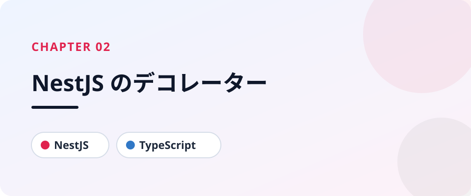

# NestJS のデコレーター



前の節の `api/src/app.controller.ts` には、`@Controller()` や `@Get()` のように、`@` で始まる書き方が出てきました。これを **デコレーター** と呼びます。この節では、コードは書かずに、デコレーターが何をしているのかを見ます。

:::warning
**デコレーターは、JavaScript の標準の書き方ではありません。** TypeScript の実験的な機能を設定でオンにして使う書き方で、NestJS はそれを前提に作られています。
:::

## デコレーターとは

前の節の `AppController` では、`@Controller()` はクラスに、`@Get()` はメソッドに付いています。デコレーターの正体は **関数** です。`@Controller()` と書くと、`Controller()` を呼んで返ってきた関数に、クラス `AppController` が渡されます。

NestJS のデコレーターの多くは、受け取ったクラスやメソッドに **メタデータ**（コードの動きとは別に付けておく情報）を貼り付けるだけです。

| デコレーター | 貼り付ける情報 |
|---|---|
| `@Controller()` | このクラスはコントローラーである |
| `@Get()` | このメソッドは `GET` のリクエストを受け付ける |
| `@Injectable()` | このクラスは NestJS が作って、ほかのクラスに渡してよい |

起動のとき、NestJS はクラスに貼られた情報を読んで、「`GET /` が来たら `AppController` の `getHello()` を呼ぶ」という対応表を作ります。起動ログの `Mapped {/, GET} route` は、この対応表ができたことを表しています。

## ビルドしたコードで確かめる

`npm run build` で作られた `api/dist/app.controller.js` を開くと、デコレーターがふつうの関数の呼び出しに書き換えられています（一部を抜き出しています）。

```js
let AppController = class AppController {
    appService;
    constructor(appService) {
        this.appService = appService;
    }
    getHello() {
        return this.appService.getHello();
    }
};
__decorate([
    Get(),
    __metadata("design:type", Function),
    __metadata("design:paramtypes", []),
    __metadata("design:returntype", String)
], AppController.prototype, "getHello", null);
AppController = __decorate([
    Controller(),
    __metadata("design:paramtypes", [AppService])
], AppController);
```

- `__decorate([Get(), ...], ...)`・`__decorate([Controller(), ...], ...)` … メソッドとクラスに、`Get()`・`Controller()` を当てています
- `__metadata("design:paramtypes", [AppService])` … 「コンストラクターは `AppService` を受け取る」という型の情報です

最後の型の情報が、NestJS の **依存性の注入（DI）** を支えています。TypeScript の型はふつうビルドで消えますが、デコレーターの付いたクラスでは JavaScript に残ります。NestJS はこれを読んで、`AppService` を作って `AppController` に渡します。

## TypeScript の設定でオンにしている

デコレーターと型の情報は、`nest new` が書いた `api/tsconfig.json` の次の 2 行でオンになっています。

```json
"emitDecoratorMetadata": true,
"experimentalDecorators": true,
```

| 設定 | 意味 |
|---|---|
| `experimentalDecorators` | 「実験的な」デコレーターを使えるようにする |
| `emitDecoratorMetadata` | デコレーターの付いたクラスに、型の情報（`design:paramtypes` など）を残す |

消すと、NestJS のコードはビルドできなくなります。デコレーターは JavaScript の仕様にはまだ入っていないので、Node.js やブラウザは `@` の書き方をそのままは実行できません。TypeScript がビルドで上のような関数の呼び出しに書き換えるので動きます。

## このハンズオンで使うデコレーター

この先の章では、クラスに付ける `@Module()`・`@Injectable()`・`@Catch()`、メソッドに付ける `@Post()`・`@Patch()`・`@Delete()`、引数に付ける `@Query()`・`@Body()`・`@Param()` を使います。どれも「メタデータを貼る」「NestJS が読む」という仕組みは同じです。

## 参考にした公式ドキュメント

この節は、次の公式ドキュメントをもとに書いています。

- [TypeScript: Decorators](https://www.typescriptlang.org/docs/handbook/decorators.html) … `experimentalDecorators` のデコレーター（引数のデコレーター・メタデータ）
- [TypeScript: experimentalDecorators](https://www.typescriptlang.org/tsconfig/#experimentalDecorators) … 設定の意味
- [TypeScript: emitDecoratorMetadata](https://www.typescriptlang.org/tsconfig/#emitDecoratorMetadata) … 型の情報を JavaScript に残す設定
- [NestJS: Custom decorators](https://docs.nestjs.com/custom-decorators) … NestJS でのデコレーターの使い方
