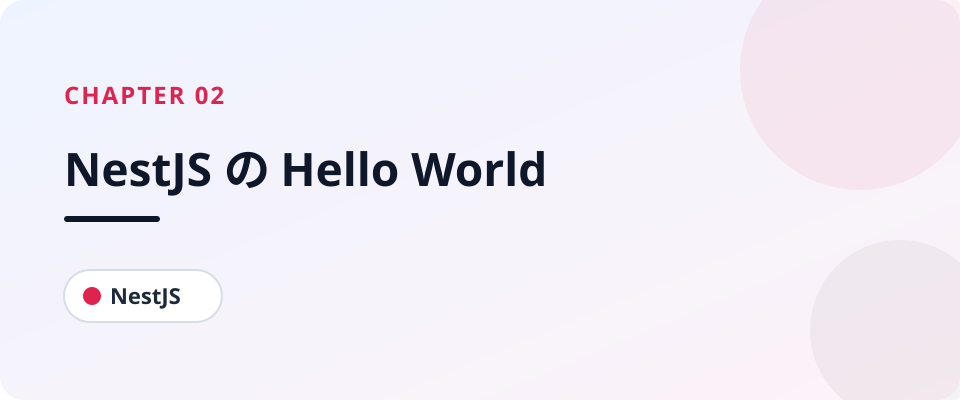
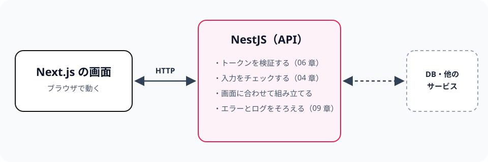

# NestJS の Hello World



この節では、画面（UI）から呼び出す **API** を NestJS で作り、「Hello World!」を返すところまでを行います。

この API は、このアプリの UI のためだけに用意する API サーバーです。このような API を **BFF**（Backend for Frontend）と呼ぶこともあります。このハンズオンでは、単に「API」と呼びます。画面が必要とするデータをまとめて返したり、認証の確認をしたりと、ブラウザでは任せられない仕事を引き受けます。Next.js を静的ファイルとして配るこの構成では、サーバーで動く処理はすべて API が担当します。



## NestJS のプロジェクトを作る

`my-app` フォルダ（`ui/` と同じ階層）に戻り、Nest CLI でプロジェクトを作ります。

```bash
cd ..   # ui/ にいる場合は my-app に戻る
npx @nestjs/cli@12 new api --package-manager npm --skip-git
```

| オプション | 意味 |
|---|---|
| `api` | 作るフォルダの名前 |
| `--package-manager npm` | パッケージマネージャーに npm を使う（聞かれずに済む） |
| `--skip-git` | `api/` の中で `git init` しない |

主なファイルは次のとおりです。

| ファイル | 役割 |
|---|---|
| `src/main.ts` | アプリを起動する入り口。ポート番号もここで決める |
| `src/app.module.ts` | モジュール。コントローラーとサービスをまとめる |
| `src/app.controller.ts` | コントローラー。URL とメソッドに応じて処理を呼ぶ |
| `src/app.service.ts` | サービス。実際の処理（ここでは文字列を返すだけ） |
| `src/*.spec.ts`・`test/` | テスト（Vitest）。このハンズオンでは扱わない |

## ポートを 3001 番にする

NestJS も Next.js も、既定では 3000 番ポートを使います。両方を同時に動かすため、API は 3001 番にします。

:::code{filepath="api/src/main.ts" offset=1 newOffset=1}
```ts
 import { NestFactory } from '@nestjs/core';
 import { AppModule } from './app.module.js';
 
 async function bootstrap() {
   const app = await NestFactory.create(AppModule);
-  await app.listen(process.env.PORT ?? 3000);
+  await app.listen(process.env.PORT ?? 3001);
 }
 await bootstrap();
```
:::

`process.env.PORT ?? 3001` は「環境変数 `PORT` があればその値、無ければ 3001」という意味です。

## 動かす

```bash
cd api
npm run start:dev
```

```text
[Nest] 53212  - 2026/11/18 11:37:13     LOG [NestFactory] Starting Nest application...
[Nest] 53212  - 2026/11/18 11:37:13     LOG [RoutesResolver] AppController {/}:
[Nest] 53212  - 2026/11/18 11:37:13     LOG [RouterExplorer] Mapped {/, GET} route
[Nest] 53212  - 2026/11/18 11:37:13     LOG [NestApplication] Nest application successfully started
```

`Mapped {/, GET} route` は「`GET /` を受け付ける」という意味です。ブラウザで <http://localhost:3001> を開くと `Hello World!` と表示されます。

`start:dev` はファイルの変更を見張っていて、保存すると自動で再起動します。

## リクエストが届くまで

`GET /` が届くと、NestJS は次の順で処理します。

1. `AppModule` に登録された `AppController` の中から、`@Get()` が付いたメソッドを探す
2. `getHello()` を呼ぶ。コントローラーは `AppService` の `getHello()` を呼ぶ
3. 返した文字列がレスポンスの本文になる

:::code{filepath="api/src/app.controller.ts"}
```ts
@Controller()
export class AppController {
  constructor(private readonly appService: AppService) {}

  @Get()
  getHello(): string {
    return this.appService.getHello();
  }
}
```
:::

`constructor(private readonly appService: AppService)` と書くだけで、NestJS が `AppService` のインスタンスを作って渡してくれます。これを **依存性の注入（DI）** と呼びます。コントローラーは「URL とメソッドの受け付け」、サービスは「処理の中身」と役割を分けておくと、あとで処理を差し替えたりテストしたりしやすくなります。

:::notice
NestJS 12 のプロジェクトは ES Modules で書かれています。`import { AppService } from './app.service.js'` のように、TypeScript のファイルでも import の末尾は `.js` にします（ビルド後のファイル名に合わせるため）。
:::

## 参考にした公式ドキュメント

この節は、次の公式ドキュメントをもとに書いています。

- [NestJS: First steps](https://docs.nestjs.com/first-steps) … `nest new` で作るプロジェクトと `main.ts`
- [NestJS: Controllers](https://docs.nestjs.com/controllers) … `@Controller()`・`@Get()` とルートの決まり方

## この節を終えたときのディレクトリ

::tree

:::download
[この節を終えた状態をダウンロード](./project.zip)
:::

:::faq

### `npm run start:dev` で `EADDRINUSE: address already in use :::3001` と出る

3001 番ポートを別のプログラムが使っています。前に起動した API が残っていないか確かめてください。使っているプログラムは、macOS・Linux なら `lsof -i :3001`、Windows の PowerShell なら `Get-Process -Id (Get-NetTCPConnection -LocalPort 3001).OwningProcess` で分かります。

### Next.js の開発サーバーと同時に動かしたい

ターミナルを 2 つ開き、片方で `ui/` の `npm run dev`、もう片方で `api/` の `npm run start:dev` を実行します。03 章では、Podman で 1 つのコマンドから両方を起動できるようにします。

:::
