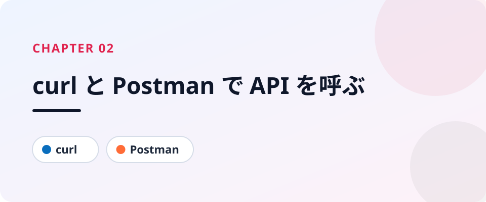

# curl と Postman で API を呼ぶ



画面を作る前に、API が正しく応答するかを確かめる道具として、ターミナルから HTTP リクエストを送る **curl** と、画面から送る **Postman** の使い方を覚えます。

練習用に、API にエンドポイントを 2 つ足します。

| メソッド | パス | 中身 |
|---|---|---|
| `GET` | `/greeting?name=...` | クエリの `name` を使ってあいさつを JSON で返す |
| `POST` | `/echo` | 受け取った本文（JSON）をそのまま返す |

## エンドポイントを足す

::diff{file="api/src/app.controller.ts"}

- `@Query('name')` は、URL の `?name=...` の値を引数に入れます。無ければ `undefined` です
- `@Body()` は、リクエストの本文を引数に入れます
- メソッドがオブジェクトを返すと、NestJS は JSON にして返します

`npm run start:dev` が動いていれば、保存すると自動で再起動します。

## curl で呼ぶ

curl は macOS・Linux・Windows に最初から入っているコマンドです。

### GET

```bash
curl "http://localhost:3000/greeting?name=NestJS"
```

```json
{"message":"Hello, NestJS!"}
```

URL に `?` や `&` が入るときは、シェルに解釈されないよう `"` で囲みます。

### レスポンスのヘッダーも見る

`-i` を付けると、ステータスコードとヘッダーも表示します。

```bash
curl -i "http://localhost:3000/greeting"
```

```text
HTTP/1.1 200 OK
X-Powered-By: Express
Content-Type: application/json; charset=utf-8
Content-Length: 27
...

{"message":"Hello, World!"}
```

`Content-Type: application/json` から、本文が JSON だと分かります。

### POST で JSON を送る

:::::platform
::::macos-linux
```bash
curl -X POST http://localhost:3000/echo \
  -H "Content-Type: application/json" \
  -d '{"title":"買い物","body":"牛乳を買う"}'
```
::::
::::windows
PowerShell では、行の終わりの `` ` ``（バッククォート）で、次の行に続けます。Windows の curl は、日本語の本文をうまく送れないことがあるので、本文を英語にしています。

```powershell
curl -X POST http://localhost:3000/echo `
  -H "Content-Type: application/json" `
  -d '{"title":"Shopping","body":"Buy milk"}'
```
::::
:::::

```json
{"received":{"title":"買い物","body":"牛乳を買う"}}
```

| オプション | 意味 |
|---|---|
| `-X POST` | メソッドを指定する |
| `-H "..."` | リクエストヘッダーを足す |
| `-d '...'` | 本文を送る |

:::warning
`-H "Content-Type: application/json"` を付け忘れると、curl は本文をフォームの形式として送り、API は JSON として読みません。JSON を送るときは必ず付けます。
:::

## Postman で呼ぶ

[Postman](https://www.postman.com/downloads/) は、リクエストを画面で組み立てて送れるアプリです。

1. Postman のデスクトップアプリを入れて起動する
2. **New** → **HTTP** で新しいリクエストを作る
3. メソッドを `GET`、URL を `http://localhost:3000/greeting?name=Postman` にして **Send**

画面の下にレスポンスの本文・ステータス（`200 OK`）・ヘッダーが表示されます。

### POST で JSON を送る

1. メソッドを `POST`、URL を `http://localhost:3000/echo` にする
2. **Body** タブ → **raw** を選び、右の種類を **JSON** にする
3. 本文に `{"title":"買い物","body":"牛乳を買う"}` を書いて **Send**

**JSON** を選ぶと、Postman が `Content-Type: application/json` ヘッダーを自動で付けます。

## 参考にした公式ドキュメント

この節は、次の公式ドキュメントをもとに書いています。

- [NestJS: Controllers](https://docs.nestjs.com/controllers) … `@Query()`・`@Body()`・`@Post()` の使い方
- [curl: man page](https://curl.se/docs/manpage.html) … `-i`・`-X`・`-H`・`-d` などのオプション
- [Postman Docs](https://learning.postman.com/docs/introduction/overview/) … Postman でのリクエストの送り方

## この節を終えたときのディレクトリ

::tree

:::download
[この節を終えた状態をダウンロード](./project.zip)
:::

:::faq

### `curl: (7) Failed to connect to localhost port 3000` と出る

API が起動していません。`api/` で `npm run start:dev` を実行してから試してください。

:::
