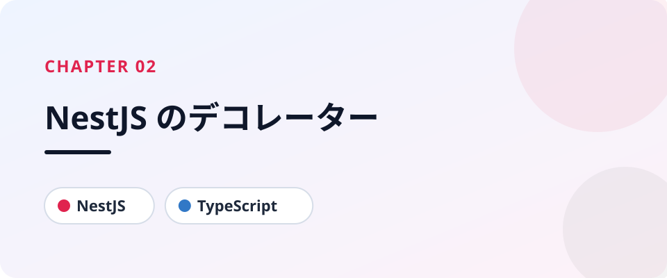

# NestJS のデコレーター



前の節の NestJS のコードには、`@Controller()` や `@Get()` のように、`@` で始まる書き方が出てきました。これを **デコレーター** と呼びます。NestJS では、この先ずっとデコレーターを使います。

この節では、コードは書かずに、デコレーターが何をしているのかを見ます。大事なのは次の 1 点です。

:::warning
**デコレーターは、TypeScript や JavaScript の「ふつうの書き方」ではありません。** TypeScript の実験的な機能を設定でオンにして使う書き方で、NestJS はそれを前提に作られています。`@Controller()` や `@Get()` の中身も、NestJS が用意したものです。ほかの TypeScript のプロジェクトでは、同じように書けるとは限りません。
:::

## デコレーターとは

前の節の `api/src/app.controller.ts` をもう一度見てみます。

```ts
import { Controller, Get } from '@nestjs/common';
import { AppService } from './app.service.js';

@Controller()
export class AppController {
  constructor(private readonly appService: AppService) {}

  @Get()
  getHello(): string {
    return this.appService.getHello();
  }
}
```

`@Controller()` はクラスに、`@Get()` はメソッドに付いています。デコレーターの正体は **関数** です。`@Controller()` と書くと、`Controller()` を呼んで返ってきた関数に、クラス `AppController` が渡されます。

NestJS のデコレーターの多くは、受け取ったクラスやメソッドに **メタデータ**（コードの動きとは別に付けておく情報）を貼り付けるだけです。

| デコレーター | 貼り付ける情報 |
|---|---|
| `@Controller()` | このクラスはコントローラーである |
| `@Get()` | このメソッドは `GET` のリクエストを受け付ける |
| `@Injectable()` | このクラスは NestJS が作って、ほかのクラスに渡してよい |

起動のとき、NestJS はクラスに貼られた情報を読んで、「`GET /` が来たら `AppController` の `getHello()` を呼ぶ」という対応表を作ります。前の節で起動したときのログの `Mapped {/, GET} route` は、この対応表ができたことを表しています。

Java の `@Override` や `@Autowired` のような **アノテーション** と見た目が似ていて、使い方の感覚も近いです。ただ、Java のアノテーションは情報を付けるだけの印なのに対して、TypeScript のデコレーターは、クラスを定義したときに実際に実行される関数です。

## ビルドしたコードで確かめる

`npm run build` で作られた `api/dist/app.controller.js` を開くと、デコレーターがふつうの関数の呼び出しに書き換えられています（一部を抜き出しています）。

```js
let AppController = class AppController {
    appService;
    constructor(appService) {
        this.appService = appService;
    }
    getHello() {
        return this.appService.getHello();
    }
};
__decorate([
    Get(),
    __metadata("design:type", Function),
    __metadata("design:paramtypes", []),
    __metadata("design:returntype", String)
], AppController.prototype, "getHello", null);
AppController = __decorate([
    Controller(),
    __metadata("design:paramtypes", [AppService])
], AppController);
```

- `__decorate([Get(), ...], AppController.prototype, "getHello")` … `getHello` に `Get()` を当てています
- `__decorate([Controller(), ...], AppController)` … クラスに `Controller()` を当てています
- `__metadata("design:paramtypes", [AppService])` … 「コンストラクターは `AppService` を受け取る」という型の情報です

最後の型の情報が、NestJS の **依存性の注入（DI）** を支えています。TypeScript の型は、ふつうはビルドすると消えてしまいます。デコレーターの付いたクラスでは、設定によって、引数の型がこのように JavaScript に残ります。NestJS はこれを読んで、「`AppController` を作るには `AppService` が要る」と判断し、`AppService` を作って渡してくれます。

## TypeScript の設定でオンにしている

デコレーターと型の情報は、`api/tsconfig.json` の次の 2 行でオンになっています。`nest new` が最初から書いてくれています。

```json
"emitDecoratorMetadata": true,
"experimentalDecorators": true,
```

| 設定 | 意味 |
|---|---|
| `experimentalDecorators` | 「実験的な」デコレーターを使えるようにする |
| `emitDecoratorMetadata` | デコレーターの付いたクラスに、型の情報（`design:paramtypes` など）を残す |

名前のとおり、`experimentalDecorators` は TypeScript が昔から持っている **実験的な機能** です。消すと、NestJS のコードはビルドできなくなります。

## JavaScript の標準ではない

デコレーターを JavaScript の仕様に入れる話は、仕様を決める TC39 で長く続いています。ただ、2026 年 11 月の時点では、まだ **提案の段階**（Stage 2.7）で、仕様には入っていません。Node.js やブラウザも、`@` の書き方をそのままは実行できません。

```text
class A { @log m(){} }
          ^

SyntaxError: Invalid or unexpected token
```

TypeScript 5.0 からは、この提案に合わせた **新しい方式** のデコレーターも使えます（`experimentalDecorators` を付けないときの動き）。ただし、NestJS は使っていません。新しい方式には、NestJS に欠かせない次の 2 つが無いからです。

| | 昔からの方式（NestJS が使う） | 新しい方式 |
|---|---|---|
| 有効にする方法 | `experimentalDecorators: true` | 設定なし |
| 引数に付ける（`@Body()`・`@Param()` など） | できる | できない（`TS1206: Decorators are not valid here.`） |
| 型の情報を残す（DI に使う） | できる（`emitDecoratorMetadata`） | できない |

まとめると、NestJS のデコレーターは次のようなものです。

- `@` の書き方は、TypeScript の実験的な機能を設定でオンにしたもの
- JavaScript の標準ではなく、標準になりそうな新しい方式とも別物
- `@Controller()` などの中身は NestJS が用意したもので、NestJS の中でだけ意味を持つ

## このハンズオンで使うデコレーター

この先の章で、次のようなデコレーターを使います。付ける場所は 3 種類です。

| 付ける場所 | 例 | 出てくる章 |
|---|---|---|
| クラス | `@Module()`・`@Controller('notes')`・`@Injectable()` | 02・04 章 |
| メソッド | `@Get()`・`@Post()`・`@Patch()`・`@Delete()`・`@HttpCode(204)` | 02・04 章 |
| メソッド | `@UseGuards()`・自分で作る `@Public()` | 06・09 章 |
| 引数 | `@Query()`・`@Body()`・`@Param()` | 02・04 章 |
| 引数 | 自分で作る `@CurrentUser()` | 06 章 |

06 章と 09 章では、デコレーターを自分で作ります。そのときも「メタデータを貼る」「NestJS が読む」という仕組みは同じです。

## 参考にした公式ドキュメント

この節は、次の公式ドキュメントをもとに書いています。

- [TypeScript: Decorators](https://www.typescriptlang.org/docs/handbook/decorators.html) … `experimentalDecorators` のデコレーター（引数のデコレーター・メタデータ）
- [TypeScript: experimentalDecorators](https://www.typescriptlang.org/tsconfig/#experimentalDecorators) … 設定の意味
- [TypeScript: emitDecoratorMetadata](https://www.typescriptlang.org/tsconfig/#emitDecoratorMetadata) … 型の情報を JavaScript に残す設定
- [TC39: proposal-decorators](https://github.com/tc39/proposal-decorators) … JavaScript の標準にする提案と、その段階
- [NestJS: Custom decorators](https://docs.nestjs.com/custom-decorators) … NestJS でのデコレーターの使い方

:::faq

### デコレーターを使わずに NestJS を書ける？

ほとんど書けません。コントローラー・ルート・DI・引数の受け取りのどれもが、デコレーターで宣言する作りになっているからです。デコレーターを使わずに書きたい場合は、Express や Hono のような、関数でルートを書くフレームワークを選ぶことになります。

### `tsx` や `node` で直接 `.ts` を動かしたら、DI がうまくいかない

`tsx` などの道具は、型の情報（`emitDecoratorMetadata`）を残さないので、NestJS がコンストラクターに何を渡せばよいか分からず、`undefined` になります。NestJS は、`npm run start:dev`（Nest CLI）で動かしてください。

### UI（Next.js）でもデコレーターを使う？

使いません。UI の `tsconfig.json` には `experimentalDecorators` が無く、React のコンポーネントはふつうの関数で書きます。デコレーターは、このハンズオンでは API（NestJS）だけで使う書き方です。

:::
