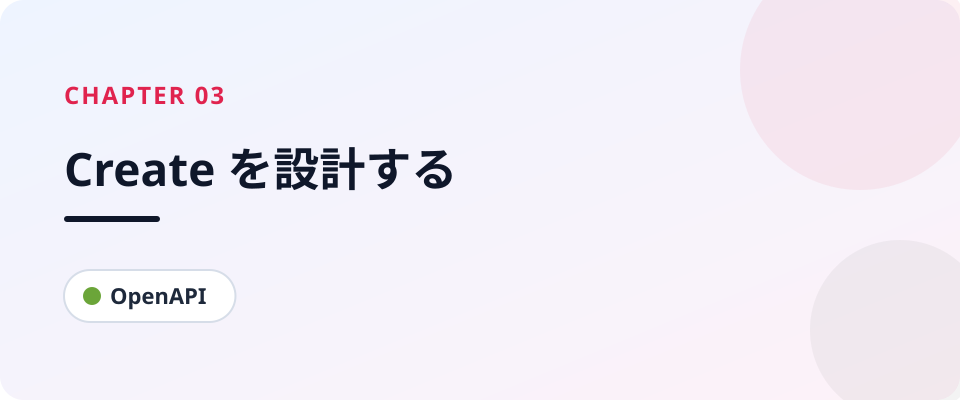

# Create を設計する

この章では、API を作る前に、API の約束（どの URL に何を送ると何が返るか）を **OpenAPI** で `api/openapi.yaml` に書きます。1 節で 1 つの操作を書き足し、04 章ではこのファイルに合わせて実装します。

最初は、メモを作る操作（Create）です。

| メソッド | パス | 中身 |
|---|---|---|
| `POST` | `/notes` | 本文（JSON）からメモを作り、`201` で返す |

## openapi.yaml を書く

`api/` の直下（`package.json` と同じ階層）に置きます。

::diff{file="api/openapi.yaml"}

- `openapi: 3.0.3` … OpenAPI の版です。04 章でリクエストを送る拡張機能の機能（Try it）が 3.0 に対応しているので、3.0 で書きます
- `servers` … API の URL です。04 章では、ここに書いた `http://localhost:3000` にリクエストを送ります
- `paths` → `/notes` → `post` … `POST /notes` の操作です
- `requestBody` … 送る本文の形です。`required` に書いた `title` は必ず送り、`body` は省略すると `''` になります。`additionalProperties: false` は、ほかの項目を受け付けないという意味です
- `responses` … ステータスコードごとの応答です。キーは `'201'` のように文字列で書きます。`400` は入力が決まりに合わないときです

## プレビューで確かめる

VS Code で `api/openapi.yaml` を開き、エディタの右上のプレビューのボタンを押します。横に API のドキュメントの画面が出ます。 `POST /notes` が出て、送る本文と返るメモの形が見えれば大丈夫です。

字下げを間違えたり、決まりに無いキーを書いたりすると、エディタに赤い波線が出て、下の **問題** パネルに説明が出ます。

## 参考にした公式ドキュメント

この節は、次の公式ドキュメントをもとに書いています。

- [OpenAPI Specification v3.0.3](https://spec.openapis.org/oas/v3.0.3.html) … `openapi.yaml` に書ける項目
- [42Crunch: OpenAPI (Swagger) Editor（README）](https://github.com/42Crunch/vscode-openapi#readme) … プレビュー

## この節を終えたときのディレクトリ

::tree

:::download
[この節を終えた状態をダウンロード](./project.zip)
:::

:::faq

### プレビューのボタンが出ない

拡張機能は、`openapi:` で始まるファイルを OpenAPI のファイルとして扱います。1 行目が `openapi: 3.0.3` になっているか確かめてください。

:::
