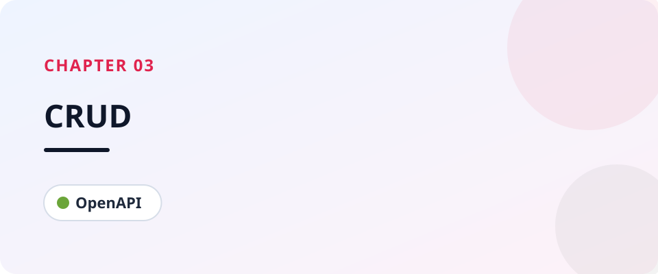

# CRUD

この章では、API を作る前に、API の約束（どの URL に何を送ると何が返るか）を **OpenAPI** で `api/openapi.yaml` に書きます。04 章では、このファイルに合わせて実装します。

データを扱う API の操作は、作る（Create）・読む（Read）・書き換える（Update）・消す（Delete）の 4 つが基本です。頭文字を取って **CRUD** と呼びます。メモの API では、読む操作を 1 件の取得と一覧の取得に分けて、次の 5 つを設計します。

| 節 | 操作 | メソッド | パス |
|---|---|---|---|
| 作成の設計 | Create | `POST` | `/notes` |
| 単一取得の設計 | Read | `GET` | `/notes/{id}` |
| 一覧取得の設計 | Read | `GET` | `/notes` |
| 更新の設計 | Update | `PUT` / `PATCH` | `/notes/{id}` |
| 削除の設計 | Delete | `DELETE` | `/notes/{id}` |

更新には、送った中身でまるごと置き換える `PUT` と、送った項目だけを書き換える `PATCH` があります。このハンズオンでは `PUT` を使います。

操作の種類は **メソッド** で、対象は **パス** で表します。`/notes` はメモ全体、`/notes/{id}` は `id` で決まる 1 件のメモです。

次の節で空の `openapi.yaml` を作り、そのあと 1 節に 1 つずつ操作を書き足します。

## 参考にした公式ドキュメント

この節は、次の公式ドキュメントをもとに書いています。

- [RFC 9110: HTTP Semantics](https://www.rfc-editor.org/rfc/rfc9110.html#name-method-definitions) … `GET`・`POST`・`PUT`・`DELETE` の意味
