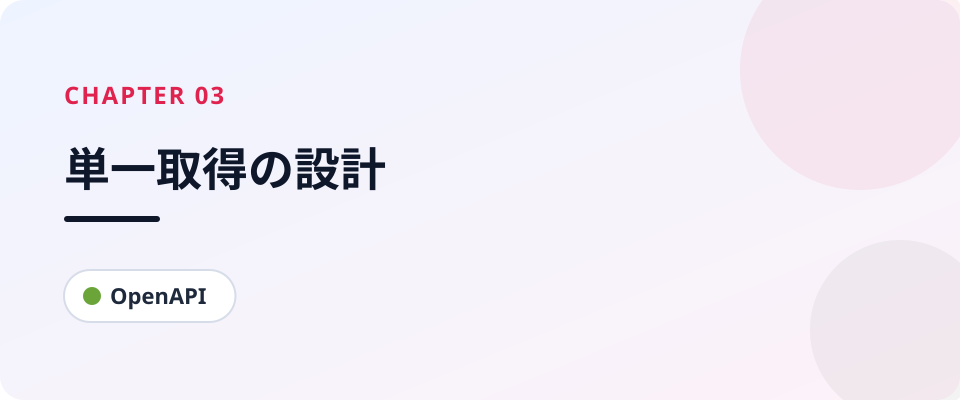

# 単一取得の設計

メモを 1 件返す操作（Get）を書き足します。

| メソッド | パス | 中身 |
|---|---|---|
| `GET` | `/notes/{id}` | メモを 1 件返す。無ければ `404` |

::diff{file="api/openapi.yaml"}

- 応答のメモの形は、前の節の `201` と同じものをもう一度書いています。同じ形をまとめるのは、この章の最後の節です
- `400` は ID が UUID の形でないとき、`404` はメモが無いときです

## パスパラメーターの書き方

`/notes/{id}` の `{id}` のように、パスの中で変わる部分を **パスパラメーター** と呼びます。`/notes/1b9d6bcd-...` へのリクエストでは、`id` が `1b9d6bcd-...` になります。

- パスの中では、名前を `{}` で囲みます
- `parameters` に、同じ名前（`name: id`）で 1 つ書きます
- `in: path` … パスの中の値だという意味です
- `required: true` … パスパラメーターでは必ず書きます（省略できる値にはできません）
- `schema` … 値の形です。ここでは UUID の形の文字列にします

## プレビューで確かめる

VS Code で `api/openapi.yaml` を開き、エディタの右上のプレビューのボタンを押します。横に API のドキュメントの画面が出ます。 `GET /notes/{id}` が増え、`id` のパラメーターと `200`・`400`・`404` の応答が見えれば大丈夫です。

## 参考にした公式ドキュメント

この節は、次の公式ドキュメントをもとに書いています。

- [OpenAPI Specification v3.0.3](https://spec.openapis.org/oas/v3.0.3.html) … Path Item・Parameter Object

## この節を終えたときのディレクトリ

::tree

:::download
[この節を終えた状態をダウンロード](./project.zip)
:::
