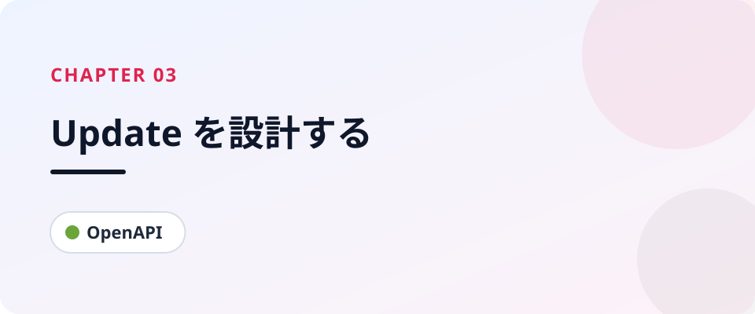

# Update を設計する

メモを書き換える操作（Update）を書き足します。

| メソッド | パス | 中身 |
|---|---|---|
| `PATCH` | `/notes/{id}` | 送った項目だけを書き換えて返す |

::diff{file="api/openapi.yaml"}

- `PATCH` は、送った項目だけを書き換えるメソッドです。本文の項目はどれも省略できるので、`required` を書きません
- Create と違って `default` を書きません。省略した項目は「変えない」という意味にするためです

## プレビューで確かめる

VS Code で `api/openapi.yaml` を開き、エディタの右上のプレビューのボタンを押します。横に API のドキュメントの画面が出ます。 `PATCH /notes/{id}` が増えていれば大丈夫です。

## 参考にした公式ドキュメント

この節は、次の公式ドキュメントをもとに書いています。

- [OpenAPI Specification v3.0.3](https://spec.openapis.org/oas/v3.0.3.html) … Request Body Object

## この節を終えたときのディレクトリ

::tree

:::download
[この節を終えた状態をダウンロード](./project.zip)
:::
