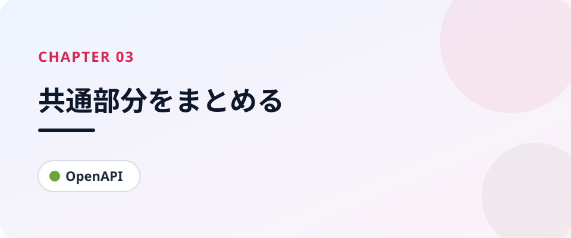

# 共通部分をまとめる

ここまでで、メモの形を 4 回、`id` のパラメーターを 3 回、同じように書きました。同じものは **`components`** にまとめ、`$ref` で参照します。片方だけ直し忘れることがなくなります。

::diff{file="api/openapi.yaml"}

| `components` の中 | まとめたもの |
|---|---|
| `schemas` | メモの形（`Note`）、作るときの本文（`CreateNoteInput`）、書き換えるときの本文（`UpdateNoteInput`） |
| `parameters` | パスの `id`（`NoteId`） |
| `responses` | `400`（`BadRequest`）・`404`（`NotFound`） |

- `$ref: '#/components/schemas/Note'` は、「このファイルの `components` → `schemas` → `Note`」を指します。Cmd（Windows・Linux は Ctrl）を押しながらクリックすると、参照先へ移動します
- `schemas` に付けた名前は、04 章で作る TypeScript の型の名前にもなります

## プレビューで確かめる

VS Code で `api/openapi.yaml` を開き、エディタの右上のプレビューのボタンを押します。横に API のドキュメントの画面が出ます。 前の節と同じ 5 つの操作が、同じ形で見えれば大丈夫です。まとめても、約束の中身は変わりません。

## 参考にした公式ドキュメント

この節は、次の公式ドキュメントをもとに書いています。

- [OpenAPI Specification v3.0.3](https://spec.openapis.org/oas/v3.0.3.html) … Components Object と Reference Object（`$ref`）
- [42Crunch: OpenAPI (Swagger) Editor（README）](https://github.com/42Crunch/vscode-openapi#readme) … `$ref` の参照先へ移動

## この節を終えたときのディレクトリ

::tree

:::download
[この節を終えた状態をダウンロード](./project.zip)
:::
