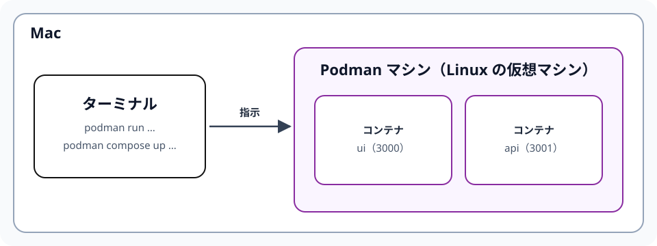

# Podman の構築


[01 章](../../01-setup/02-podman/LECTURE.md) で入れた Podman を、コンテナが動かせる状態にします。この章のゴールは、`podman compose up` の 1 つのコマンドで Next.js と NestJS の両方が起動し、ファイルを保存すると反映される開発環境です。この節では、その土台として次の 2 つを用意します。

- **Podman マシン** … macOS でコンテナを動かすための Linux の仮想マシン
- **compose のプロバイダ** … `compose.yaml` を読んで、複数のコンテナをまとめて動かすプログラム

この節ではプロジェクトのファイルは変えません。

## Podman マシンを作る

:::::platform
::::macos
コンテナは Linux の仕組みで動きます。macOS では、Podman が Linux の仮想マシン（**Podman マシン**）を作り、その中でコンテナを動かします。`podman` コマンドは Mac で打ちますが、実際の処理は仮想マシンの中で行われます。



仮想マシンを作って起動します。初回は Linux のイメージをダウンロードするので、数分かかります。

```bash
podman machine init --now
```

`--now` は「作ったらすぐ起動する」という意味です。起動しているかは `podman machine list` で確かめます。

```bash
podman machine list
```

```text
NAME                     VM TYPE     CREATED        LAST UP            CPUS        MEMORY      DISK SIZE
podman-machine-default*  libkrun     2 minutes ago  Currently running  5           2GiB        100GiB
```

`LAST UP` が `Currently running` なら起動しています。

Mac を再起動すると、Podman マシンは止まります。コンテナを使う前に起動してください。

```bash
podman machine start
```

使い終わって止めたいときは `podman machine stop` です。
::::
::::windows-linux
コンテナは Linux の仕組みで動きます。Linux と Windows の WSL2（Ubuntu）では、コンテナがそのまま動くので、Podman マシンは要りません。次の「動くか確かめる」に進んでください。
::::
:::::

## 動くか確かめる

確認用のイメージ `hello-world` を動かします。

```bash
podman run --rm docker.io/library/hello-world
```

```text
Hello from Docker!
This message shows that your installation appears to be working correctly.
...
```

このメッセージが出れば、コンテナが動いています（イメージは Docker のものですが、Podman でもそのまま動きます）。

| 部分 | 意味 |
|---|---|
| `podman run` | イメージからコンテナを作って動かす |
| `--rm` | 終わったらコンテナを消す |
| `docker.io/library/hello-world` | イメージの名前。`docker.io` は Docker Hub のこと |

## compose のプロバイダを入れる

この章では、Next.js と NestJS の 2 つのコンテナを `compose.yaml` というファイルにまとめて書き、`podman compose up` で一度に起動します。

`podman compose` は、それ自身では `compose.yaml` を読みません。**compose のプロバイダ**（実際に `compose.yaml` を読んで動かすプログラム）を呼び出します。このハンズオンでは、ファイルの変更をコンテナに反映する機能（`watch`）が使える **Docker Compose**（`docker-compose`）をプロバイダにします。

:::::platform
::::macos
```bash
brew install docker-compose
```
::::
::::windows-linux
Docker Compose を入れ、Podman を Docker の API で呼び出せるようにします（Docker Compose はこの API を通して Podman を操作します）。

```bash
sudo apt install -y docker-compose-v2
systemctl --user enable --now podman.socket
```
::::
:::::

### 確かめる

```bash
podman compose version
```

```text
>>>> Executing external compose provider "/opt/homebrew/bin/docker-compose". Please see podman-compose(1) for how to disable this message. <<<<

Docker Compose version 5.8.0
```

1 行目は「外部のプロバイダ（`docker-compose`）を呼び出しています」というお知らせです。毎回出てうるさいときは、環境変数で消せます。

:::::platform
::::macos
```bash
echo 'export PODMAN_COMPOSE_WARNING_LOGS=false' >> ~/.zshrc
```
::::
::::windows-linux
```bash
echo 'export PODMAN_COMPOSE_WARNING_LOGS=false' >> ~/.bashrc
```
::::
:::::

:::faq

### `Cannot connect to Podman` と出る

Podman マシンが起動していません。`podman machine start` を実行してください。`podman machine list` に何も出ないときは、まだ作っていないので `podman machine init --now` から始めます。

### `podman compose version` で compose のプロバイダが見つからないと言われる

`docker-compose` が入っていないか、パスが通っていません。`docker-compose version` が単独で動くかを確かめてください。

### `podman-compose` が入っているけど、それでもいい？

`podman compose` は、`docker-compose` と Python で書かれた `podman-compose` の両方が入っていれば `docker-compose` を優先します。`podman-compose` だけだと、この章で使う `watch` が動かないことがあるので、`docker-compose` を入れてください。

### Docker Desktop が入っていても大丈夫？

共存できます。ただし `docker-compose` は、環境変数 `DOCKER_HOST` が無いと Docker Desktop のほうにつなぎにいきます。`podman compose` 経由で呼べば、Podman につなぐ設定を Podman が渡してくれるので、この章では必ず `podman compose ...` の形で実行してください。

### 仮想マシンのメモリやディスクを変えたい

止めてから `podman machine set` で変えられます。たとえばメモリを 4 GiB にするなら `podman machine stop && podman machine set --memory 4096 && podman machine start` です。Next.js のビルドが遅いときに試してください。

:::
