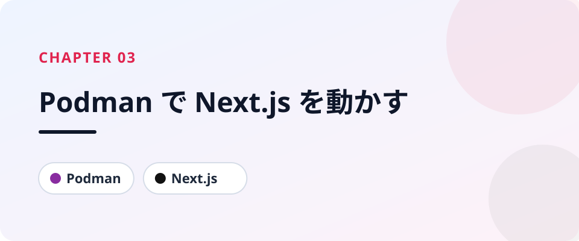
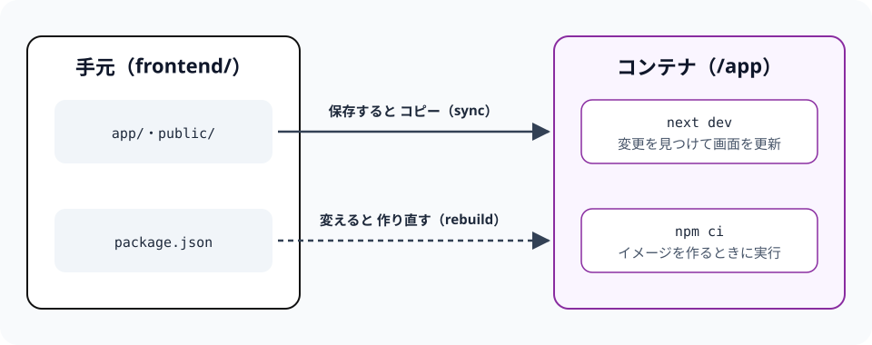

# Podman で Next.js を動かす



この節では、frontend（Next.js）の開発サーバーをコンテナの中で動かします。作るファイルは 3 つです。

| ファイル | 役割 |
|---|---|
| `frontend/Containerfile` | コンテナのイメージの作り方 |
| `frontend/.containerignore` | イメージに入れないファイル |
| `compose.yaml` | どのコンテナを、どのポートで、どう動かすか |

BFF は、次の節でコンテナにします。この節の間は、これまでどおり手元の Node.js（`npm run start:dev`）で動かしてください。

## Containerfile を書く

**Containerfile** は、イメージ（コンテナのもとになるファイル一式）の作り方を書いたファイルです。Docker の `Dockerfile` と同じ書き方で、Podman はどちらの名前でも読めます。

::diff{file="frontend/Containerfile"}

| 命令 | 意味 |
|---|---|
| `FROM` | もとにするイメージ。Node.js 26 の入った軽い Debian（`node:26-slim`） |
| `WORKDIR` | コンテナの中の作業フォルダ。以降の命令はここで実行される |
| `COPY` | 手元のファイルをイメージにコピーする |
| `RUN` | イメージを作るときに実行するコマンド |
| `EXPOSE` | コンテナが使うポートのメモ（これだけでは公開されない） |
| `CMD` | コンテナを起動したときに実行するコマンド |

### package.json を先にコピーする理由

イメージは命令ごとの **層（レイヤー）** を積み重ねて作られ、変わっていない層は前回の結果（キャッシュ）が使い回されます。

`package.json` と `package-lock.json` だけを先にコピーして `npm ci` を実行しておくと、ソースだけを変えたときは `npm ci` の層がキャッシュから使われ、依存を入れ直さずに済みます。`COPY . .` を先に書くと、どのファイルを変えても `npm ci` からやり直しになります。

`npm ci` は `package-lock.json` のとおりに依存を入れるコマンドです。`npm install` と違って `package-lock.json` を書き換えないので、誰が作っても同じ依存になります。

### `--hostname 0.0.0.0` を付ける理由

`CMD` で `npm run dev -- --hostname 0.0.0.0` としています。`--` の後ろは `next dev` に渡す引数です。

コンテナの中の `localhost` は、コンテナ自身のことです。開発サーバーが `localhost` だけで待ち受けると、コンテナの外（Mac のブラウザ）からは届きません。`0.0.0.0` は「どこからの接続でも受け付ける」という意味です。

## .containerignore を書く

`COPY . .` は、フォルダの中身をすべてイメージにコピーします。手元の `node_modules/` や `.next/` まで入ると、イメージが大きくなるうえ、Mac 用に入れた依存が Linux のコンテナに混ざってしまいます。`.containerignore` に書いたものはコピーされません（`.gitignore` と同じ書き方です）。

::diff{file="frontend/.containerignore"}

`.env*` も入れないようにしています。05 章で作る `.env.local` には Cognito の ID を書くので、イメージに入らないようにしておきます。

## compose.yaml を書く

`my-app/` の直下（`frontend/` と `bff/` と同じ階層）に `compose.yaml` を作ります。

::diff{file="compose.yaml"}

| キー | 意味 |
|---|---|
| `services` | 動かすコンテナの一覧。ここでは `frontend` の 1 つ |
| `build.context` | イメージを作るときのフォルダ |
| `build.dockerfile` | 使う定義ファイルの名前。既定は `Dockerfile` なので、`Containerfile` を指定する |
| `ports` | `"手元のポート:コンテナのポート"`。Mac の 3000 番をコンテナの 3000 番につなぐ |
| `develop.watch` | ファイルの変更をコンテナに反映する設定（次で説明） |

:::warning
`build: ./frontend` のように短く書くと、Docker Compose は `Dockerfile` を探して `no such file or directory` で止まります。`dockerfile: Containerfile` を忘れずに書いてください。
:::

### ファイルの変更をコンテナに反映する（watch）

イメージを作った時点のソースはコンテナの中にコピーされています。手元でファイルを保存しても、そのままではコンテナの中は古いままです。

`develop.watch` を書いておくと、手元のファイルの変更を compose が見張って、コンテナに反映します。



| `action` | 動き |
|---|---|
| `sync` | `path` の変更を、コンテナの `target` にコピーする。コンテナの中の `next dev` が変更に気づいて画面を更新する |
| `rebuild` | `path` が変わったら、イメージを作り直してコンテナを入れ替える。依存を足したときのため |

:::notice
手元のフォルダをコンテナにそのまま見せる **バインドマウント**（`volumes: - ./frontend:/app`）という方法もあります。ただ macOS では、ファイルが仮想マシンをまたぐため、保存したことがコンテナに伝わるのが遅れたり、伝わらなかったりします（Next.js のドキュメントにも注意があります）。`watch` はファイルをコンテナの中にコピーするので、コンテナの中で普通に変更として見つかります。
:::

## 動かす

BFF を手元で動かしていなければ、別のターミナルで起動しておきます。

```bash
cd bff
npm run start:dev
```

`my-app/` で、イメージを作ってコンテナを起動します。

```bash
podman compose up --build --watch
```

| オプション | 意味 |
|---|---|
| `--build` | 起動する前にイメージを作る（作り直す） |
| `--watch` | `develop.watch` の見張りを始める |

初回は `node:26-slim` のダウンロードと `npm ci` で数分かかります。次のように出たら起動しています。

```text
 Container my-app-frontend-1 Started
        ⦿ Watch enabled
frontend-1  | ▲ Next.js 16.4.6 (Turbopack)
frontend-1  | - Local:         http://localhost:3000
frontend-1  | - Network:       http://0.0.0.0:3000
frontend-1  | ✓ Ready in 150ms
```

ブラウザで <http://localhost:3000> を開くと、02 章と同じページが表示されます。

### 保存すると反映されることを確かめる

`frontend/app/page.tsx` の `Hello World` を `Hello Podman` に変えて保存します。ターミナルに次のように出て、ブラウザの表示が変わります。

```text
        ⦿ Syncing service "frontend" after 1 changes were detected
```

確かめたら `Hello World` に戻しておきます。

### 止める

`Ctrl+C` で止めます。コンテナとネットワークを片付けるときは次を実行します。

```bash
podman compose down
```

## この節を終えたときのディレクトリ

::tree

:::download
[この節を終えた状態をダウンロード](./project.zip)
:::

:::faq

### `Error: ... Dockerfile: no such file or directory` と出る

`compose.yaml` の `build` に `dockerfile: Containerfile` が書かれていません。

### `listen tcp :3000: bind: address already in use` と出る

手元で `npm run dev` の Next.js が動いたままで、3000 番ポートがふさがっています。手元の開発サーバーを止めてから、もう一度 `podman compose up` を実行してください。

### ファイルを消したのに、コンテナの中に残っている

Podman と Docker Compose の組み合わせでは、`watch` が消したファイルをコンテナから消せないことがあります（ターミナルに `Error handling changed files: deleting paths` と出ます）。ファイルを消したり名前を変えたりしたときは、`Ctrl+C` で止めてから `podman compose up --build --watch` で作り直してください。

### 依存（パッケージ）を足したい

`frontend/` で手元の `npm install <パッケージ名>` を実行します。`package.json` が変わるので、`watch` の `rebuild` がイメージを作り直してくれます。

:::
