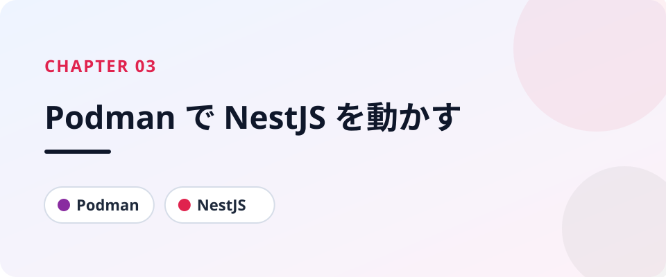

# Podman で NestJS を動かす



前の節の frontend と同じように、BFF（NestJS）もコンテナで動かします。この節を終えると、`podman compose up --build --watch` の 1 つのコマンドで frontend と BFF の両方が起動し、どちらのファイルも保存すると反映されるようになります。

手元で `npm run start:dev` の BFF が動いていたら、先に `Ctrl+C` で止めておいてください（3001 番ポートがぶつかります）。

## Containerfile を書く

::diff{file="bff/Containerfile"}

frontend の Containerfile とほとんど同じです。違うのは次の 2 点です。

- `CMD` が `npm run start:dev`（`nest start --watch`）。NestJS は既定ですべての接続を受け付けるので、`--hostname` のような指定は要りません
- `procps` を入れている（次で説明）

### procps を入れる理由

`nest start --watch` は、ファイルが変わると古いプロセスを止めてから、新しいプロセスを起動します。古いプロセスを探すのに `ps` コマンドを使いますが、`node:26-slim` は軽くするために `ps` を入れていません。

`ps` が無いと古いプロセスを止められず、新しいプロセスが同じ 3001 番ポートを使おうとして、次のエラーで落ちます。

```text
Error: listen EADDRINUSE: address already in use :::3001
```

そこで、`ps` の入ったパッケージ `procps` を `apt-get` で入れています。`--no-install-recommends` で余計なパッケージを入れず、最後に `rm -rf /var/lib/apt/lists/*` でパッケージの一覧を消して、イメージを小さく保ちます。

## .containerignore を書く

::diff{file="bff/.containerignore"}

`dist/` は `nest build` の出力です。コンテナの中で作り直すので入れません。

## compose.yaml に BFF を足す

::diff{file="compose.yaml"}

`frontend` と同じ形で `bff` を足します。`watch` は `src/` を `sync` し、`package.json` が変わったら `rebuild` します。コンテナの中の `nest start --watch` が、コピーされた変更に気づいて再起動します。

## 動かす

```bash
podman compose up --build --watch
```

2 つのコンテナが起動し、ログには行頭にサービスの名前が付きます。

```text
 Container my-app-frontend-1 Started
 Container my-app-bff-1 Started
        ⦿ Watch enabled
bff-1       | [Nest] 46  - 11/18/2026, 3:53:40 AM     LOG [NestFactory] Starting Nest application...
bff-1       | [Nest] 46  - 11/18/2026, 3:53:40 AM     LOG [RouterExplorer] Mapped {/, GET} route
bff-1       | [Nest] 46  - 11/18/2026, 3:53:40 AM     LOG [RouterExplorer] Mapped {/greeting, GET} route
bff-1       | [Nest] 46  - 11/18/2026, 3:53:40 AM     LOG [RouterExplorer] Mapped {/echo, POST} route
bff-1       | [Nest] 46  - 11/18/2026, 3:53:40 AM     LOG [NestApplication] Nest application successfully started
frontend-1  | ✓ Ready in 150ms
```

コンテナの中の時計は UTC なので、ログの時刻は日本時間より 9 時間早く表示されます。

02 章と同じ curl で、コンテナの BFF を呼べます。

```bash
curl "http://localhost:3001/greeting?name=Podman"
```

```json
{"message":"Hello, Podman!"}
```

### 保存すると反映されることを確かめる

`bff/src/app.service.ts` の `'Hello World!'` を `'Hello Podman!'` に変えて保存します。

```text
        ⦿ Syncing service "bff" after 1 changes were detected
bff-1       | File change detected. Starting incremental compilation...
bff-1       | Found 0 errors. Watching for file changes.
```

<http://localhost:3001> が `Hello Podman!` に変われば成功です。確かめたら元に戻しておきます。

### よく使うコマンド

| コマンド | 使いどころ |
|---|---|
| `podman compose ps` | 動いているコンテナの一覧 |
| `podman compose logs bff` | BFF のログだけを見る（`-f` で流し続ける） |
| `podman compose exec bff sh` | BFF のコンテナの中でシェルを開く |
| `podman compose up --build bff` | BFF だけを作り直して起動する |
| `podman compose down` | コンテナとネットワークを片付ける |

## この節を終えたときのディレクトリ

::tree

:::download
[この節を終えた状態をダウンロード](./project.zip)
:::

:::faq

### 保存するたびに `EADDRINUSE: address already in use :::3001` で落ちる

`bff/Containerfile` に `procps` を入れる行がありません。足してから `podman compose up --build --watch` で作り直してください。

### `npm error signal SIGTERM` と出る

イメージを作り直したり止めたりするときに、npm が「止める合図（SIGTERM）を受け取った」と表示しているだけです。そのあと新しいコンテナが起動していれば問題ありません。

### `npm run test` もコンテナの中で動かしたい

`podman compose exec bff npm test` で、動いている BFF のコンテナの中で実行できます。

### Next.js から BFF を呼ぶときの URL は？

ブラウザで動く画面から呼ぶので、Mac から見た `http://localhost:3001` です。コンテナどうしで呼び合うわけではないので、`http://bff:3001` のようなサービス名は使いません。04 章で実際に呼び出します。

:::
