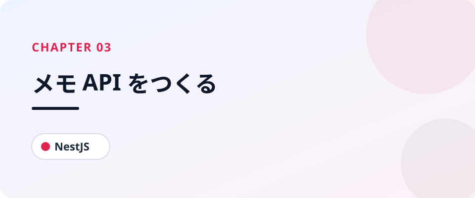

# メモ API をつくる



この章では、API に **メモ** を読み書きする REST API を作ります。この節では、メモの一覧と作成の 2 つを作ります。

| メソッド | パス | 中身 |
|---|---|---|
| `GET` | `/notes` | メモの一覧を返す |
| `POST` | `/notes` | 本文（JSON）からメモを作って返す |

メモはデータベースではなく、API のメモリ上（配列）に持ちます。API を再起動すると消えますが、API の作り方を覚えるにはこれで十分です。

## REST API とは

**REST API** は、URL で「何を」（リソース）、HTTP のメソッドで「どうするか」を表す API の作り方です。メモなら、次のように決めるのが一般的です。

| やりたいこと | メソッドとパス | この章で作る節 |
|---|---|---|
| 一覧を見る | `GET /notes` | この節 |
| 作る | `POST /notes` | この節 |
| 1 件を見る | `GET /notes/:id` | 02 |
| 書き換える | `PATCH /notes/:id` | 02 |
| 消す | `DELETE /notes/:id` | 02 |

`:id` の部分には、メモごとの ID が入ります。

## notes のモジュールを作る

02 章で見たとおり、NestJS ではコントローラー（URL の受け付け）とサービス（処理の中身）を、モジュールにまとめます。メモ用のモジュール・コントローラー・サービスを、Nest CLI で作ります。

```bash
npx nest g module notes
npx nest g controller notes
npx nest g service notes
```

```text
CREATE src/notes/notes.module.ts (82 bytes)
UPDATE src/app.module.ts (321 bytes)
CREATE src/notes/notes.controller.spec.ts (488 bytes)
CREATE src/notes/notes.controller.ts (99 bytes)
UPDATE src/notes/notes.module.ts (173 bytes)
CREATE src/notes/notes.service.spec.ts (456 bytes)
CREATE src/notes/notes.service.ts (89 bytes)
UPDATE src/notes/notes.module.ts (253 bytes)
```

`nest g` は、ファイルを作るだけでなく、モジュールへの登録もしてくれます。`AppModule` には `NotesModule` が足されています。

::diff{file="api/src/app.module.ts"}

`notes.module.ts` には、コントローラーとサービスが登録されています。

::diff{file="api/src/notes/notes.module.ts"}

## メモの形を決める

メモ 1 件の形と、作るときに受け取る値の形を、TypeScript の型で書いておきます。ファイルの置き場所は、NestJS の決まりに合わせます。

| ファイル | 中身 |
|---|---|
| `notes/entities/note.entity.ts` | そのモジュールが扱うもの（エンティティ）の形。ここではメモ 1 件 |
| `notes/dto/create-note.dto.ts` | リクエストで受け取る値の形。DTO（Data Transfer Object）と呼ぶ |

この置き方は、Nest CLI の `nest g resource notes`（モジュール・コントローラー・サービスに加えて、CRUD のひな形を一度に作るコマンド）が作るファイルと同じです。このハンズオンでは、1 つずつ作って中身を確かめるために、手で作ります。

::diff{file="api/src/notes/entities/note.entity.ts"}

`id` はメモを区別するための値、`createdAt` / `updatedAt` は作った日時と更新した日時です。日時は JSON にしやすいように、ISO 8601 形式の文字列（`2026-11-18T04:02:24.623Z`）で持ちます。

::diff{file="api/src/notes/dto/create-note.dto.ts"}

## サービスを書く

メモを配列に入れておき、一覧と作成の処理を書きます。

::diff{file="api/src/notes/notes.service.ts"}

- `randomUUID()` は Node.js に入っている関数で、重ならない ID（UUID）を作ります
- `private readonly notes` は、このサービスの中だけで使う配列です。NestJS はサービスを 1 つだけ作って使い回す（シングルトン）ので、リクエストをまたいでメモが残ります

## コントローラーを書く

::diff{file="api/src/notes/notes.controller.ts"}

- `@Controller('notes')` で、このコントローラーのメソッドはすべて `/notes` から始まるパスになります
- `@Get()` は `GET /notes`、`@Post()` は `POST /notes` を受け付けます
- `@Body()` は、リクエストの本文（JSON）を引数に入れます
- `POST` の応答は、既定で `201 Created` になります

コントローラーが `NotesService` を使うようになったので、`nest g controller` が作ったテストにもサービスを登録します。`providers: [NotesService],` の 1 行を足します。登録しないと、テストで「`NotesService` が見つからない」というエラーになります。

::diff[providers の行を足す]{file="api/src/notes/notes.controller.spec.ts"}

## 動かす

`npm run start:dev` で起動します（動かしたままなら、保存したときに再起動しています）。ログに 2 つのルートが増えています。

```text
[Nest] 46  - ...     LOG [RoutesResolver] NotesController {/notes}:
[Nest] 46  - ...     LOG [RouterExplorer] Mapped {/notes, GET} route
[Nest] 46  - ...     LOG [RouterExplorer] Mapped {/notes, POST} route
```

最初は空の配列が返ります。

```bash
curl http://localhost:3000/notes
```

```json
[]
```

メモを作ります。

:::::platform
::::macos-linux
```bash
curl -X POST http://localhost:3000/notes \
  -H "Content-Type: application/json" \
  -d '{"title":"買い物","body":"牛乳を買う"}'
```
::::
::::windows
Windows の curl は、日本語の本文をうまく送れないことがあるので、本文を英語にしています。

```powershell
curl -X POST http://localhost:3000/notes `
  -H "Content-Type: application/json" `
  -d '{"title":"Shopping","body":"Buy milk"}'
```
::::
:::::

```json
{"id":"3b698a13-ddf5-40ec-8ec6-720004f0e9cd","title":"買い物","body":"牛乳を買う","createdAt":"2026-11-18T04:02:24.623Z","updatedAt":"2026-11-18T04:02:24.623Z"}
```

もう一度 `GET /notes` を呼ぶと、作ったメモが入っています。

## 困ったところ：何でも受け付けてしまう

`title` を数値にして、`body` を省いて送ってみます。

:::::platform
::::macos-linux
```bash
curl -i -X POST http://localhost:3000/notes \
  -H "Content-Type: application/json" \
  -d '{"title":123}'
```
::::
::::windows
```powershell
curl -i -X POST http://localhost:3000/notes `
  -H "Content-Type: application/json" `
  -d '{"title":123}'
```
::::
:::::

```text
HTTP/1.1 201 Created
...
{"id":"38b8a264-...","title":123,"createdAt":"...","updatedAt":"..."}
```

`201 Created` で保存されてしまいました。`CreateNoteDto` は TypeScript の型なので、コンパイルのときにしか働かず、実際に届いた JSON の中身は確かめていません。次の節で、届いた値を確かめる **入力チェック** を入れます。

## 参考にした公式ドキュメント

この節は、次の公式ドキュメントをもとに書いています。

- [NestJS: Modules](https://docs.nestjs.com/modules) … モジュールの役割と、`cats/dto/create-cat.dto.ts`・`cats/interfaces/cat.interface.ts`・`cats.controller.ts` などのファイルの置き方の例
- [NestJS: Providers](https://docs.nestjs.com/providers) … サービス（`@Injectable()`）と DI
- [NestJS: Controllers](https://docs.nestjs.com/controllers) … `@Post()`・`@Body()`・`@Param()`
- [NestJS: CLI command reference](https://docs.nestjs.com/cli/usages) … `nest g module` / `controller` / `service` / `resource` で作れるもの
- [NestJS: CRUD generator](https://docs.nestjs.com/recipes/crud-generator) … `nest g resource` が作るファイル（`dto/`・`entities/`）

## この節を終えたときのディレクトリ

::tree

:::download
[この節を終えた状態をダウンロード](./project.zip)
:::

:::faq

### `npx nest g` で `command not found` や、パッケージのダウンロードが始まる

`api/` の中で実行していないか、`api/node_modules` がありません。`api/` で `npm install` を実行してから、もう一度試してください。

### API を再起動したらメモが消えた

メモリ上に持っているので、再起動すると消えます。`npm run start:dev` で動かしていると、ファイルを保存したときも再起動するので消えます。このハンズオンではこれで進めます。

### `npm test` で `Nest can't resolve dependencies of the NotesController` と出る

`notes.controller.spec.ts` の `providers` に `NotesService` を足していません。

:::
