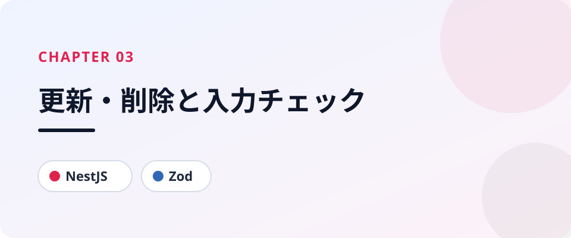

# 更新・削除と入力チェック



この節では、メモ API に残りの操作（1 件の取得・更新・削除）を足し、届いた値を確かめる **入力チェック** を入れます。

| メソッド | パス | 中身 |
|---|---|---|
| `GET` | `/notes/:id` | 1 件を返す。無ければ `404` |
| `PATCH` | `/notes/:id` | 送った項目だけを書き換えて返す |
| `DELETE` | `/notes/:id` | 消す。本文の無い `204 No Content` を返す |

## 入力チェックの考え方

前の節で見たとおり、TypeScript の型はコンパイルのときにしか働きません。API に届く JSON は、ブラウザや curl から送られてくる「何が入っているか分からない値」です。使う前に、決まりどおりかを確かめる必要があります。

NestJS 12 には、**Zod** のような **スキーマ**（値の決まりを書いたオブジェクト）で確かめる `StandardSchemaValidationPipe` が入っています。スキーマを 1 つ書けば、次の 2 つが手に入ります。

- 実行時のチェック … 決まりに合わなければ `400 Bad Request` を返す
- TypeScript の型 … `z.infer<typeof schema>` でスキーマから型を作れる

:::notice
NestJS には、クラスにデコレーターで決まりを書く `ValidationPipe`（class-validator）もあります。このハンズオンでは、06 章の OpenAPI の型と組み合わせやすいスキーマのほうを使います。
:::

## Zod を入れる

```bash
npm install zod
```

::diff{file="api/package.json"}

## スキーマを書く

`create-note.dto.ts` の `CreateNoteDto` を、Zod のスキーマから作るように書き換えます。

::diff{file="api/src/notes/dto/create-note.dto.ts"}

| 書き方 | 意味 |
|---|---|
| `z.strictObject({...})` | 決まったキーだけを持つオブジェクト。知らないキーがあればエラー |
| `z.string().trim().min(1).max(100)` | 文字列。前後の空白を取ってから、1〜100 文字か確かめる |
| `.default('')` | 省略されたら `''` を入れる |
| `z.infer<typeof createNoteSchema>` | スキーマを通した後の値の型 |

更新のときに受け取る値は、`update-note.dto.ts` に書きます。

::diff{file="api/src/notes/dto/update-note.dto.ts"}

`.optional()` は「省略してよい」という意味です。

### 更新用のスキーマを別に書く理由

Zod には、すべての項目を省略できるようにする `createNoteSchema.partial()` があります。ただ、これを使うと `body` の `.default('')` が残り、`{"title":"x"}` を送ったときに `body: ''` が補われます。「タイトルだけ変えたのに本文が消える」ことになるので、更新用は既定値の無いスキーマを別に書いています。

## グローバルに pipe を登録する

`main.ts` で、`StandardSchemaValidationPipe` をアプリ全体に登録します。

::diff{file="api/src/main.ts"}

この pipe は、`schema` を指定した引数だけを確かめ、それ以外はそのまま通します。02 章の `GET /greeting` や `POST /echo` には影響しません。

## サービスに 1 件の取得・更新・削除を足す

::diff{file="api/src/notes/notes.service.ts"}

- `findOne` は、見つからなければ `NotFoundException` を投げます。NestJS がこれを `404 Not Found` の応答に変えてくれます
- `update` と `remove` は、最初に `findOne` を呼ぶので、無い ID なら同じく `404` になります
- `update` は、送られてきた項目（`undefined` でないもの）だけを書き換えます

## コントローラーで schema を指定する

::diff{file="api/src/notes/notes.controller.ts"}

- `@Body({ schema: createNoteSchema })` のように、`schema` を渡した引数が確かめられます
- `noteIdSchema`（`z.uuid()`）は、URL の `:id` が UUID の形かを確かめるスキーマです。コントローラーでしか使わないので、コントローラーのファイルに書いています。`@Param('id', { schema: noteIdSchema })` で使います
- 引数には、スキーマを通した後の値が入ります。`title` は前後の空白が取れ、`body` を省いていれば `''` になっています
- `@HttpCode(204)` で、`DELETE` の応答を `204 No Content` にします（何もしなければ `200`）

`@Post` と `@Patch` の引数は長くなるので、Prettier（`npm run format`）が 1 行に 1 つずつに整えています。

## 動かす

まず、正しいメモを作ります。返ってきた `id` を、以降のコマンドで使います。

:::::platform
::::macos-linux
```bash
curl -X POST http://localhost:3000/notes \
  -H "Content-Type: application/json" \
  -d '{"title":"買い物","body":"牛乳を買う"}'
```
::::
::::windows
Windows の curl は、日本語の本文をうまく送れないことがあるので、本文を英語にしています。

```powershell
curl -X POST http://localhost:3000/notes `
  -H "Content-Type: application/json" `
  -d '{"title":"Shopping","body":"Buy milk"}'
```
::::
:::::

```json
{"id":"c126ae93-b01b-4a2c-b460-abf53996f0f9","title":"買い物","body":"牛乳を買う","createdAt":"2026-11-18T04:03:12.677Z","updatedAt":"2026-11-18T04:03:12.677Z"}
```

### 決まりに合わない値を送る

前の節で通ってしまった値を送ると、今度は `400 Bad Request` になります。

:::::platform
::::macos-linux
```bash
curl -X POST http://localhost:3000/notes \
  -H "Content-Type: application/json" \
  -d '{"title":123}'
```
::::
::::windows
```powershell
curl -X POST http://localhost:3000/notes `
  -H "Content-Type: application/json" `
  -d '{"title":123}'
```
::::
:::::

```json
{"message":["title: Invalid input: expected string, received number"],"error":"Bad Request","statusCode":400}
```

`message` には、どの項目がどう違うかが入ります。知らないキーを送ったときも弾かれます。

:::::platform
::::macos-linux
```bash
curl -X POST http://localhost:3000/notes \
  -H "Content-Type: application/json" \
  -d '{"title":"a","body":"b","owner":"x"}'
```
::::
::::windows
```powershell
curl -X POST http://localhost:3000/notes `
  -H "Content-Type: application/json" `
  -d '{"title":"a","body":"b","owner":"x"}'
```
::::
:::::

```json
{"message":["Unrecognized key: \"owner\""],"error":"Bad Request","statusCode":400}
```

### 1 件の取得・更新・削除

`<id>` を、作ったメモの `id` に置き換えて実行します。

:::::platform
::::macos-linux
```bash
curl http://localhost:3000/notes/<id>
curl -X PATCH http://localhost:3000/notes/<id> \
  -H "Content-Type: application/json" \
  -d '{"body":"牛乳とパン"}'
```
::::
::::windows
```powershell
curl http://localhost:3000/notes/<id>
curl -X PATCH http://localhost:3000/notes/<id> `
  -H "Content-Type: application/json" `
  -d '{"body":"Milk and bread"}'
```
::::
:::::

```json
{"id":"c126ae93-...","title":"買い物","body":"牛乳とパン","createdAt":"2026-11-18T04:03:12.677Z","updatedAt":"2026-11-18T04:03:12.759Z"}
```

`body` だけが変わり、`updatedAt` が新しくなっています。

```bash
curl -i -X DELETE http://localhost:3000/notes/<id>
```

```text
HTTP/1.1 204 No Content
```

消したあとに `GET` すると `404` になります。

```json
{"message":"Note c126ae93-b01b-4a2c-b460-abf53996f0f9 not found","error":"Not Found","statusCode":404}
```

`/notes/abc` のように UUID でない ID を送ると、`404` ではなく `400`（`Invalid UUID`）になります。探す前に、形が違うことで弾かれるからです。

## 参考にした公式ドキュメント

この節は、次の公式ドキュメントをもとに書いています。

- [NestJS: Validation](https://docs.nestjs.com/application/validation) … `StandardSchemaValidationPipe` と、`@Body()` へのスキーマの渡し方
- [NestJS: Pipes](https://docs.nestjs.com/pipes) … pipe の役割と、グローバルな登録
- [Zod](https://zod.dev/) … スキーマの書き方
- [Standard Schema](https://standardschema.dev/) … Zod などのライブラリに共通の約束

## この節を終えたときのディレクトリ

::tree

:::download
[この節を終えた状態をダウンロード](./project.zip)
:::

:::faq

### `npm install zod` で `npm warn install-scripts` と出る

npm 11 は、インストールのときにスクリプトを実行するパッケージがあると知らせてくれます。macOS では `fsevents`（ファイルの変更を見張るための部品）について出ますが、このハンズオンでは気にしなくてかまいません。

### 送った値が検証されない

`main.ts` で `app.useGlobalPipes(new StandardSchemaValidationPipe())` をしているか、`@Body()` に `{ schema: ... }` を渡しているかを確かめてください。どちらかが欠けると、前の節と同じく何でも通ります。

### PATCH で何も送らないとどうなる？

`{}` を送ると、どの項目も変わらず、`updatedAt` だけが新しくなります。「何か 1 つは必要」にしたいときは、Zod の `.refine()` で決まりを足せます。

:::
