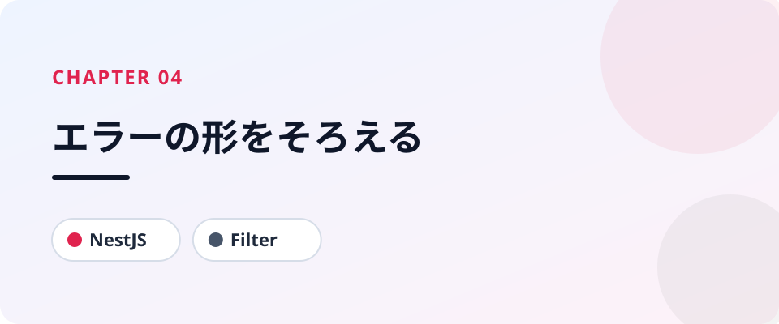

# エラーの形をそろえる



前の章までで、API のエラーは NestJS の既定の形で返っていました。

```json
{"message":["title: Too small: expected string to have >=1 characters"],"error":"Bad Request","statusCode":400}
{"message":"Note c126ae93-... not found","error":"Not Found","statusCode":404}
```

`message` が、入力チェックのときは配列、それ以外は文字列です。API を呼ぶ側は、どちらかを見分けて扱う必要があります。

この節では **ExceptionFilter** で、すべてのエラーを 1 つの形にそろえます。

```json
{
  "statusCode": 400,
  "error": "Bad Request",
  "messages": ["title: Too small: expected string to have >=1 characters"],
  "path": "/notes",
  "timestamp": "2026-11-20T06:21:59.791Z"
}
```

- `messages` は、いつも文字列の配列
- どのパスで、いつ起きたか（`path`・`timestamp`）も入れる
- 思いがけない例外（`500`）では、中身を返さない

## ExceptionFilter を作る

NestJS では、処理の途中で投げられた例外を **ExceptionFilter** が受け取って、応答を作ります。`@Catch()` に何も渡さないと、すべての例外を受け取ります。

::diff{file="api/src/common/all-exceptions.filter.ts"}

- `ErrorBody` … この API が返すエラーの形を、TypeScript の型で書いています。応答の本文（`body`）にこの型を付けているので、項目を入れ忘れたり、名前を間違えたりするとコンパイルエラーになります。API を呼ぶ人に見せる「約束」でもあるので、項目ごとに説明を書いておきます
- `HttpException`（`BadRequestException`・`NotFoundException` など）なら、そのステータスを使います。それ以外の例外は `500` にします
- `error` は、Node.js の `STATUS_CODES`（`400` なら `Bad Request`）から作ります
- `toMessages` は、例外の中身から説明を取り出し、いつも配列にします。入力チェックの例外の中身は `{ message: string[] }`、`NotFoundException('...')` の中身は `{ message: string }` です
- `500` のときは、利用者には `Internal server error` とだけ返し、例外の中身（スタックトレース）はログに出します。データベースのエラーの文言などには、見せてはいけない情報が入ることがあるからです
- `httpAdapter.reply` で応答を返します。Express の `Response` を直接使わないので、HTTP のアダプターを Fastify などに変えても同じ filter が使えます

## アプリ全体に登録する

`APP_FILTER` で、アプリ全体に登録します。

::diff{file="api/src/app.module.ts"}

`APP_FILTER` で登録すると、filter も NestJS が作ってくれるので、コンストラクターで `HttpAdapterHost` を受け取れます。コントローラーごとに `@UseFilters()` で付ける方法もありますが、形をそろえたいのはすべてのエラーなので、アプリ全体に登録します。

## テストで確かめる

filter の動きを、テストで確かめます。HTTP のアダプターをまねたものを渡し、`reply` に何が渡されたかを見ます。

::diff{file="api/src/common/all-exceptions.filter.spec.ts"}

`vi.fn()` は、呼ばれた引数を覚えておく「まねの関数」です。`vi.spyOn(Logger.prototype, 'error')` で、`500` のときにログが出たことも確かめています。

```bash
npm test
```

```text
 Test Files  4 passed (4)
      Tests  6 passed (6)
```

## 動かす

`npm run start:dev` で起動し、入力チェックに合わない値を送ります。

:::::platform
::::macos-linux
```bash
curl -X POST http://localhost:3000/notes \
  -H "Content-Type: application/json" \
  -d '{"title":""}'
```
::::
::::windows
```powershell
curl -X POST http://localhost:3000/notes `
  -H "Content-Type: application/json" `
  -d '{"title":""}'
```
::::
:::::

```json
{"statusCode":400,"error":"Bad Request","messages":["title: Too small: expected string to have >=1 characters"],"path":"/notes","timestamp":"2026-11-20T06:21:59.791Z"}
```

存在しないメモや、存在しないパスも、同じ形になります。

```bash
curl http://localhost:3000/notes/3b698a13-ddf5-40ec-8ec6-720004f0e9cd
curl http://localhost:3000/nope
```

```json
{"statusCode":404,"error":"Not Found","messages":["Note 3b698a13-ddf5-40ec-8ec6-720004f0e9cd not found"],"path":"/notes/3b698a13-ddf5-40ec-8ec6-720004f0e9cd","timestamp":"..."}
{"statusCode":404,"error":"Not Found","messages":["Cannot GET /nope"],"path":"/nope","timestamp":"..."}
```

## 参考にした公式ドキュメント

この節は、次の公式ドキュメントをもとに書いています。

- [NestJS: Exception filters](https://docs.nestjs.com/exception-filters) … `@Catch()` ですべての例外を受け取る filter、`HttpAdapterHost` と `httpAdapter.reply`、`APP_FILTER` での登録
- [Node.js: http.STATUS_CODES](https://nodejs.org/api/http.html#httpstatus_codes) … ステータスコードから名前を引く

## この節を終えたときのディレクトリ

::tree

:::download
[この節を終えた状態をダウンロード](./project.zip)
:::

:::faq

### `@Catch(HttpException)` と書くのと何が違う？

`@Catch(HttpException)` は、`HttpException` とその仲間だけを受け取ります。思いがけない例外（コードの間違いや、つながらない外部のサービス）は受け取らず、NestJS の既定の `500` の応答になります。形をそろえるには、`@Catch()` ですべてを受け取ります。

### 500 のエラーの中身を、開発中は画面で見たい

`npm run start:dev` のターミナルに、スタックトレースが出ています。応答に入れるのは、公開したときに中身が漏れる原因になるので避けます。

### エラーに独自のコード（`NOTE_NOT_FOUND` など）を入れたい

`ErrorBody` に `code` を足し、例外を投げるときに渡して、filter で取り出します。

:::
