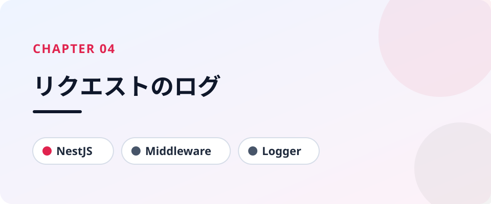

# リクエストのログ



API に届いたリクエストを、ログに残す middleware を作ります。どの API が呼ばれ、どうなったか（ステータスと、かかった時間）が分かると、困ったときに原因を探しやすくなります。

```text
LOG [HTTP] POST /notes 201 5ms
WARN [HTTP] POST /notes 400 1ms
```

## middleware とは

**middleware** は、コントローラーより前に、リクエストごとに呼ばれる関数です。リクエストを見たり、応答に手を加えたりしてから、`next()` で次へ渡します。どのパスに掛けるかを決められるので、「すべてのリクエストでやりたいこと」を書くのに向いています。

## ロギング用の middleware を作る

::diff{file="api/src/common/logging.middleware.ts"}

- `NestMiddleware` … NestJS の middleware が持つ形です。`use(req, res, next)` を書きます
- `new Logger('HTTP')` … NestJS の `Logger` です。起動のときのログと同じ形で、`[HTTP]` という見出しを付けて出ます
- `res.on('finish', ...)` … 応答を返し終わったときに呼ばれます。ステータスコードは、このときに決まっています
- ステータスで、ログの重さを変えます。`5xx` は `error`、`4xx` は `warn`、それ以外は `log` です
- 最後の `next()` を忘れると、リクエストがコントローラーに届かず、応答が返らなくなります

## すべてのパスに掛ける

middleware は、モジュールの `configure()` で掛けます。`AppModule` で、すべてのパスに掛けます。

::diff{file="api/src/app.module.ts"}

- `implements NestModule` … `configure()` を持つモジュールであることを表します
- `apply(LoggingMiddleware)` … 掛ける middleware
- `forRoutes({ path: '{*splat}', method: RequestMethod.ALL })` … 掛けるパスとメソッド。`'{*splat}'` は「どんなパスでも（無くても）」です

## 動かす

`npm run start:dev` で起動し、curl でメモを作ったり、決まりに合わない値を送ったりすると、`npm run start:dev` のターミナルに次のように出ます。

```text
[Nest] 63492  - 2026/11/20 15:21:59     LOG [HTTP] POST /notes 201 5ms
[Nest] 63492  - 2026/11/20 15:21:59     LOG [HTTP] GET /notes 200 0ms
[Nest] 63492  - 2026/11/20 15:21:59    WARN [HTTP] POST /notes 400 1ms
[Nest] 63492  - 2026/11/20 15:21:59    WARN [HTTP] GET /nope 404 0ms
```

存在しないパス（`/nope`）は、どのコントローラーにも当たりませんが、middleware は掛かるのでログに残ります。

:::warning
ログに、パスワードやトークン、メモの本文のような中身は書かないでください。ログはいろいろな人や道具が読むので、だれでも見てよい情報だけにします。
:::

## 参考にした公式ドキュメント

この節は、次の公式ドキュメントをもとに書いています。

- [NestJS: Middleware](https://docs.nestjs.com/middleware) … `NestMiddleware`、`configure()` と `MiddlewareConsumer`、すべてのパスに掛ける `forRoutes`
- [NestJS: Logger](https://docs.nestjs.com/application/logger) … `Logger` の使い方と、JSON で出す設定

## この節を終えたときのディレクトリ

::tree

:::download
[この節を終えた状態をダウンロード](./project.zip)
:::

:::faq

### ログを JSON で出したい

ログを集めるサービス（CloudWatch Logs など）に送るときは、JSON のほうが検索しやすくなります。NestJS の `ConsoleLogger` には JSON で出す設定（`json: true`）があり、`NestFactory.create(AppModule, { logger: new ConsoleLogger({ json: true }) })` のように使えます。

### ヘルスチェックのような、たくさん呼ばれる API はログに残したくない

`forRoutes` の前に `exclude()` で、外すパスを書けます。

### かかった時間が 0ms になる

メモはメモリ上にあるので、とても速く返せています。データベースや外部のサービスを呼ぶようになると、ここに時間が出てきます。

:::
