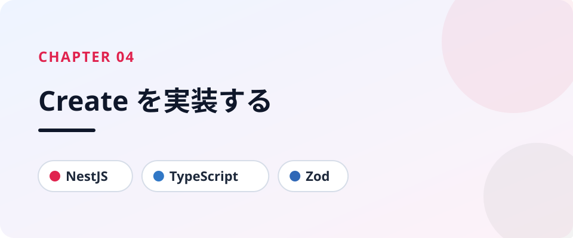

# Create を実装する



`POST /notes`（Create）を実装します。`openapi.yaml` から TypeScript の型を作り、入力チェックとあわせて、コントローラーに直接書きます。

## openapi.yaml から型を作る

**openapi-typescript** で、`openapi.yaml` の `components` から型を作ります。openapi-typescript は TypeScript 5 を前提にしているので、先に `package.json` の `overrides` で、このプロジェクトの TypeScript（6）を使わせてから入れます。

```bash
npm pkg set 'overrides.openapi-typescript.typescript=$typescript'
npm install -D openapi-typescript
npm pkg set 'scripts.generate:api=openapi-typescript openapi.yaml -o src/api/schema.d.ts --default-non-nullable false'
```

- `"$typescript"` … このプロジェクトの `devDependencies` の `typescript` と同じ版、という意味です
- `--default-non-nullable false` … `default` のある項目（`CreateNoteInput` の `body`）を、省略できる型にします

型を作ります。`openapi.yaml` を変えたら、このコマンドで作り直します。

```bash
npm run generate:api
```

```text
🚀 openapi.yaml → src/api/schema.d.ts [17ms]
```

::diff{file="api/src/api/schema.d.ts"}

`components['schemas']['Note']` のように取り出すと、`openapi.yaml` の `Note` の型になります。

## 入力チェックを用意する

届いた本文が `openapi.yaml` の決まりに合っているかを、**Zod** のスキーマで確かめます。NestJS 12 の `StandardSchemaValidationPipe` を登録すると、`@Body({ schema })` に渡したスキーマで確かめ、合わなければ `400` を返します。

```bash
npm install zod
```

ここまでの `package.json` の変更は次のとおりです。

::diff{file="api/package.json"}

::diff{file="api/src/main.ts"}

## コントローラーに書く

::diff{file="api/src/notes/notes.controller.ts"}

- `type Note`・`type CreateNoteInput` … `openapi.yaml` から作った型です
- `createNoteSchema` … `CreateNoteInput` と同じ決まりを Zod で書きます。`satisfies z.ZodType<unknown, CreateNoteInput>` で、受け付ける形が `CreateNoteInput` に合っているかを TypeScript が確かめます
- `@Post()` … `POST /notes` を受け付けます。応答は `201 Created` になります
- `prepare(...).run(note)` … SQL の `:id` などに、`note` の同じ名前の項目を入れて実行します

`openapi.yaml` を変えて `npm run generate:api` で型を作り直すと、`Note` やスキーマが合わないところは `npm run build` のエラーになります。

## 動作確認する

`npm run start:dev` で API を起動したまま、VS Code で `api/openapi.yaml` を開きます。

1. `post:` のすぐ下の行に出る **Try it** を押します
2. 横に開いた画面で、本文（Body）を次のように書き換えて **Send** を押します

```json
{ "title": "買い物", "body": "牛乳を買う" }
```

`openapi.yaml` の `servers` の `http://localhost:3000` に送られ、`201` と作ったメモが返れば大丈夫です。

```json
{
  "id": "cf3ba8aa-850c-4fec-bd88-7378c0e88c37",
  "title": "買い物",
  "body": "牛乳を買う",
  "createdAt": "2026-11-20T07:38:27.144Z",
  "updatedAt": "2026-11-20T07:38:27.144Z"
}
```

`title` を `""` にして送ると、`400` になります。

```json
{
  "message": ["title: Too small: expected string to have >=1 characters"],
  "error": "Bad Request",
  "statusCode": 400
}
```

## 参考にした公式ドキュメント

この節は、次の公式ドキュメントをもとに書いています。

- [openapi-typescript: CLI](https://openapi-ts.dev/cli) … `-o`・`--default-non-nullable`
- [npm Docs: overrides](https://docs.npmjs.com/cli/v11/configuring-npm/package-json#overrides) … `overrides` と `"$typescript"`
- [NestJS: Validation](https://docs.nestjs.com/application/validation) … `StandardSchemaValidationPipe` と `@Body({ schema })`
- [Zod](https://zod.dev/) … スキーマの書き方
- [Node.js: SQLite](https://nodejs.org/docs/latest-v26.x/api/sqlite.html) … `prepare()` と、名前付きの値（`:id`）での `run()`
- [42Crunch: OpenAPI (Swagger) Editor（README）](https://github.com/42Crunch/vscode-openapi#readme) … Try it でリクエストを送る

## この節を終えたときのディレクトリ

::tree

:::download
[この節を終えた状態をダウンロード](./project.zip)
:::

:::faq

### Try it が出ない

API とは関係なく、拡張機能が `openapi.yaml` を OpenAPI 3.0 のファイルとして読めていないときに出ません。1 行目が `openapi: 3.0.3` か、**問題** パネルにエラーが無いかを確かめてください。

### Try it で送ると、つながらないというエラーになる

API が起動していません。`api/` で `npm run start:dev` を実行してから送ってください。

:::
