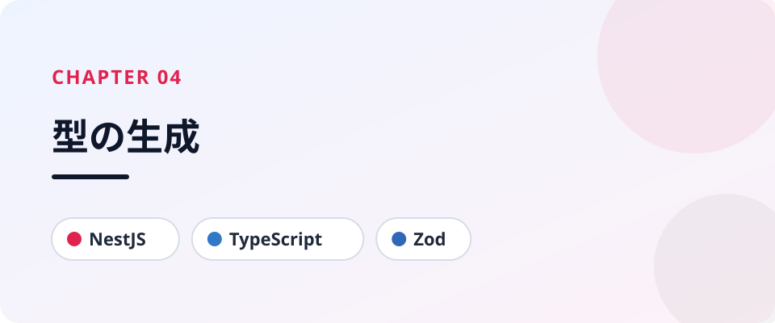

# 型の生成



**@hey-api/openapi-ts** で、`openapi.yaml` から TypeScript の型を作ります。次の節からは、この型を使ってコントローラーを書きます。

## @hey-api/openapi-ts を入れる

```bash
npm install -D @hey-api/openapi-ts
npm pkg set 'scripts.generate:api=openapi-ts -i openapi.yaml -o src/api -p @hey-api/typescript'
```

- `-i` … 読む `openapi.yaml` です
- `-o` … 型を書き出すフォルダです
- `-p @hey-api/typescript` … 型だけを作ります（API を呼ぶためのコードは作りません）

::diff{file="api/package.json" by="command"}

## 型を作る

`openapi.yaml` を変えたら、このコマンドで作り直します。

```bash
npm run generate:api
```

`src/api/` に、型を書いた `types.gen.ts` と、それをまとめて読み込めるようにする `index.ts` ができます。

::diff{file="api/src/api/types.gen.ts" by="command"}

`components` に書いた `Note`・`CreateNoteInput`・`UpdateNoteInput` が、同じ名前の型になります。`import type { Note } from '../api/index.js'` のように読み込んで使います。

## 参考にした公式ドキュメント

この節は、次の公式ドキュメントをもとに書いています。

- [Hey API: Get Started](https://heyapi.dev/openapi-ts/get-started) … CLI の `-i`・`-o`
- [Hey API: TypeScript](https://heyapi.dev/openapi-ts/plugins/typescript) … 型を作るプラグイン `@hey-api/typescript` と `types.gen.ts`

## この節を終えたときのディレクトリ

::tree

:::download
[この節を終えた状態をダウンロード](./project.zip)
:::
