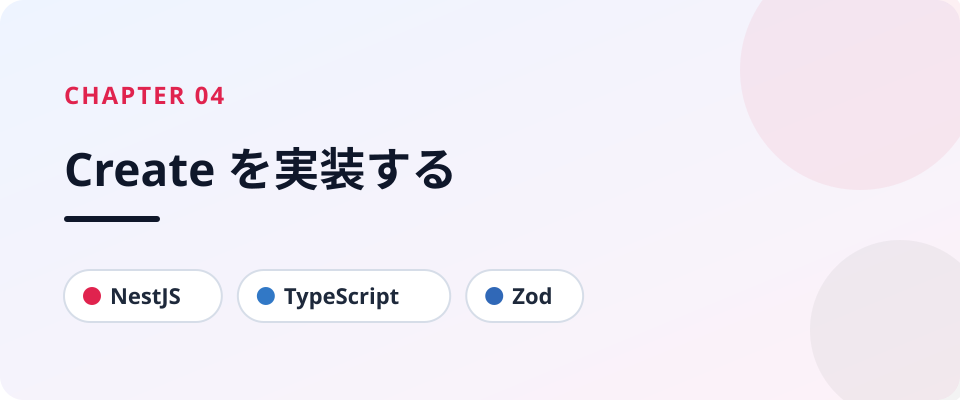

# Create を実装する



`POST /notes`（Create）を実装します。前の節で作った型を使って、コントローラーに直接書きます。届いた本文の中身を確かめる入力チェックは、5 つの操作がそろってから[入力チェック](../08-validation/LECTURE.md)の節で足します。

## コントローラーに書く

::diff{file="api/src/notes/notes.controller.ts"}

- `type Note`・`type CreateNoteInput` … `openapi.yaml` から作った型です
- `@Body() input: CreateNoteInput` … 届いた本文（JSON）を受け取ります。型は書くときの手助けで、届いた中身を確かめるわけではありません
- `input.body ?? ''` … `body` は省略できるので、無ければ `''` にします
- `@Post()` … `POST /notes` を受け付けます。応答は `201 Created` になります
- `prepare(...).run(note)` … SQL の `:id` などに、`note` の同じ名前の項目を入れて実行します

`openapi.yaml` を変えて `npm run generate:api` で型を作り直すと、`Note` などが合わないところは `npm run build` のエラーになります。

## 動作確認する

`npm run start:dev` で API を起動したまま、VS Code で `api/openapi.yaml` を開きます。

1. `post:` のすぐ下の行に出る **Try it** を押します
2. 横に開いた画面で、本文（Body）を次のように書き換えて **Send** を押します

```json
{ "title": "買い物", "body": "牛乳を買う" }
```

`openapi.yaml` の `servers` の `http://localhost:3000` に送られ、`201` と作ったメモが返れば大丈夫です。

```json
{
  "id": "cf3ba8aa-850c-4fec-bd88-7378c0e88c37",
  "title": "買い物",
  "body": "牛乳を買う",
  "createdAt": "2026-11-20T07:38:27.144Z",
  "updatedAt": "2026-11-20T07:38:27.144Z"
}
```

## 参考にした公式ドキュメント

この節は、次の公式ドキュメントをもとに書いています。

- [NestJS: Controllers](https://docs.nestjs.com/controllers) … `@Post()` と `@Body()`
- [Node.js: SQLite](https://nodejs.org/docs/latest-v26.x/api/sqlite.html) … `prepare()` と、名前付きの値（`:id`）での `run()`
- [42Crunch: OpenAPI (Swagger) Editor（README）](https://github.com/42Crunch/vscode-openapi#readme) … Try it でリクエストを送る

## この節を終えたときのディレクトリ

::tree

:::download
[この節を終えた状態をダウンロード](./project.zip)
:::

:::faq

### Try it が出ない

API とは関係なく、拡張機能が `openapi.yaml` を OpenAPI 3.0 のファイルとして読めていないときに出ません。1 行目が `openapi: 3.0.3` か、**問題** パネルにエラーが無いかを確かめてください。

### Try it で送ると、つながらないというエラーになる

API が起動していません。`api/` で `npm run start:dev` を実行してから送ってください。

:::
