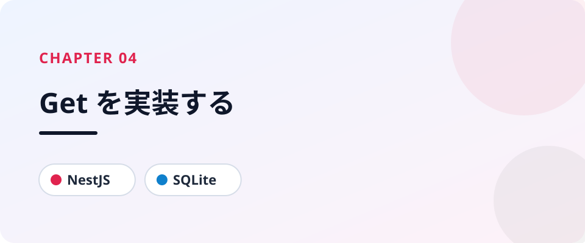

# Get を実装する

`GET /notes/{id}`（Get）を実装します。

::diff{file="api/src/notes/notes.controller.ts"}

- `@Get(':id')` と `@Param('id')` … URL の `:id` を引数で受け取ります
- `prepare(...).get(id)` … SQL の `?` に `id` を入れて実行し、最初の 1 行を返します。無ければ `undefined` です
- `NotFoundException` … 投げると、NestJS が `404 Not Found` の応答にします

## 動作確認する

`npm run start:dev` で API を起動したまま、VS Code で `api/openapi.yaml` を開きます。

1. `post:` の **Try it** でメモを作り、返ってきた `id` をコピーします
2. `/notes/{id}:` の `get:` の下の **Try it** を押し、`id` に貼り付けて **Send** を押します

作ったメモが `200` で返れば大丈夫です。API を再起動してから送っても返ります（SQLite に残っています）。`id` の最後の 1 文字を変えて送ると `404` になります。

## 参考にした公式ドキュメント

この節は、次の公式ドキュメントをもとに書いています。

- [NestJS: Controllers](https://docs.nestjs.com/controllers) … `@Param()` とルートのパラメーター
- [Node.js: SQLite](https://nodejs.org/docs/latest-v26.x/api/sqlite.html) … `statement.get()`
- [NestJS: Exception filters](https://docs.nestjs.com/exception-filters) … `NotFoundException`

## この節を終えたときのディレクトリ

::tree

:::download
[この節を終えた状態をダウンロード](./project.zip)
:::
