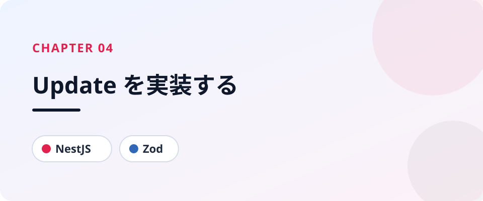

# Update を実装する

`PATCH /notes/{id}`（Update）を実装します。

::diff{file="api/src/notes/notes.controller.ts"}

- `updateNoteSchema` … `UpdateNoteInput` と同じ決まりです。どの項目も `.optional()` で省略でき、`default` はありません
- `this.findOne(id)` … Get の処理を使ってメモを探します。無ければ `404` です
- `input.title ?? note.title` … 送られてこなかった項目は、もとの値のままにします
- `UPDATE` の `?` には、`run()` に並べた値が順に入ります

## 動作確認する

`npm run start:dev` で API を起動したまま、VS Code で `api/openapi.yaml` を開きます。 `patch:` の下の **Try it** を押し、`id` に作ったメモの ID を入れ、本文を `{ "body": "牛乳とパン" }` にして **Send** を押します。`body` だけが変わり、`updatedAt` が新しくなったメモが `200` で返れば大丈夫です。

## 参考にした公式ドキュメント

この節は、次の公式ドキュメントをもとに書いています。

- [Node.js: SQLite](https://nodejs.org/docs/latest-v26.x/api/sqlite.html) … `statement.run()` と、`?` への値の入れ方

## この節を終えたときのディレクトリ

::tree

:::download
[この節を終えた状態をダウンロード](./project.zip)
:::
