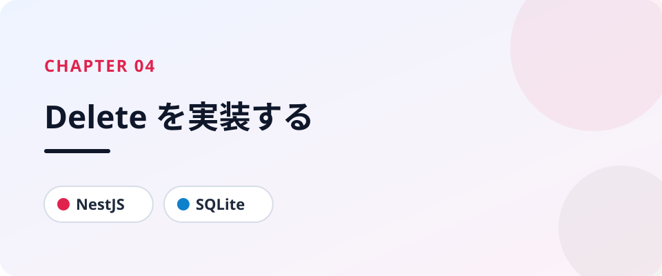

# Delete を実装する

`DELETE /notes/{id}`（Delete）を実装します。これで、`openapi.yaml` の 5 つの操作がそろいます。

::diff{file="api/src/notes/notes.controller.ts"}

- `@HttpCode(204)` … 応答を `204 No Content` にします（何もしなければ `200`）
- `run(id)` が返す `changes` は、消した行の数です。`0` なら、そのメモは無いので `404` にします

## 動作確認する

`npm run start:dev` で API を起動したまま、VS Code で `api/openapi.yaml` を開きます。 `delete:` の下の **Try it** を押し、`id` に作ったメモの ID を入れて **Send** を押します。`204` が返れば大丈夫です。もう一度同じ ID で送ると `404` になります。

## 参考にした公式ドキュメント

この節は、次の公式ドキュメントをもとに書いています。

- [NestJS: Controllers](https://docs.nestjs.com/controllers) … `@HttpCode()`
- [Node.js: SQLite](https://nodejs.org/docs/latest-v26.x/api/sqlite.html) … `run()` が返す `changes`

## この節を終えたときのディレクトリ

::tree

:::download
[この節を終えた状態をダウンロード](./project.zip)
:::
