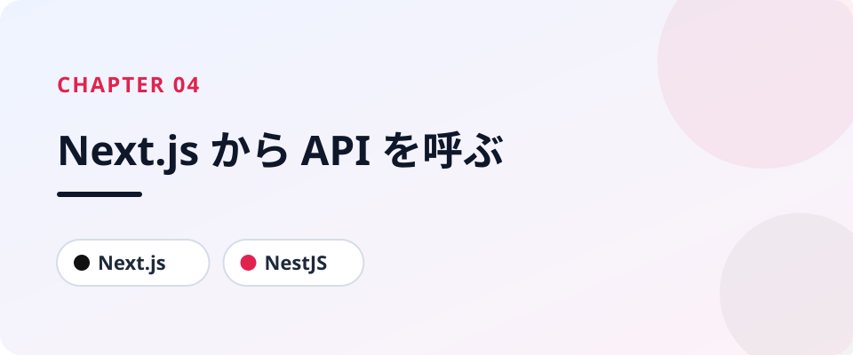
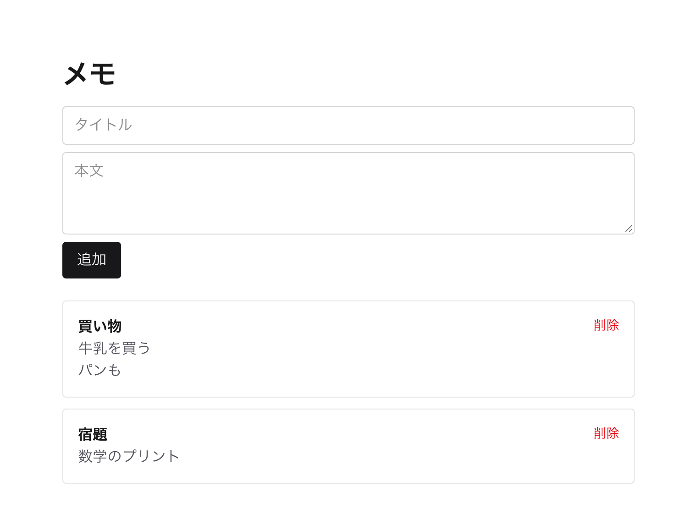
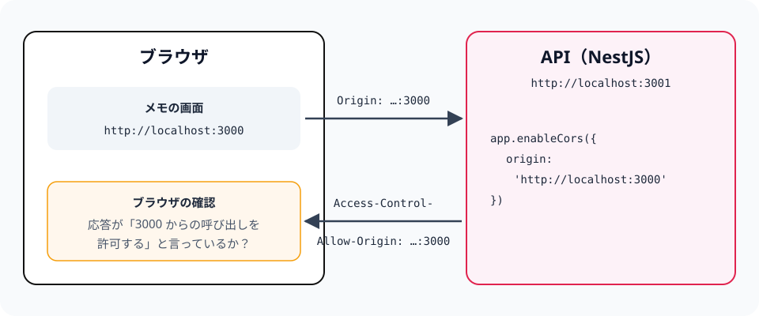

# Next.js から API を呼ぶ



この節では、Next.js の画面から API のメモ API を呼び出し、メモの一覧・追加・削除ができる画面を作ります。



## 静的書き出しでのデータの取り方

UI は `output: "export"` で静的ファイル（HTML・JS・CSS）に書き出しています。書き出したファイルは S3 にそのまま置けますが、サーバーで動く処理は持てません。そのため、メモのように「開くたびに変わるデータ」は、**ブラウザで開いたときに、ブラウザから API を呼んで** 取ってきます。

ブラウザで動く処理は、**クライアントコンポーネント**（ファイルの先頭に `"use client"` を書いたコンポーネント）に書きます。

## API を呼ぶ関数を書く

API を呼ぶ関数を `ui/lib/notes-api.ts` にまとめます。

::diff{file="ui/lib/notes-api.ts"}

- `API_URL` は API の URL です。`NEXT_PUBLIC_` で始まる環境変数は、ビルドのときにコードへ埋め込まれ、ブラウザで使えます。設定していなければ `http://localhost:3001` を使います
- `Note` と `CreateNoteInput` は、API の `note.ts` と同じ形を、UI 側にも書いています。2 か所に同じことを書くのは間違いのもとなので、07・08 章で OpenAPI から型を作って 1 か所にまとめます
- `ensureOk` は、応答が `2xx` でなければ、API が返した `message` を使ってエラーにします。入力チェックで `400` になったとき、その理由を画面に出せます

:::notice
API はコンテナで動いていますが、呼び出すのはコンテナの中の Next.js ではなく **ブラウザ** です。なので URL は、Mac から見た `http://localhost:3001` です。
:::

## 画面を作る

メモの一覧とフォームを、クライアントコンポーネント `app/notes.tsx` に書きます。

::diff{file="ui/app/notes.tsx"}

- `useEffect(() => {...}, [])` は、画面を開いたときに 1 回だけ実行されます。ここで一覧を読み込みます
- フォームを送ると `createNote` を呼び、返ってきたメモを一覧の末尾に足します
- 削除ボタンを押すと `deleteNote` を呼び、一覧からそのメモを除きます
- エラーが起きたら `error` に入れて、赤い文字で表示します

トップページ（`app/page.tsx`）は、このコンポーネントを表示するだけにします。

::diff{file="ui/app/page.tsx"}

`page.tsx` 自体はサーバーコンポーネントのままです。ビルドのときに HTML に書き出され、`Notes` の部分だけがブラウザで動きます。

## watch に lib/ を足す

03 章の `compose.yaml` では、`app/` と `public/` だけをコンテナに同期していました。新しく作った `lib/` も同期するように足します。

::diff{file="compose.yaml"}

## 動かしてみる（まだ失敗する）

ここまでで `podman compose up --build --watch` を実行し、<http://localhost:3000> を開いてみてください。一覧は表示されず、画面に赤い文字で `Failed to fetch` と出ます。ブラウザの開発者ツールのコンソールを開くと、次のエラーが出ています。

```text
Access to fetch at 'http://localhost:3001/notes' from origin 'http://localhost:3000'
has been blocked by CORS policy: No 'Access-Control-Allow-Origin' header is present
on the requested resource.
```

## CORS を有効にする

ブラウザは、画面を読み込んだ場所（**オリジン**。`http://localhost:3000` のように「スキーム・ホスト・ポート」の組）と違うオリジンへの fetch について、相手が許可しているかを確かめます。この仕組みを **CORS**（Cross-Origin Resource Sharing）と呼びます。ポートが違えば別のオリジンなので、3000 番の画面から 3001 番の API を呼ぶのは「別のオリジンへの呼び出し」です。



API の応答に `Access-Control-Allow-Origin: http://localhost:3000` が付いていれば、ブラウザは結果を画面に渡します。NestJS では `enableCors()` で付けられます。

::diff{file="api/src/main.ts"}

`origin` に許可するオリジンを書きます。`enableCors()` と何も渡さないと、どのオリジンからでも呼べるようになります。API は自分の画面のためだけの API なので、許可するのは自分の画面のオリジンだけにしておきます。

`POST`（JSON の本文付き）や `DELETE` の前には、ブラウザが **プリフライト**（`OPTIONS` メソッドで「このメソッドで呼んでいい？」と聞くリクエスト）を送ります。`enableCors()` はこれにも答えてくれます。

:::::platform
::::macos-linux
```bash
curl -i -X OPTIONS http://localhost:3001/notes \
  -H "Origin: http://localhost:3000" \
  -H "Access-Control-Request-Method: DELETE"
```
::::
::::windows
```powershell
curl -i -X OPTIONS http://localhost:3001/notes `
  -H "Origin: http://localhost:3000" `
  -H "Access-Control-Request-Method: DELETE"
```
::::
:::::

```text
HTTP/1.1 204 No Content
Access-Control-Allow-Origin: http://localhost:3000
Vary: Origin, Access-Control-Request-Headers
Access-Control-Allow-Methods: GET,HEAD,PUT,PATCH,POST,DELETE
...
```

:::notice
CORS は **ブラウザが** 守る決まりです。curl や Postman はオリジンを持たないので、CORS の設定が無くても呼べます。「curl では動くのに画面からは動かない」ときは、まず CORS を疑ってください。
:::

## 動かす

保存すると、API が再起動します。<http://localhost:3000> を開き直すと、メモの画面が表示されます。

- タイトルと本文を入れて「追加」を押すと、一覧に並びます
- ページを再読み込みしても、メモは残っています（API のメモリにあるため）
- 「削除」を押すと消えます
- タイトルを空のまま「追加」を押すと、API の入力チェックの結果が表示されます

```text
title: Too small: expected string to have >=1 characters
```

画面の側でも入力を確かめることはできますが、API の入力チェックは省けません。画面を通らずに curl などで直接呼ばれることもあるからです。

## 参考にした公式ドキュメント

この節は、次の公式ドキュメントをもとに書いています。

- [Next.js: Static Exports](https://nextjs.org/docs/app/guides/static-exports) … 静的書き出しでは、データをブラウザで取る
- [Next.js: Environment Variables](https://nextjs.org/docs/app/guides/environment-variables) … `NEXT_PUBLIC_` がビルドのときに埋め込まれること
- [NestJS: CORS](https://docs.nestjs.com/security/cors) … `enableCors()` の使い方
- [MDN: オリジン間リソース共有（CORS）](https://developer.mozilla.org/ja/docs/Web/HTTP/Guides/CORS) … プリフライトと `Access-Control-Allow-Origin`

## この節を終えたときのディレクトリ

::tree

:::download
[この節を終えた状態をダウンロード](./project.zip)
:::

:::faq

### 画面に `Failed to fetch` と出る

API が動いていないか、CORS の設定が効いていません。`curl http://localhost:3001/notes` が応答するか、`main.ts` の `enableCors` の `origin` が `http://localhost:3000`（末尾に `/` を付けない）になっているかを確かめてください。

### `lib/notes-api.ts` を直したのに画面が変わらない

`compose.yaml` の `watch` に `./ui/lib` を足していないと、コンテナの中に変更が届きません。足したら `Ctrl+C` で止めて、`podman compose up --build --watch` で起動し直します。

### 本番では API の URL をどう変える？

`NEXT_PUBLIC_API_URL` を設定してから `npm run build` します（macOS・Linux なら `NEXT_PUBLIC_API_URL=https://api.example.com npm run build`、Windows の PowerShell なら `$env:NEXT_PUBLIC_API_URL = 'https://api.example.com'; npm run build`）。値はビルドのときに埋め込まれるので、書き出したあとで変えることはできません。API の `enableCors` の `origin` も、本番の画面のオリジンに合わせます。

:::
