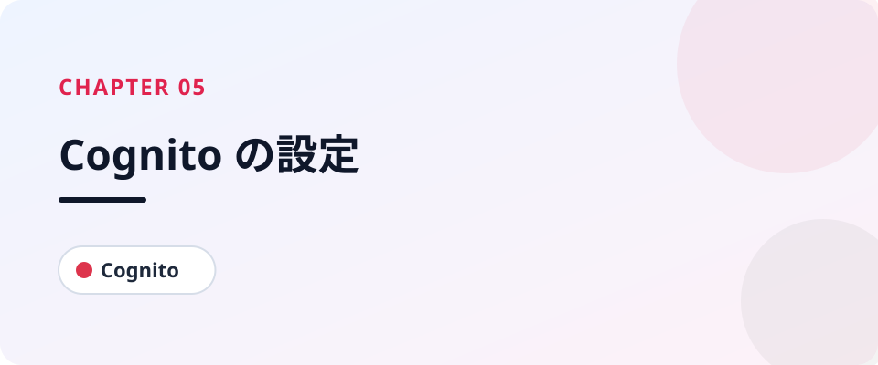
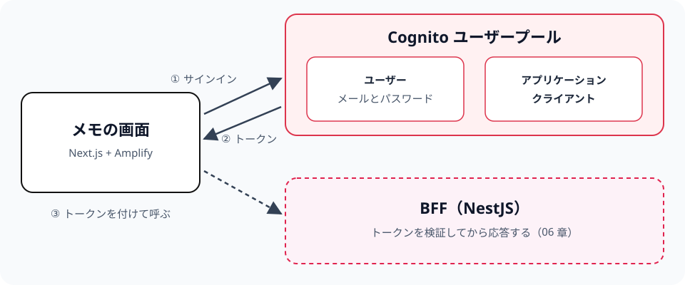

# Cognito の設定



ここまでのメモ API は、誰でも読み書きできます。この章と次の章で、**サインインした人だけが使える** ようにします。サインインの仕組みには **Amazon Cognito** を使います。

この節では、AWS のコンソールで Cognito のユーザープールを作り、その ID を UI から読めるように `.env.local` に書きます。

## Cognito の役割



| 用語 | 意味 |
|---|---|
| **ユーザープール** | ユーザー（メールアドレスとパスワード）を入れておく場所。サインアップ・サインイン・パスワードの再設定を引き受ける |
| **アプリケーションクライアント** | ユーザープールを使うアプリの登録。画面はこの ID を使ってユーザープールにサインインを頼む |
| **トークン** | サインインに成功すると受け取る、署名付きの「通行証」（JWT）。API はこれを見て、誰からの呼び出しかを確かめる |

パスワードを確かめる処理や、パスワードを安全に保存する処理を自分で書かずに済むのが、Cognito を使う理由です。

## ユーザープールを作る

:::notice
AWS のアカウントが必要です。Cognito のユーザープールは、月 1 万人のアクティブユーザーまで無料で使えます（Lite プランの場合。最新の料金は AWS の料金ページで確かめてください）。コンソールの画面は変わることがあるので、項目の名前が少し違っていたら、近いものを選んでください。
:::

1. AWS のコンソールにサインインし、右上のリージョンを **東京（ap-northeast-1）** にする
2. 検索で **Cognito** を開き、**ユーザープールを作成** を押す
3. 「アプリケーションを定義」で次のように選ぶ

| 項目 | 選ぶもの |
|---|---|
| アプリケーションタイプ | **シングルページアプリケーション（SPA）** |
| アプリケーションに名前を付ける | `memo-app`（好きな名前でよい） |
| サインイン識別子のオプション | **メールアドレス** |
| 自己登録 | **有効**（画面の「アカウントを作る」から登録するため） |
| サインアップのための必須属性 | **email** |
| リターン URL | 空のまま（このハンズオンでは使わない） |

4. **ユーザーディレクトリを作成する** を押す

SPA を選ぶと、**クライアントシークレットの無い** アプリケーションクライアントが作られます。ブラウザで動くコードは誰でも中身を見られるので、秘密の値は持たせられません。そのため、シークレットを使わないクライアントにします。

### ID を控える

作り終わったら、次の 2 つを控えます。

| 値 | 場所 | 形 |
|---|---|---|
| ユーザープール ID | ユーザープールの「概要」 | `ap-northeast-1_` で始まる文字列 |
| クライアント ID | 「アプリケーションクライアント」の一覧 | 英数字 26 文字くらい |

### 認証フローを確かめる

「アプリケーションクライアント」から作ったクライアントを開き、**認証フロー** に次が入っているか確かめます。足りなければ「編集」で足します。

- `ALLOW_USER_SRP_AUTH` … パスワードそのものを送らずにサインインする方式（SRP）。Amplify は既定でこれを使います
- `ALLOW_REFRESH_TOKEN_AUTH` … トークンの期限が切れたときに、サインインし直さずに取り直すため

## ID を .env.local に書く

ユーザープール ID とクライアント ID は、画面のコードに直接書かずに、環境変数で渡します。まず、どんな変数が要るかを書いた見本 `ui/.env.example` を作ります。

::diff{file="ui/.env.example"}

`create-next-app` が作った `.gitignore` は、`.env` で始まるファイルをすべて Git に入れない設定です。見本の `.env.example` だけは Git に入れたいので、例外を足します。

::diff{file="ui/.gitignore"}

見本をコピーして `.env.local` を作ります。

```bash
cd ui
cp .env.example .env.local
```

`NEXT_PUBLIC_COGNITO_USER_POOL_ID` と `NEXT_PUBLIC_COGNITO_USER_POOL_CLIENT_ID` の右側を、控えた値に置き換えます（`=` の前後に空白は入れません）。

```ini
NEXT_PUBLIC_API_URL=http://localhost:3001
NEXT_PUBLIC_COGNITO_USER_POOL_ID=ap-northeast-1_AbCdEfGhI
NEXT_PUBLIC_COGNITO_USER_POOL_CLIENT_ID=1a2b3c4d5e6f7g8h9i0j1k2l3m
```

:::danger
`.env.local` は Git に入れないでください。`git status` に `.env.local` が出てこないことを確かめてから、コミットしてください。
:::

ユーザープール ID とクライアント ID は、ブラウザに渡るので「秘密」ではありません（書き出した JS を見れば分かります）。それでも、自分の AWS アカウントの情報を公開のリポジトリに載せる理由は無いので、Git には入れずに環境変数で渡します。

## コンテナに .env.local を渡す

03 章の `.containerignore` で `.env*` を除いているので、`.env.local` はイメージに入りません。そこで compose の `env_file` で、コンテナの環境変数として渡します。

::diff{file="compose.yaml"}

`required: false` にしておくと、`.env.local` が無くてもエラーになりません。Next.js は、`NEXT_PUBLIC_` で始まる環境変数を、ファイルからでもコンテナの環境変数からでも読みます。

`compose.yaml` を変えたので、`Ctrl+C` で止めて起動し直します。

```bash
podman compose up --build --watch
```

渡せているかは、コンテナの中の環境変数で確かめられます。

```bash
podman compose exec ui printenv NEXT_PUBLIC_COGNITO_USER_POOL_ID
```

画面はまだ変わりません。次の節で、この値を使ってサインインの画面を出します。

:::notice
**AWS CLI で作る場合**

AWS CLI の認証情報を設定してあれば、コマンドでも作れます。

```bash
aws cognito-idp create-user-pool \
  --region ap-northeast-1 \
  --pool-name memo-app \
  --username-attributes email \
  --auto-verified-attributes email \
  --query UserPool.Id --output text

aws cognito-idp create-user-pool-client \
  --region ap-northeast-1 \
  --user-pool-id <ユーザープール ID> \
  --client-name memo-app \
  --no-generate-secret \
  --explicit-auth-flows ALLOW_USER_SRP_AUTH ALLOW_REFRESH_TOKEN_AUTH \
  --query UserPoolClient.ClientId --output text
```

1 つ目がユーザープール ID、2 つ目がクライアント ID を表示します。
:::

## この節を終えたときのディレクトリ

::tree

:::download
[この節を終えた状態をダウンロード](./project.zip)
:::

ZIP には `.env.local` は入っていません。展開したら `.env.example` をコピーして作ってください。

:::faq

### `git status` に `.env.example` が出てこない

`ui/.gitignore` に `!.env.example` を足していません。`.env*` の行より **後ろ** に書いてください（`.gitignore` は後ろの行が優先されます）。

### `printenv` で何も表示されない

`.env.local` の場所が `ui/.env.local` になっているか、`compose.yaml` を変えたあとに起動し直したかを確かめてください。

### 使い終わったユーザープールを消したい

ユーザープールを開き、右上の **削除** から消せます。削除保護が有効なときは、先に「設定」で削除保護を無効にします。

:::
