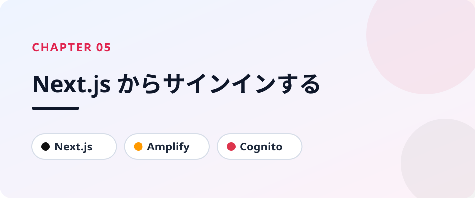
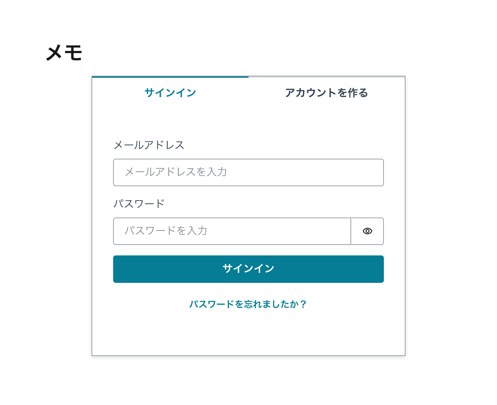

# Next.js からサインインする



前の節で作ったユーザープールを使って、メモの画面にサインインの画面を付けます。サインインの画面は自分では作らず、**Amplify UI** の **Authenticator** を使います。サインアップ（アカウント作成）・メールでの確認・パスワードの再設定まで、1 つの部品で用意されています。



## Amplify を入れる

```bash
cd frontend
npm install aws-amplify @aws-amplify/ui-react
```

| パッケージ | 役割 |
|---|---|
| `aws-amplify` | Cognito とのやり取り（サインイン・トークンの取得と更新）を引き受けるライブラリ |
| `@aws-amplify/ui-react` | Authenticator などの、React の部品 |

::diff{file="frontend/package.json"}

`podman compose up --watch` で動かしていれば、`package.json` が変わったのでイメージが作り直されます。

## サインインの部品を作る

::diff{file="frontend/app/auth.tsx"}

上から順に見ていきます。

- `"use client"` … Amplify はブラウザで動くので、クライアントコンポーネントにします
- `Amplify.configure(...)` … どのユーザープールの、どのアプリケーションクライアントを使うかを Amplify に教えます。`loginWith: { email: true }` は、前の節で「サインイン識別子」をメールアドレスにしたのに合わせています。リージョンはユーザープール ID の前半（`ap-northeast-1`）から Amplify が読み取ります
- `I18n.putVocabularies(translations)` と `I18n.setLanguage("ja")` … Authenticator の文言を日本語にします
- ID が無いとき … `.env.local` を作り忘れていると Amplify は動かないので、何をすればよいかを表示します
- `<Authenticator>` … サインインしていなければサインインの画面を、していれば `{({ signOut, user }) => ...}` の中身を表示します。`user.signInDetails.loginId` はサインインに使ったメールアドレス、`signOut` はサインアウトする関数です

`import "@aws-amplify/ui-react/styles.css"` は、Authenticator の見た目の CSS です。

## メモの画面を囲む

`page.tsx` で、メモの部品を `Auth` で囲みます。

::diff{file="frontend/app/page.tsx"}

サインインするまで `Notes` は表示されないので、BFF の呼び出しもサインインしてから始まります。

## 動かす

<http://localhost:3000> を開くと、メモの代わりにサインインの画面が表示されます。

### アカウントを作る

1. **アカウントを作る** のタブで、メールアドレスとパスワード（2 回）を入れて **アカウントを作る** を押す
2. 入れたメールアドレスに、Cognito から 6 桁の確認コードが届く
3. 画面に確認コードを入れて **確定** を押す

確認が終わるとサインインした状態になり、上に「（メールアドレス）でサインイン中」とメモの画面が表示されます。

パスワードには、ユーザープールの既定の決まり（8 文字以上で、大文字・小文字・数字・記号を含む）があります。満たしていないと、Authenticator がその場で教えてくれます。

作ったユーザーは、Cognito のコンソールの「ユーザー」に並んでいます。

### サインアウトとサインイン

**サインアウト** を押すとサインインの画面に戻ります。**サインイン** のタブで、作ったメールアドレスとパスワードを入れるとサインインできます。

ページを再読み込みしても、サインインしたままです。Amplify は受け取ったトークンをブラウザの localStorage に保存し、期限が切れそうになると自動で取り直します。

## まだ守れていないもの

画面にはサインインが必要になりましたが、BFF の API はこれまでどおり誰でも呼べます。

```bash
curl http://localhost:3001/notes
```

サインインの画面は「画面の入り口」を守っているだけで、API を直接呼ばれると防げません。次の章で、BFF がトークンを確かめて、サインインした人の呼び出しだけを受け付けるようにします。

## この節を終えたときのディレクトリ

::tree

:::download
[この節を終えた状態をダウンロード](./project.zip)
:::

:::faq

### 「Cognito の設定がありません」と出る

`frontend/.env.local` が無いか、変数の名前が違います。`.env.local` を作ったあとは、`Ctrl+C` で止めて `podman compose up --build --watch` で起動し直してください（`env_file` はコンテナを作るときに読まれます）。

### サインインすると `User pool client ... does not exist.` と出る

クライアント ID が間違っています。コンソールの「アプリケーションクライアント」の ID と見比べてください。ユーザープールのリージョンと、ユーザープール ID の前半（`ap-northeast-1` など）が合っているかも確かめます。

### `Client ... is configured with secret but SECRET_HASH was not received` と出る

クライアントシークレットのあるアプリケーションクライアントを使っています。ブラウザからはシークレットを使えないので、アプリケーションタイプを SPA にして（シークレット無しで）作り直してください。

### 確認コードのメールが届かない

迷惑メールのフォルダを確かめてください。Cognito が既定で送るメールは、1 日に送れる数が少なく決められています。届かないときは、コンソールの「ユーザー」からそのユーザーを開き、確認済みにすることもできます。

:::
