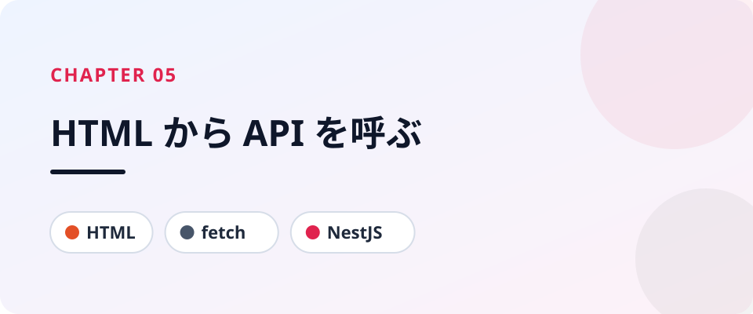
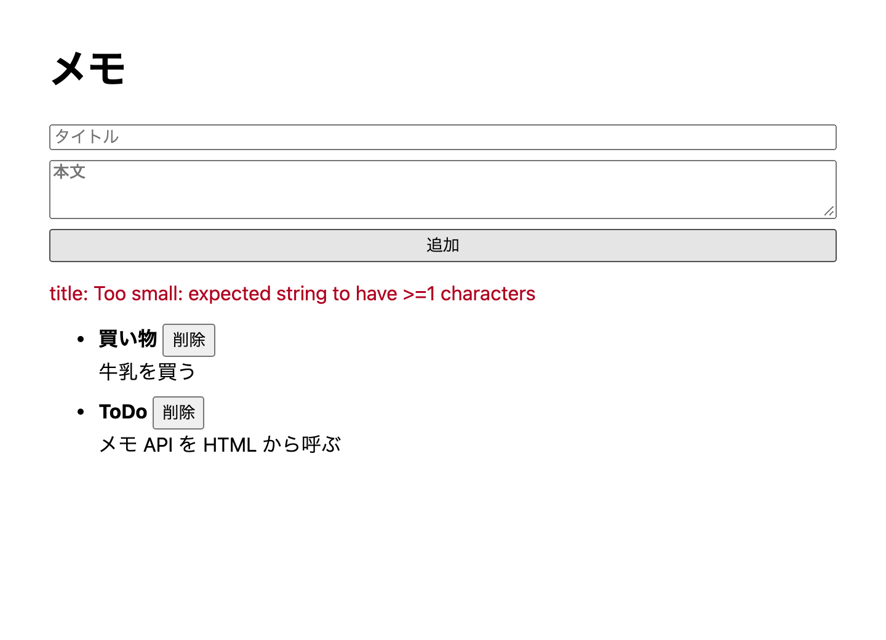

# HTML から API を呼ぶ



この節では、ブラウザの画面からメモの一覧・追加・削除ができるようにします。画面は HTML 1 枚で作り、ブラウザの `fetch` で API を呼びます。HTML は NestJS から配るので、API と同じ <http://localhost:3000> で開けます。



## `/` を画面に譲る

<http://localhost:3000/> で画面が出るように、`Hello World!` を返す `GET /` を消します。コントローラーから `getHello()` を消し、`GET /greeting` のあいさつを作る処理をサービスに移します。

::diff{file="api/src/app.controller.ts"}

::diff{file="api/src/app.service.ts"}

## HTML を配る

`api/public/` に置いたファイルを、そのまま配るようにします。

::diff{file="api/src/main.ts"}

- `NestFactory.create<NestExpressApplication>(...)` … NestJS は中で Express を使っています。この型を付けると、`useStaticAssets()` を呼べます
- `app.useStaticAssets(join(import.meta.dirname, '..', 'public'))` … `public/` のファイルを、そのままのパスで配ります。`public/index.html` は `/` で開けます
- `import.meta.dirname` は、このファイルのあるフォルダです。ビルドすると `dist/main.js` から動くので、`..` で `api/` に戻り、`api/public/` を指します

## 画面を書く

::diff{file="api/public/index.html"}

- `request()` … `fetch` で API を呼び、応答が `2xx` でなければ、前の章でそろえたエラーの形（`ErrorBody`）の `messages` を取り出して、エラーとして投げます。`DELETE` の `204 No Content` には本文が無いので、読まずに `null` を返します
- `showNotes()` … `GET /notes` で一覧を取り、`<ul>` の中身を作り直します。メモは `textContent` で入れます（`innerHTML` だと、メモに書かれた HTML が動いてしまうため）
- 削除のボタン … `DELETE /notes/:id` を呼び、一覧を出し直します
- フォームを送ったとき … `POST /notes` に JSON を送り、成功したらフォームを空にして一覧を出し直します。入力チェックで `400` になったら、`messages` を画面に出します

## 動かす

```bash
npm run start:dev
```

ブラウザで <http://localhost:3000/> を開きます。タイトルと本文を入れて **追加** を押すと、一覧にメモが増えます。**削除** を押すと消えます。タイトルを空のまま **追加** を押すと、API の入力チェックのエラーが赤い文字で出ます。

## 参考にした公式ドキュメント

この節は、次の公式ドキュメントをもとに書いています。

- [NestJS: Model-View-Controller](https://docs.nestjs.com/http/mvc) … `NestExpressApplication` と `app.useStaticAssets(join(import.meta.dirname, '..', 'public'))`
- [MDN: Fetch API の使用](https://developer.mozilla.org/ja/docs/Web/API/Fetch_API/Using_Fetch) … `fetch` で JSON を送る・受け取る、`response.ok`

## この節を終えたときのディレクトリ

::tree

:::download
[この節を終えた状態をダウンロード](./project.zip)
:::

:::faq

### `http://localhost:3000/` を開くと `Cannot GET /` と出る

`index.html` を、`api/src/public/` ではなく `src/` と同じ階層の `api/public/` に置いているか確かめてください。

### `file://` で `index.html` を直接開いたら動かない

`fetch('/notes')` のパスは、画面を開いた場所から決まるので、API に届きません。NestJS を起動して、<http://localhost:3000/> から開いてください。

:::
