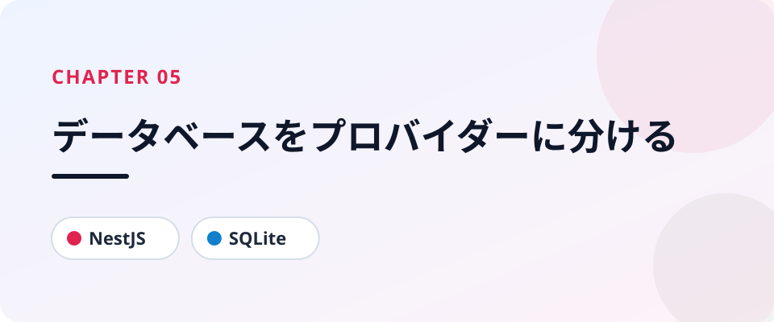

# データベースをプロバイダーに分ける

04 章では、すべてをコントローラーに直接書きました。この章では、動きを変えずに、NestJS の標準の形に 1 つずつ分けていきます。各節の最後に、04 章の最後と同じ動作確認をします。

最初は、データベースです。コントローラーが自分で `openDatabase()` を呼ぶのをやめ、NestJS に **プロバイダー** として渡してもらいます。

::diff{file="api/src/app.module.ts"}

- `{ provide: DatabaseSync, useFactory: openDatabase }` … 「`DatabaseSync` を受け取りたいクラスには、`openDatabase()` が返したものを渡す」という登録です。NestJS は `openDatabase()` を 1 回だけ呼び、同じデータベースを使い回します

::diff{file="api/src/notes/notes.controller.ts"}

- `constructor(private readonly db: DatabaseSync)` … 引数の型を見て、NestJS が上で登録したデータベースを渡します（02 章の `AppService` と同じ依存性の注入です）

## 動作確認する

`npm run start:dev` で起動したまま、`api/openapi.yaml` の 5 つの操作を **Try it** で送ります。04 章の最後と同じ応答（`200`・`201`・`204`・`400`・`404`）が返れば、整理しても動きは変わっていません。

## 参考にした公式ドキュメント

この節は、次の公式ドキュメントをもとに書いています。

- [NestJS: Custom providers](https://docs.nestjs.com/fundamentals/custom-providers) … `provide` と `useFactory`

## この節を終えたときのディレクトリ

::tree

:::download
[この節を終えた状態をダウンロード](./project.zip)
:::
