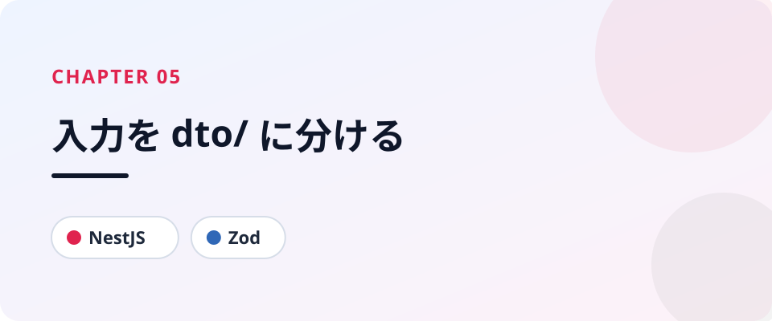

# 入力を dto/ に分ける

リクエストで受け取る値の形と入力チェックを、`notes/dto/` に分けます。DTO（Data Transfer Object）は、NestJS で「受け取る値の形」を置く場所の名前です。

::diff{file="api/src/notes/dto/create-note.dto.ts"}

::diff{file="api/src/notes/dto/update-note.dto.ts"}

- スキーマと `satisfies` は、コントローラーにあったものをそのまま移しています
- `CreateNoteDto`・`UpdateNoteDto` … スキーマを通したあとの値の型です（`z.infer`）

::diff{file="api/src/notes/notes.controller.ts"}

## 動作確認する

`npm run start:dev` で起動したまま、`api/openapi.yaml` の 5 つの操作を **Try it** で送ります。04 章の最後と同じ応答（`200`・`201`・`204`・`400`・`404`）が返れば、整理しても動きは変わっていません。

## 参考にした公式ドキュメント

この節は、次の公式ドキュメントをもとに書いています。

- [NestJS: Controllers](https://docs.nestjs.com/controllers) … DTO（`dto/create-cat.dto.ts`）の置き方

## この節を終えたときのディレクトリ

::tree

:::download
[この節を終えた状態をダウンロード](./project.zip)
:::
