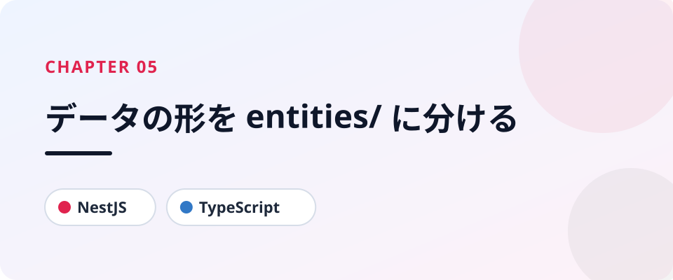

# データの形を entities/ に分ける

メモ 1 件の形（`Note`）を、`notes/entities/` に分けます。エンティティは、そのモジュールが扱うデータの形です。

::diff{file="api/src/notes/entities/note.entity.ts"}

::diff{file="api/src/notes/notes.controller.ts"}

## 動作確認する

`npm run start:dev` で起動したまま、`api/openapi.yaml` の 5 つの操作を **Try it** で送ります。04 章の最後と同じ応答（`200`・`201`・`204`・`400`・`404`）が返れば、整理しても動きは変わっていません。

## 参考にした公式ドキュメント

この節は、次の公式ドキュメントをもとに書いています。

- [NestJS: CRUD generator](https://docs.nestjs.com/recipes/crud-generator) … `entities/` と `dto/` の置き方

## この節を終えたときのディレクトリ

::tree

:::download
[この節を終えた状態をダウンロード](./project.zip)
:::
