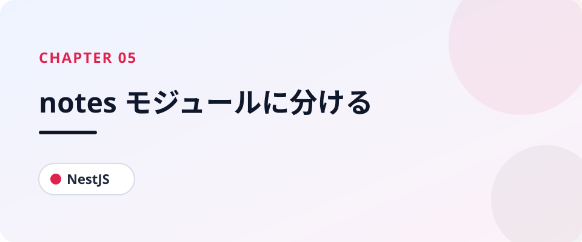

# notes モジュールに分ける



メモに関わるもの（コントローラー・サービス・データベース）を、`NotesModule` にまとめます。`AppModule` は `NotesModule` を読み込むだけになります。

```bash
npx nest g module notes
```

```text
CREATE src/notes/notes.module.ts (82 bytes)
UPDATE src/app.module.ts (737 bytes)
```

`nest g module` は、`AppModule` の `imports` に `NotesModule` を足します。`AppModule` に残っているメモのものを、`NotesModule` に移します。

::diff{file="api/src/notes/notes.module.ts" base="generated"}

::diff{file="api/src/app.module.ts" base="generated"}

これで、メモの API は `notes/` の中にまとまりました。

```text
src/notes/
├── dto/
│   ├── create-note.dto.ts   受け取る値の形と入力チェック
│   └── update-note.dto.ts
├── entities/
│   └── note.entity.ts       メモの形（openapi.yaml の Note）
├── notes.controller.ts      HTTP の受け付け
├── notes.module.ts          まとめ
└── notes.service.ts         SQL と処理
```

## 動作確認する

`npm run start:dev` で起動したまま、`api/openapi.yaml` の 5 つの操作を **Try it** で送ります。04 章の最後と同じ応答（`200`・`201`・`204`・`400`・`404`）が返れば、整理しても動きは変わっていません。

## 参考にした公式ドキュメント

この節は、次の公式ドキュメントをもとに書いています。

- [NestJS: Modules](https://docs.nestjs.com/modules) … 機能ごとのモジュール（feature module）と `imports`

## この節を終えたときのディレクトリ

::tree

:::download
[この節を終えた状態をダウンロード](./project.zip)
:::
