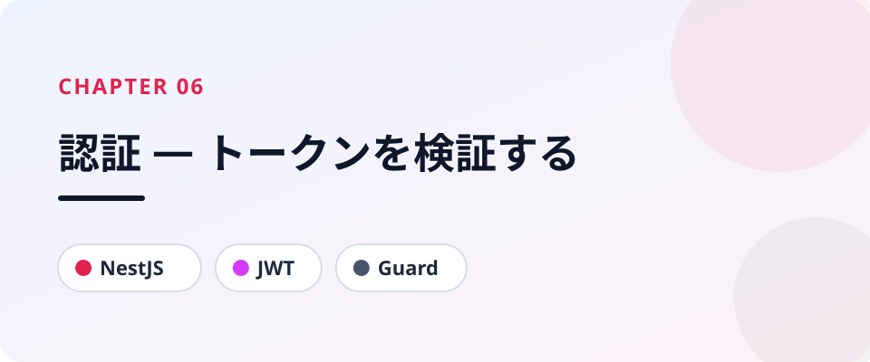
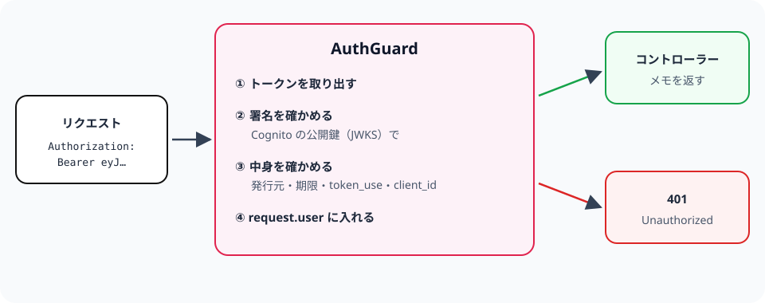

# 認証 — トークンを検証する



前の章で、画面にはサインインが必要になりました。しかし API は、curl から誰でも呼べるままです。この節では、API が **Cognito のアクセストークンを検証して、サインインした人の呼び出しだけを受け付ける** ようにします。

この章では 2 つの言葉を使い分けます。

| 言葉 | 確かめること | この章の節 |
|---|---|---|
| **認証**（Authentication） | 誰からの呼び出しか | この節 |
| **認可**（Authorization） | その人に、その操作をさせてよいか | 次の節 |

## アクセストークンとは

サインインすると、Cognito は 3 つのトークンを返します。

| トークン | 用途 |
|---|---|
| ID トークン | 画面で「誰がサインインしているか」（メールアドレスなど）を知るため |
| **アクセストークン** | **API を呼ぶときに渡すため**。この章で使う |
| リフレッシュトークン | ほかの 2 つの期限が切れたときに、取り直すため |

アクセストークンは **JWT**（JSON Web Token）という形の文字列です。`.` で区切られた 3 つの部分でできています。

```text
eyJraWQiOi...（ヘッダー）.eyJzdWIiOi...（ペイロード）.Wd3h1c...（署名）
```

ペイロードを Base64 で戻すと、次のような JSON が入っています。

```json
{
  "sub": "7a1b2c3d-...",
  "cognito:groups": ["admin"],
  "iss": "https://cognito-idp.ap-northeast-1.amazonaws.com/ap-northeast-1_AbCdEfGhI",
  "client_id": "1a2b3c4d5e6f7g8h9i0j1k2l3m",
  "token_use": "access",
  "exp": 1795000000,
  "username": "7a1b2c3d-..."
}
```

| 項目 | 意味 |
|---|---|
| `sub` | ユーザーごとに決まる ID。次の節で「メモの持ち主」に使う |
| `cognito:groups` | ユーザーが入っている Cognito のグループ。次の節で使う |
| `iss` | 発行元（どのユーザープールが発行したか） |
| `client_id` | どのアプリケーションクライアントのために発行したか |
| `token_use` | `access`（アクセストークン）か `id`（ID トークン）か |
| `exp` | 期限（1970 年からの秒数）。既定では発行から 1 時間 |

中身は誰でも読めます。大事なのは **署名** です。署名は Cognito だけが持つ秘密鍵で作られていて、Cognito が公開している公開鍵（**JWKS**）で確かめられます。中身を 1 文字でも書き換えると、署名が合わなくなります。

## aws-jwt-verify を入れる

署名と中身の確認には、AWS が公開している **aws-jwt-verify** を使います。公開鍵の取得とキャッシュまで引き受けてくれます。

```bash
cd api
npm install aws-jwt-verify
```

::diff{file="api/package.json"}

## API に Cognito の ID を渡す

API も、どのユーザープールのトークンを受け付けるかを知る必要があります。UI と同じように、見本の `api/.env.example` を作ります。

::diff{file="api/.env.example"}

コピーして `api/.env` を作り、05 章で控えた値に書き換えます。

```bash
cp .env.example .env
```

`nest new --skip-git` で作った `api/` には `.gitignore` がありません。このままでは、`my-app` を Git で管理したときに `api/.env` が入ってしまうので、`api/.gitignore` を作ります。

::diff{file="api/.gitignore"}

`.env` で始まるファイルを無視し、見本の `.env.example` だけを例外にしています。`git status` に `api/.env` が出てこないことを確かめてください。

compose では、UI と同じく `env_file` で渡します。

::diff{file="compose.yaml"}

:::notice
Podman を使わずに手元で動かすときは、Nest CLI の `--env-file` で `.env` を読ませます。

:::::platform
::::macos-linux
```bash
npm run start:dev -- --env-file .env
```
::::
::::windows
PowerShell では、`npm run` に渡す `--` がうまく伝わらないことがあるので、`nest` を直接呼びます（`start:dev` の中身と同じです）。

```powershell
npx nest start --watch --env-file .env
```
::::
:::::
:::

## Guard を作る

NestJS で「このリクエストを通すかどうか」を決める部品を **Guard** と呼びます。Guard の `canActivate()` が `true` を返せば、コントローラーのメソッドが呼ばれます。例外を投げれば、そのままエラーの応答になります。



::diff{file="api/src/auth/auth.guard.ts"}

- `CognitoJwtVerifier.create(...)` … ユーザープール ID・`tokenUse: 'access'`・クライアント ID を渡すと、それに合うトークンだけを正しいとする検証器ができます。ID トークンや、別のアプリケーションクライアントのトークンは通りません
- `requireEnv` … 環境変数が無ければ、起動のときにエラーで止めます。気づかずに動き続けるより、すぐ分かるほうが直しやすいからです
- `request.headers.authorization?.split(' ')` … `Bearer <トークン>` を、`Bearer` とトークンに分けます
- `this.verifier.verify(token)` … 署名・発行元・期限・`token_use`・`client_id` を確かめ、正しければペイロードを返します。正しくなければ例外を投げるので、`UnauthorizedException`（`401`）にします
- `request.user = ...` … 確かめたペイロードをリクエストに入れておき、あとでコントローラーから使います

### トークンの中身を引数で受け取る

`request.user` に入れた中身を、コントローラーのメソッドの引数で受け取れるように、**カスタムデコレーター** を作ります。

::diff{file="api/src/auth/current-user.decorator.ts"}

`@CurrentUser() user` と書くと、`user` に `request.user` が入ります。

## Guard を掛ける

`@UseGuards(AuthGuard)` で Guard を掛けます。コントローラーに付けるとすべてのメソッドに、メソッドに付けるとそのメソッドだけに掛かります。

メモの API は、すべてサインインが必要なので、コントローラーに付けます。

::diff{file="api/src/notes/notes.controller.ts"}

`AppController` には、トークンの中身を返す `GET /me` を足して、メソッドだけに掛けます。02 章の `GET /` や `GET /greeting` は、これまでどおり誰でも呼べます。

::diff{file="api/src/app.controller.ts"}

### テストでは Guard を差し替える

`nest g` が作ったテストは、コントローラーを作るときに Guard も作ります。テストには Cognito の ID が無いので、`requireEnv` がエラーにします。テストでは `overrideGuard` で、Guard を「いつも通す」ものに差し替えます。

::diff{file="api/src/app.controller.spec.ts"}

::diff{file="api/src/notes/notes.controller.spec.ts"}

## 画面からトークンを送る

UI の API を呼ぶ関数で、アクセストークンを `Authorization: Bearer ...` ヘッダーに付けます。

::diff{file="ui/lib/notes-api.ts"}

`fetchAuthSession()` は、Amplify が保存しているトークンを返します。期限が切れていれば、リフレッシュトークンで自動で取り直してから返します。

`Authorization` ヘッダーを付けると、ブラウザは GET でもプリフライト（`OPTIONS`）を送ります。04 章の `enableCors` は、プリフライトで聞かれたヘッダーを許可して返すので、API 側の変更は要りません。

## 動かす

`api/.env` を作ったら、`Ctrl+C` で止めて起動し直します（`env_file` はコンテナを作るときに読まれます）。

```bash
podman compose up --build --watch
```

### トークン無しでは呼べない

```bash
curl -i http://localhost:3001/notes
```

```text
HTTP/1.1 401 Unauthorized
...
{"message":"Missing bearer token","error":"Unauthorized","statusCode":401}
```

でたらめなトークンを付けても通りません。

```bash
curl http://localhost:3001/notes -H "Authorization: Bearer abc.def.ghi"
```

```json
{"message":"Invalid token","error":"Unauthorized","statusCode":401}
```

### 画面からは呼べる

<http://localhost:3000> でサインインすると、これまでどおりメモを読み書きできます。画面はアクセストークンを付けて呼んでいるからです。

### 自分のトークンで curl から呼ぶ

ブラウザの開発者ツールの「ネットワーク」で、`notes` へのリクエストを選び、リクエストヘッダーの `Authorization` の値をコピーします。これを付ければ、curl からも呼べます。

:::::platform
::::macos-linux
```bash
TOKEN="eyJraWQiOi...（コピーした Bearer の後ろ）"
curl http://localhost:3001/me -H "Authorization: Bearer $TOKEN"
```
::::
::::windows
```powershell
$TOKEN = "eyJraWQiOi...（コピーした Bearer の後ろ）"
curl http://localhost:3001/me -H "Authorization: Bearer $TOKEN"
```
::::
:::::

```json
{"sub":"7a1b2c3d-...","username":"7a1b2c3d-...","groups":[]}
```

アクセストークンの期限は 1 時間です。期限が切れると `Invalid token` になるので、画面を再読み込みして取り直してください。

:::notice
**`@nestjs/authentication` を使う方法**

NestJS には、認証のための公式パッケージ `@nestjs/authentication` もあります。サインアップ・サインイン・セッション・トークンの発行まで、アプリ自身が認証を引き受けるための道具です。他の発行元（Cognito など）のトークンを検証するだけなら、`JwtBearerProvider` に発行元の `jwks` の URL と `issuer` を渡して使えます。Cognito のアクセストークンには `aud` が無いので、`audience: false` にして、`validate()` の中で `client_id` を確かめます。

このハンズオンでは、Guard の中で何が起きているかが見えるように、Guard を自分で書きました。詳しくは [NestJS の Authentication の章](https://docs.nestjs.com/security/authentication) を見てください。
:::

## 参考にした公式ドキュメント

この節は、次の公式ドキュメントをもとに書いています。

- [NestJS: Guards](https://docs.nestjs.com/guards) … Guard の役割と `@UseGuards()`
- [NestJS: Authentication](https://docs.nestjs.com/security/authentication) … 公式パッケージ `@nestjs/authentication` での認証（このハンズオンでは使わず、Guard を自分で書いています）
- [Amazon Cognito: Verifying a JSON Web Token](https://docs.aws.amazon.com/cognito/latest/developerguide/amazon-cognito-user-pools-using-tokens-verifying-a-jwt.html) … アクセストークンの検証で確かめること
- [aws-jwt-verify（README）](https://github.com/awslabs/aws-jwt-verify) … `CognitoJwtVerifier` の使い方
- [Node.js: --env-file](https://nodejs.org/api/cli.html#--env-fileconfig) … `.env` を読んで起動する

## この節を終えたときのディレクトリ

::tree

:::download
[この節を終えた状態をダウンロード](./project.zip)
:::

:::faq

### API が `環境変数 COGNITO_USER_POOL_ID がありません` で止まる

`api/.env` が無いか、変数の名前が違います。作ったら、`Ctrl+C` で止めて `podman compose up --build --watch` で起動し直してください。

### 画面で `Invalid token` と出る

`api/.env` と `ui/.env.local` の、ユーザープール ID とクライアント ID が同じか確かめてください。どちらかが違うと、画面が受け取ったトークンを API が受け付けません。

### ID トークンを送ってはいけないの？

ID トークンは「画面が、サインインした人の情報を知るため」のもので、`aud` に画面のクライアント ID が入っています。API の呼び出しには、API に渡すためのアクセストークンを使うのが決まりです。この Guard は `tokenUse: 'access'` にしているので、ID トークンを送ると `Invalid token` になります。

### サインアウトしたら、そのトークンは使えなくなる？

既定では、期限（1 時間）までは署名も中身も正しいままなので、API は受け付けます。すぐに無効にしたいときは、Cognito の「トークンの取り消し」と、API での確認を組み合わせます（このハンズオンでは扱いません）。

:::
