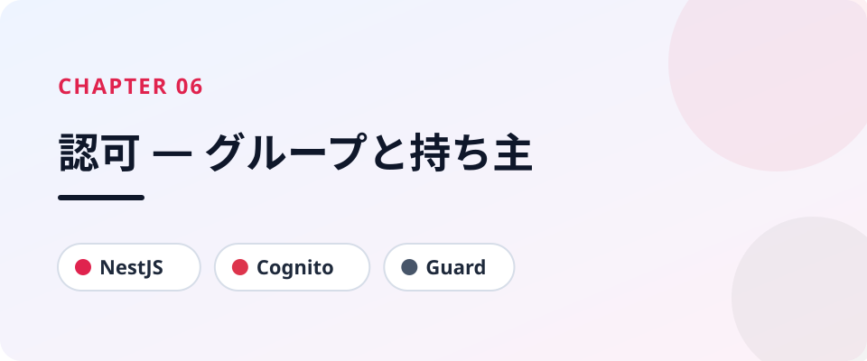
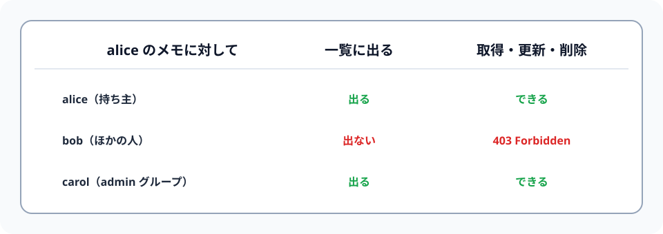

# 認可 — グループと持ち主



前の節で、API は「誰からの呼び出しか」が分かるようになりました（認証）。ただ、サインインしていれば、他の人のメモも読めて、消せてしまいます。この節では「**その人に、その操作をさせてよいか**」（認可）を確かめます。

決まりは次のとおりです。



- メモには **持ち主** がいる。作った人が持ち主になる
- 一覧には、自分のメモだけが出る
- 他の人のメモを取得・更新・削除しようとすると `403 Forbidden`
- Cognito の **admin グループ** に入っている人は、全員のメモを扱える

`401` と `403` の違いも押さえておきます。

| ステータス | 意味 | この API で返すとき |
|---|---|---|
| `401 Unauthorized` | 誰か分からない（認証の失敗） | トークンが無い・正しくない |
| `403 Forbidden` | 誰かは分かったが、させられない（認可の失敗） | 他の人のメモを触ろうとした |

## admin グループを作る

Cognito のコンソールで、グループを作ってユーザーを入れます。

1. ユーザープールを開き、**グループ** → **グループを作成** を押す
2. グループ名を `admin` にして作成する
3. 作った `admin` グループを開き、**ユーザーをグループに追加** で、05 章で作ったユーザーを追加する

グループは、サインインしたときに発行されるトークンの `cognito:groups` に入ります。グループに入れたあとは、画面で **一度サインアウトしてからサインインし直して** ください。前の節の `GET /me` を呼ぶと、`groups` に `admin` が入っているのが分かります。

```json
{"sub":"7a1b2c3d-...","username":"7a1b2c3d-...","groups":["admin"]}
```

確かめるには、admin に入っていないユーザーも要ります。画面の「アカウントを作る」から、もう 1 人作っておきます。

## ユーザーの型と admin の判定

Guard が `request.user` に入れたトークンの中身を、API の中では「ユーザー」として扱います。`api/src/auth/user.ts` に、型と admin の判定をまとめます。

::diff{file="api/src/auth/user.ts"}

`cognito:groups` は、どのグループにも入っていなければトークンに含まれません。`?.` と `?? false` で、無いときは「admin ではない」にしています。

## メモに持ち主を持たせる

`Note` に `ownerId` を足します。Cognito の `sub` を入れます。

::diff{file="api/src/notes/note.ts"}

`sub` は、ユーザーごとに決まり、変わらない ID です。メールアドレスは変えられることがあるので、持ち主には `sub` を使います。

## サービスで認可を確かめる

サービスのメソッドに、呼び出したユーザーを渡すようにして、決まりどおりに判定します。

::diff{file="api/src/notes/notes.service.ts"}

- `create` … 持ち主を、呼び出したユーザーの `sub` にします。持ち主は本文からは受け取りません
- `findAll` … admin なら全部、そうでなければ `ownerId` が自分の `sub` のものだけを返します
- `findOne` … 見つからなければ `404`、持ち主でも admin でもなければ `ForbiddenException`（`403`）にします
- `update` と `remove` … 最初に `findOne` を呼ぶので、同じ決まりが掛かります

持ち主を本文で受け取らないのは、受け取ると「他の人を持ち主にしたメモ」を作れてしまうからです。04 章で作成のスキーマを `z.strictObject` にしているので、本文に `ownerId` を入れて送っても `400`（`Unrecognized key: "ownerId"`）で弾かれます。

## コントローラーからユーザーを渡す

前の節で作った `@CurrentUser()` で、ユーザーを受け取ってサービスに渡します。

::diff{file="api/src/notes/notes.controller.ts"}

## 認可をテストで確かめる

認可の判定はサービスの中にあるので、Cognito が無くてもテストで確かめられます。テスト用のユーザーを 3 人（alice・bob・admin）用意して、決まりどおりかを確かめます。

::diff{file="api/src/notes/notes.service.spec.ts"}

```bash
cd api
npm test
```

```text
 Test Files  3 passed (3)
      Tests  9 passed (9)
```

認可の決まりは、間違えると他の人のデータが見えてしまう大事な部分です。こうしてテストにしておくと、あとでコードを変えたときにも壊れていないことを確かめられます。

## 画面に持ち主を出す

画面の型に `ownerId` を足し、メモの下に小さく表示します。admin でサインインしたときに、他の人のメモも並んでいることが分かります。

::diff{file="ui/lib/notes-api.ts"}

::diff{file="ui/app/notes.tsx"}

## 動かす

1. admin に入っていないユーザーでサインインし、メモを作る
2. サインアウトして、admin のユーザーでサインインする。1 で作ったメモも一覧に出て、持ち主が自分とは違う `sub` になっている
3. admin のユーザーで、自分のメモを作る
4. サインアウトして、admin に入っていないユーザーでサインインし直す。3 のメモは一覧に出ない

curl では、他の人のメモの ID を指定すると `403` になります。

```bash
curl http://localhost:3001/notes/<他の人のメモの id> -H "Authorization: Bearer $TOKEN"
```

```json
{"message":"Note 30be86ed-af27-4a7d-93a7-9e691fe9f303 is not yours","error":"Forbidden","statusCode":403}
```

## 参考にした公式ドキュメント

この節は、次の公式ドキュメントをもとに書いています。

- [Amazon Cognito: Adding groups to a user pool](https://docs.aws.amazon.com/cognito/latest/developerguide/cognito-user-pools-user-groups.html) … グループと、トークンの `cognito:groups`
- [Amazon Cognito: Understanding the access token](https://docs.aws.amazon.com/cognito/latest/developerguide/amazon-cognito-user-pools-using-the-access-token.html) … アクセストークンに入っている項目（`sub` など）
- [NestJS: Custom decorators](https://docs.nestjs.com/custom-decorators) … `@CurrentUser()` のような引数のデコレーター
- [NestJS: Exception filters](https://docs.nestjs.com/exception-filters) … `ForbiddenException`・`NotFoundException` などの組み込みの例外

## この節を終えたときのディレクトリ

::tree

:::download
[この節を終えた状態をダウンロード](./project.zip)
:::

:::faq

### admin に入れたのに、全員のメモが見えない

トークンは、サインインしたときのグループで発行されます。一度サインアウトしてからサインインし直してください。`GET /me` の `groups` で確かめられます。

### 他の人のメモが「無い（404）」ではなく「403」になるのはなぜ？

「そのメモはあるが、あなたには触らせない」ことを正直に返しています。ID からメモがあること自体を知られたくないときは、持ち主でなければ `404` を返す作り方もあります。

### グループを増やしたくなったら？

`user.ts` に判定の関数を足し、サービスで使います。グループが多くなってきたら、09 章で扱う「アプリ全体に掛ける Guard」と組み合わせて、メソッドごとに「必要なグループ」をデコレーターで書く形にするのが NestJS らしい書き方です。

:::
