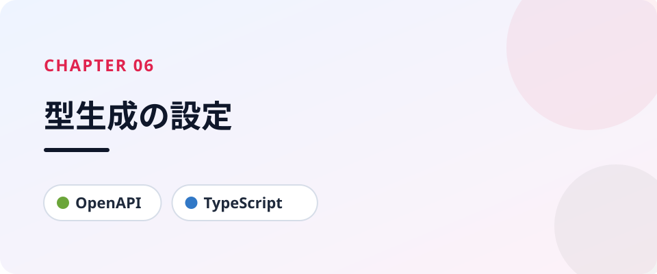

# 型生成の設定



`openapi.yaml` に書いた API の約束から、TypeScript の型を作ります。使うのは **openapi-typescript** です。`openapi.yaml` を変えたらコマンド 1 つで型を作り直せるようにしておけば、コードで使う型が約束とずれなくなります。

この節では型を作るところまでを行い、実際にコードで使うのは次の節です。

## openapi-typescript を入れる

openapi-typescript は、TypeScript 5 で動くように作られています（`package.json` の `peerDependencies` が `typescript@^5.x`）。`nest new` で作ったプロジェクトは TypeScript 6 なので、そのまま入れると、npm が依存の食い違いでエラーにします。

```text
npm error Could not resolve dependency:
npm error peer typescript@"^5.x" from openapi-typescript@7.13.0
```

そこで、先に `package.json` に `overrides` を書いて、「openapi-typescript には、このプロジェクトの TypeScript を使わせる」と npm に伝えます。`"$typescript"` は「このプロジェクトの `devDependencies` の `typescript` と同じ版」という意味です。

```json
  "overrides": {
    "openapi-typescript": {
      "typescript": "$typescript"
    }
  }
```

書いたら、入れます。

```bash
npm install -D openapi-typescript
```

openapi-typescript が TypeScript を使うのは、型のファイルを書き出すところだけです。このハンズオンの `openapi.yaml` では、TypeScript 6 でも 5 と同じファイルができることを確かめています。

## コマンドを用意する

`scripts` に 2 つのコマンドを足します。`package.json` の変更は、次のとおりです（`devDependencies` と `overrides` を含む）。

::diff{file="api/package.json"}

| コマンド | すること |
|---|---|
| `npm run generate:api` | `openapi.yaml` から `src/api/schema.d.ts` を作る（作り直す） |
| `npm run check:api` | `src/api/schema.d.ts` が `openapi.yaml` と合っているかだけを確かめる。古ければ失敗する |

`--default-non-nullable false` は、「`default` のある項目も、送るときは省略できる」ように型を作る設定です。`CreateNoteInput` の `body` は `default: ''` なので省略できますが、この設定が無いと「必ず送る」型になってしまいます。

```ts
// --default-non-nullable false のとき
CreateNoteInput: {
    title: string;
    body?: string;
};
```

## 型を作る

```bash
npm run generate:api
```

```text
✨ openapi-typescript 7.13.0
🚀 openapi.yaml → src/api/schema.d.ts [39ms]
```

作られた `src/api/schema.d.ts` を開くと、`openapi.yaml` の中身が型になっています。

::diff{file="api/src/api/schema.d.ts"}

大きく 3 つの型があります。

| 型 | 中身 | 例 |
|---|---|---|
| `paths` | パスとメソッドごとの操作 | `paths["/notes/{id}"]["patch"]` |
| `components` | `components` に書いた部品 | `components["schemas"]["Note"]` |
| `operations` | `operationId` ごとの、送るものと返るもの | `operations["createNote"]` |

たとえば `Note` の型は、次のように取り出せます。

```ts
import type { components } from './api/schema.js';

type Note = components['schemas']['Note'];
```

### 作ったファイルは Git に入れる

型のファイルは、手で直さずに `generate:api` で作り直すものです。ただし、ビルドのときに要るので、Git には入れておきます。`openapi.yaml` を変えたら、`generate:api` で作り直して、いっしょにコミットします。作り直し忘れは `check:api` で見つけられます。

```bash
npm run check:api
```

型が古いと、次のように失敗します（終了コードが 1 になる）。

```text
✘  Generated types are not up-to-date!
```

`npm run format`（Prettier）が型のファイルを書き換えると、`check:api` が失敗するようになります。Prettier の対象から外しておきます。

::diff{file="api/.prettierignore"}

## 参考にした公式ドキュメント

この節は、次の公式ドキュメントをもとに書いています。

- [openapi-typescript: Introduction](https://openapi-ts.dev/introduction) … `openapi.yaml` から型を作る、`components["schemas"]` の使い方
- [openapi-typescript: CLI](https://openapi-ts.dev/cli) … `-o`・`--default-non-nullable`・`--check`
- [npm Docs: overrides](https://docs.npmjs.com/cli/v11/configuring-npm/package-json#overrides) … `overrides` と、`$` で始まる参照（`"$typescript"`）

## この節を終えたときのディレクトリ

::tree

:::download
[この節を終えた状態をダウンロード](./project.zip)
:::

:::faq

### `npm install -D openapi-typescript` で `ERESOLVE unable to resolve dependency tree` と出る

`overrides` を書く前に入れようとしています。`package.json` に `overrides` を足してから、もう一度実行してください。

### `--legacy-peer-deps` で入れてはだめ？

入りますが、プロジェクトのすべての依存で `peerDependencies` の確かめが止まってしまいます。`overrides` なら、openapi-typescript の TypeScript だけを指定できます。

### `schema.d.ts` を手で直してしまった

`npm run generate:api` で作り直せば元に戻ります。型を変えたいときは、`openapi.yaml` を直してから作り直します。

:::
