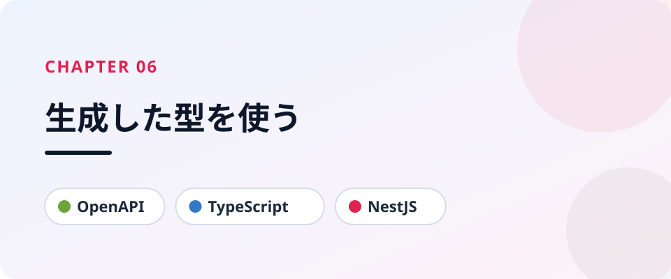

# 生成した型を使う



この節では、API のコードの型を、前の節で作った `src/api/schema.d.ts` に置き換えます。`openapi.yaml` の約束と API のコードがずれたら、**コンパイルのときに** 気づけるようにするのが目的です。

置き換えるのは、次の 4 つです。

| コード | 置き換え方 |
|---|---|
| `Note`（`note.entity.ts`） | 生成した型にする |
| `ErrorBody`（`all-exceptions.filter.ts`） | 生成した型にする |
| `createNoteSchema`（`create-note.dto.ts`） | Zod のまま。約束と合っているかを型で確かめる |
| `updateNoteSchema`（`update-note.dto.ts`） | Zod のまま。約束と合っているかを型で確かめる |

## Note を生成した型にする

::diff{file="api/src/notes/entities/note.entity.ts"}

手で書いていた `interface Note` を、`openapi.yaml` の `Note` から作った型にします。`openapi.yaml` の `Note` に項目を足すと、サービスでその項目を入れ忘れたときにエラーになります。

## ErrorBody を生成した型にする

::diff{file="api/src/common/all-exceptions.filter.ts"}

## Zod のスキーマを約束と照らし合わせる

入力チェックは、これまでどおり Zod で書きます（`openapi.yaml` の型からは、実行時のチェックは作れないため）。代わりに、Zod のスキーマが約束と合っているかを型で確かめます。

まず、「2 つの型がぴったり同じか」を確かめる型を用意します。

::diff{file="api/src/api/type-check.ts"}

`Expect<Equal<A, B>>` は、A と B が違うとコンパイルエラーになります。中身を覚える必要はなく、この使い方だけ押さえれば十分です。

これを使って、作成と更新のスキーマを約束と照らし合わせます。

::diff{file="api/src/notes/dto/create-note.dto.ts"}

::diff{file="api/src/notes/dto/update-note.dto.ts"}

- `satisfies z.ZodType<unknown, CreateNoteInput>` … スキーマが受け付ける形が `CreateNoteInput` に合っているかを確かめます。ただし、余分な項目や、受け付けない省略可能な項目は見逃します
- `Expect<Equal<z.input<typeof createNoteSchema>, CreateNoteInput>>` … ぴったり同じかを確かめて、その見逃しを無くします

## 確かめる

```bash
npm run build
```

これまでどおり通ります。型を置き換えただけなので、API の動きは変わりません。

## 約束を変えたらどうなるか

試しに、`openapi.yaml` の `Note` と `CreateNoteInput` に、ピン留めを表す `pinned`（`boolean`）を足し、`Note` では必須にしてみます。

```yaml
    Note:
      ...
      required: [id, title, body, pinned, createdAt, updatedAt]
      properties:
        pinned:
          type: boolean
```

型を作り直して、ビルドします。

```bash
npm run generate:api
npm run build
```

```text
src/notes/dto/create-note.dto.ts:18:3 - error TS2344: Type 'false' does not satisfy the constraint 'true'.
...
src/notes/notes.service.ts:26:11 - error TS2741: Property 'pinned' is missing in type '{ id: ...; title: string; body: string; createdAt: string; updatedAt: string; }' but required in type '{ pinned: boolean; ... }'.
...
Found 2 error(s).
```

- `notes.service.ts` … 作るメモに `pinned` が無い
- `create-note.dto.ts` … 作成のスキーマが `pinned` を受け付けない

約束を変えると、直すべき場所をコンパイラが教えてくれます。確かめたら、`openapi.yaml` を元に戻して `npm run generate:api` を実行しておきます。

## 参考にした公式ドキュメント

この節は、次の公式ドキュメントをもとに書いています。

- [openapi-typescript: Introduction](https://openapi-ts.dev/introduction) … 作った型（`components["schemas"]`）の使い方
- [TypeScript 4.9: satisfies](https://www.typescriptlang.org/docs/handbook/release-notes/typescript-4-9.html) … `satisfies` 演算子
- [Zod: Basic usage](https://zod.dev/basics) … スキーマから型を取り出す `z.infer` と `z.input`

## この節を終えたときのディレクトリ

::tree

:::download
[この節を終えた状態をダウンロード](./project.zip)
:::
