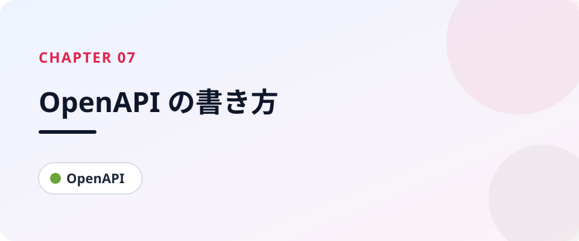
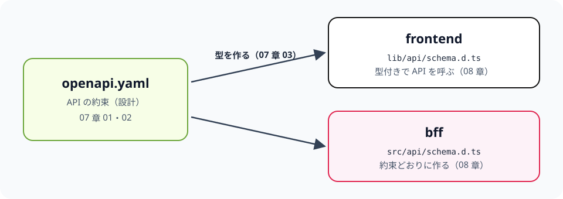

# OpenAPI の書き方



ここまでで、メモ API の形（URL・メソッド・送る JSON・返る JSON）は、API のコードと UI のコードの両方に書かれています。たとえば `Note` の型は、`api/src/notes/note.ts` と `ui/lib/notes-api.ts` の 2 か所にあります。片方だけを直すと、ずれに気づけません。

この章では、API の形を **OpenAPI** という決まった書き方で 1 つのファイルにまとめ、そこから両方の型を作ります。この節では、そのファイル `openapi.yaml` を書きます。

## OpenAPI とは

**OpenAPI** は、HTTP の API を YAML（または JSON）で書くための決まりです。どんなパスがあり、何を送ると何が返るかを、人にも道具にも読める形で書けます。書いたものからは、ドキュメントの画面・型・テスト・モックサーバーなどを作れます。

### 設計が先、コードが後

OpenAPI のファイルの作り方は 2 通りあります。

| 作り方 | 流れ |
|---|---|
| コードから作る | API のコードにデコレーターを付けて、OpenAPI を書き出す（NestJS なら `@nestjs/swagger`） |
| **設計が先**（このハンズオン） | 先に OpenAPI を手で書き、それに合わせて API と UI を作る |



設計を先にすると、画面を作る人と API を作る人が、同じ約束を見ながら同時に作業できます。`openapi.yaml` が「API の約束」の正本になります。

## openapi.yaml を書く

`my-app/` の直下（`ui/` と `api/` と同じ階層）に `openapi.yaml` を作ります。長いので、まず全体を載せてから、部分ごとに説明します。

::diff{file="openapi.yaml"}

### 全体の情報

| キー | 意味 |
|---|---|
| `openapi: 3.1.0` | OpenAPI の版。3.1 は JSON Schema と同じ書き方で型を書ける |
| `info` | API の名前・版・説明 |
| `servers` | API の URL |
| `security` | すべての操作に掛かる認証。ここでは `bearerAuth`（後で `components` に定義）。06 章の Guard と同じく、トークンが必要なことを表す |
| `tags` | 操作をまとめるための見出し |

### paths — パスと操作

`paths` の下に、パスごとに、メソッド（`get`・`post`・`patch`・`delete`）ごとの操作を書きます。

```yaml
  /notes:
    get:
      tags: [notes]
      operationId: listNotes
      summary: メモの一覧を返す
      responses:
        '200':
          description: メモの一覧
          content:
            application/json:
              schema:
                type: array
                items:
                  $ref: '#/components/schemas/Note'
```

| キー | 意味 |
|---|---|
| `operationId` | 操作の名前。型やドキュメントで、この名前が使われる |
| `summary` / `description` | 操作の説明 |
| `requestBody` | 送る本文（`POST`・`PATCH`） |
| `responses` | ステータスコードごとの応答。`'200'` のように文字列で書く |
| `$ref` | 別の場所に書いた定義を参照する。`#/components/schemas/Note` は「このファイルの `components.schemas.Note`」 |

`/notes/{id}` の `{id}` はパスの中の値です。`parameters` で、`id` がパスの値で、UUID の形の文字列であることを書いています。

### components — 使い回す部品

同じ形を何度も書かずに済むよう、`components` にまとめておき、`$ref` で参照します。

| 場所 | 中身 |
|---|---|
| `securitySchemes` | 認証の方式。`bearerAuth` は「`Authorization: Bearer <JWT>`」 |
| `parameters` | パスやクエリの値。`NoteId` |
| `schemas` | JSON の形。`Note`・`CreateNoteInput`・`UpdateNoteInput`・`Me`・`Error` |
| `responses` | よく使う応答。`400`・`401`・`403`・`404` |

`schemas` は、04 章の Zod のスキーマと同じ決まりを書いています。

| Zod | OpenAPI |
|---|---|
| `z.strictObject({...})` | `type: object` と `additionalProperties: false` |
| 省略できない項目 | `required: [...]` に名前を並べる |
| `z.string().min(1).max(100)` | `type: string`・`minLength: 1`・`maxLength: 100` |
| `.default('')` | `default: ''` |
| `z.uuid()` | `type: string`・`format: uuid` |

`Error` は、NestJS が返すエラーの形です。`message` は、入力チェックのエラーでは配列、それ以外では文字列なので、`oneOf` で「どちらか」と書いています。

:::notice
`openapi.yaml` は約束を書いただけなので、ここで API の動きは何も変わりません。約束とコードを結び付けるのは 08 章です。それまでの間、約束とコードがずれないように気を付けてください。
:::

## 参考にした公式ドキュメント

この節は、次の公式ドキュメントをもとに書いています。

- [OpenAPI Specification v3.1.1](https://spec.openapis.org/oas/v3.1.1.html) … `openapi.yaml` に書ける項目
- [OpenAPI Documentation](https://learn.openapis.org/) … OpenAPI の考え方と書き方の入門

## この節を終えたときのディレクトリ

::tree

:::download
[この節を終えた状態をダウンロード](./project.zip)
:::

:::faq

### `'200'` を `200` と書いてはいけない？

YAML では `200` は数値になります。OpenAPI の決まりでは、応答のキーは文字列なので、`'200'` と引用符で囲みます。

### `@nestjs/swagger` で作るのと、どちらがよい？

コードから作ると、約束とコードがずれにくいのが利点です。設計を先にすると、コードを書く前に約束を相談でき、画面と API を並べて作れます。どちらも広く使われています。このハンズオンでは、約束を先に決める流れを体験するために、手で書きます。

### YAML の字下げを間違えた

YAML は字下げで入れ子を表します。スペース 2 つでそろえ、タブは使いません。次の節で入れる VS Code の拡張機能が、間違いを教えてくれます。

:::
