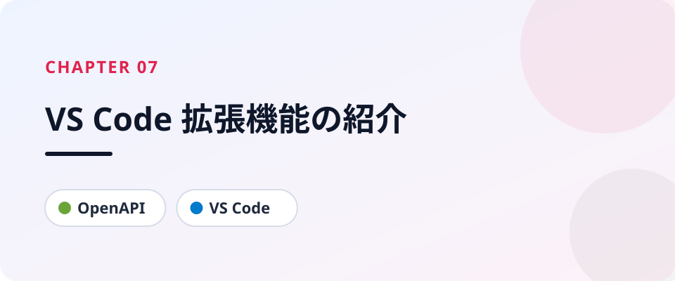

# VS Code 拡張機能の紹介



`openapi.yaml` は長く、字下げや `$ref` の書き間違いに気づきにくいファイルです。この節では、書くのを助けてくれる VS Code の拡張機能を入れ、決まりどおりに書けているかをコマンドでも確かめられるようにします。

## 使う拡張機能

| 拡張機能 | ID | できること |
|---|---|---|
| OpenAPI (Swagger) Editor | `42Crunch.vscode-openapi` | 入力の補完、OpenAPI explorer（パスや部品の一覧）、`$ref` の参照先へ移動、Swagger UI / ReDoc でのプレビュー |
| Redocly OpenAPI | `Redocly.openapi-vs-code` | `redocly.yaml` の決まりで間違いを表示、参照先ののぞき見 |
| YAML | `redhat.vscode-yaml` | YAML の字下げや書き方の間違いを表示 |

### プロジェクトで勧める

`.vscode/extensions.json` に拡張機能の ID を書いておくと、このフォルダを VS Code で開いた人に「入れておくとよい拡張機能」として表示されます。チームで同じ道具をそろえるのに便利です。

::diff{file=".vscode/extensions.json"}

`my-app/` を VS Code で開くと、右下に「このワークスペースには拡張機能の推奨事項があります」と出るので、**インストール** を押します。拡張機能のビューで `@recommended` と検索しても一覧が出ます。

:::warning
VS Code では `my-app/` を開いてください（`ui/` や `api/` ではなく）。`.vscode/` と、後で作る `redocly.yaml` は、開いたフォルダの直下にあるときに読まれます。
:::

## 拡張機能を使ってみる

`openapi.yaml` を開いて、次を試してみてください。

- **OpenAPI explorer** … 左のアクティビティバーの OpenAPI のアイコンを押すと、パス・操作・`components` の一覧が出ます。押すと、その場所へ移動します
- **補完** … 新しい行で `req` と打つと `requestBody` が候補に出ます。何を書けるかが分かります
- **参照先へ移動** … `$ref: '#/components/schemas/Note'` を Cmd（Windows は Ctrl）を押しながらクリックすると、`Note` の定義へ移動します
- **プレビュー** … エディタの右上のプレビューのボタンを押すと、API のドキュメントの画面が横に出ます。書いた説明がどう見えるかを確かめられます

わざと間違えてみると、拡張機能の働きがよく分かります。たとえば `'#/components/schemas/Note'` を `'#/components/schemas/Notes'` に変えると、参照先が無いことが赤い波線で示されます。

## 決まりを redocly.yaml に書く

Redocly は、OpenAPI として正しいかに加えて、「`operationId` を書く」「`4xx` の応答を書く」のような **書き方の決まり（ルール）** でも確かめます。どの決まりを使うかを `redocly.yaml` に書きます。

::diff{file="redocly.yaml"}

- `extends: [recommended]` … Redocly のおすすめの決まりを使います
- `rules` … プロジェクトに合わない決まりを切ります。このハンズオンの API は公開しないのでライセンスは書かず、手元で動かすので `servers` が `localhost` でかまいません

拡張機能も CLI も、このファイルを読みます。

## コマンドで確かめる

エディタで見るだけでなく、コマンドでも確かめられるようにしておきます。コマンドなら、レビューの前や CI で、決まりどおりかを機械的に確かめられます。

`my-app/` の直下に、`openapi.yaml` を扱う道具のための `package.json` を作ります。UI と API は、これまでどおりそれぞれの `package.json` を使います。

::diff{file="package.json"}

手で書くのは `scripts` までです。`devDependencies` は、次の `npm install -D` が足します。

```bash
npm install -D @redocly/cli
npm run lint:api
```

```text
openapi.yaml: validated in 13ms

Woohoo! Your API description is valid. 🎉
```

`redocly.yaml` を作る前に実行すると、ライセンスと `localhost` について、2 つの警告が出ます。

```text
Warning was generated by the info-license rule.
...
Warning was generated by the no-server-example.com rule.
...
You have 2 warnings.
```

`my-app/` の直下にも `node_modules/` ができるので、Git に入らないように `.gitignore` を作ります。

::diff{file=".gitignore"}

### Next.js にルートを教える

`my-app/` の直下に `package-lock.json` ができたので、手元で UI をビルドすると、Next.js が次の警告を出すようになります。

```text
We detected multiple lockfiles and selected the directory of .../my-app/package-lock.json as the root directory.
 To silence this warning, set `turbopack.root` in your Next.js config, ...
```

Next.js は `package-lock.json` のある場所をプロジェクトのルートとみなします。2 つ見つかると、上のほう（`my-app/`）を選んでしまいます。UI のルートは `ui/` なので、`next.config.ts` の `turbopack.root` で明示します。

::diff{file="ui/next.config.ts"}

`__dirname` は、`next.config.ts` のあるフォルダ（`ui/`）です。

ルートを変えたら、手元のビルドの結果（`.next/`）を一度消してください。前のルートで作った `.next/` が残っていると、次のビルドで `ui/ui/.next/` という入れ子のフォルダができ、`npm run lint` がその中のファイルまで調べてエラーになります。

:::::platform
::::macos-linux
```bash
cd ui
rm -rf .next ui
npm run build
```
::::
::::windows
```powershell
cd ui
Remove-Item -Recurse -Force .next, ui -ErrorAction SilentlyContinue
npm run build
```
::::
:::::

## この節を終えたときのディレクトリ

::tree

:::download
[この節を終えた状態をダウンロード](./project.zip)
:::

:::faq

### 推奨の拡張機能の表示が出てこない

`my-app/` ではなく、`ui/` などを開いていないか確かめてください。表示を一度閉じた場合は、拡張機能のビューで `@recommended` と検索すると出てきます。

### 42Crunch の拡張機能で「Audit」や「Scan」を勧められる

42Crunch の拡張機能には、API のセキュリティを調べる機能（サインインが必要）もあります。このハンズオンでは、編集とプレビューの機能だけを使います。

### Redocly の拡張機能が間違いを表示しない

`redocly.yaml` が、VS Code で開いたフォルダの直下にあるか確かめてください。拡張機能は、ワークスペースの直下の `redocly.yaml` を読みます。

:::
