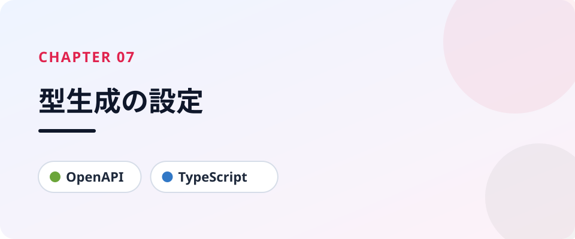

# 型生成の設定



`openapi.yaml` に書いた API の約束から、TypeScript の型を作ります。使うのは **openapi-typescript** です。`openapi.yaml` を変えたらコマンド 1 つで型を作り直せるようにしておけば、UI と API の型が約束とずれなくなります。

この節では型を作るところまでを行い、実際にコードで使うのは 08 章です。

## openapi-typescript を入れる

前の節で作った `my-app/` 直下の `package.json` に、openapi-typescript を入れます。

```bash
npm install -D openapi-typescript typescript@5
```

openapi-typescript は TypeScript 5 で動くように作られています。API は TypeScript 6 を使っているので、API に入れると依存がぶつかります（`ERESOLVE unable to resolve dependency tree`）。型を作る道具は `my-app/` 直下にまとめ、TypeScript 5 といっしょに入れます。

## 出力先を redocly.yaml に書く

openapi-typescript は、`redocly.yaml` の `apis` に書いた API ごとに型を作れます。UI 用と API 用の 2 つを書き、それぞれの出力先を `x-openapi-ts.output` で指定します。

::diff{file="redocly.yaml"}

2 つとも同じ `openapi.yaml` から作ります。UI と API は別々にビルドする（コンテナのイメージも別）ので、それぞれのフォルダの中に型のファイルを置きます。

## コマンドを用意する

::diff{file="package.json"}

| コマンド | すること |
|---|---|
| `npm run generate:api` | 型を作る（作り直す） |
| `npm run check:api` | 型が `openapi.yaml` と合っているかだけを確かめる。古ければ失敗する |

`--default-non-nullable false` は、「`default` のある項目も、送るときは省略できる」ように型を作る設定です。`CreateNoteInput` の `body` は `default: ''` なので省略できますが、この設定が無いと「必ず送る」型になってしまいます。

```ts
// --default-non-nullable false のとき
CreateNoteInput: {
    title: string;
    body?: string;
};
```

:::notice
openapi-typescript のドキュメントには、オプションを `redocly.yaml` の `x-openapi-ts` にも書けるとあります。ただ、7.13.0 の時点では、`redocly.yaml` からは `output` しか読まれません。そのため、オプションはコマンドに書いています。
:::

## 型を作る

```bash
npm run generate:api
```

```text
🚀 ui → ./ui/lib/api/schema.d.ts [44.8ms]
🚀 api → ./api/src/api/schema.d.ts [53ms]
```

作られた `api/src/api/schema.d.ts` を開くと、`openapi.yaml` の中身が型になっています（`ui/lib/api/schema.d.ts` も同じ中身です）。

::diff{file="api/src/api/schema.d.ts"}

大きく 3 つの型があります。

| 型 | 中身 | 例 |
|---|---|---|
| `paths` | パスとメソッドごとの操作 | `paths["/notes/{id}"]["patch"]` |
| `components` | `components` に書いた部品 | `components["schemas"]["Note"]` |
| `operations` | `operationId` ごとの、送るものと返るもの | `operations["createNote"]` |

たとえば `Note` の型は、次のように取り出せます。

```ts
import type { components } from "./api/schema.js";

type Note = components["schemas"]["Note"];
```

### 作ったファイルは Git に入れる

型のファイルは、手で直さずに `generate:api` で作り直すものです。ただし、コンテナのイメージを作るときやビルドのときに要るので、Git には入れておきます。`openapi.yaml` を変えたら、`generate:api` で作り直して、いっしょにコミットします。作り直し忘れは `check:api` で見つけられます。

```bash
npm run check:api
```

型が古いと、次のように失敗します（終了コードが 1 になる）。

```text
✘  Generated types are not up-to-date!
```

API の `npm run format`（Prettier）が型のファイルを書き換えると、`check:api` が失敗するようになります。Prettier の対象から外しておきます。

::diff{file="api/.prettierignore"}

## 参考にした公式ドキュメント

この節は、次の公式ドキュメントをもとに書いています。

- [openapi-typescript: Introduction](https://openapi-ts.dev/introduction) … `openapi.yaml` から型を作る
- [openapi-typescript: CLI](https://openapi-ts.dev/cli) … `redocly.yaml` の `x-openapi-ts.output` と `--check`

## この節を終えたときのディレクトリ

::tree

:::download
[この節を終えた状態をダウンロード](./project.zip)
:::

:::faq

### `npm run generate:api` で ``API ui is missing an `x-openapi-ts.output` key.`` と出る

`redocly.yaml` の `apis` の下で、`x-openapi-ts:` と `output:` の字下げがずれています。`x-openapi-ts` は `root` と同じ深さ、`output` はそれより 2 つ深くします。

### API に openapi-typescript を入れたい

API の TypeScript を 5 系に下げるか、`--legacy-peer-deps` で無理に入れることになります。どちらもおすすめしません。型を作る道具と、型を使うアプリは分けておくと、ぶつかりにくくなります。

### `schema.d.ts` を手で直してしまった

`npm run generate:api` で作り直せば元に戻ります。型を変えたいときは、`openapi.yaml` を直してから作り直します。

:::
