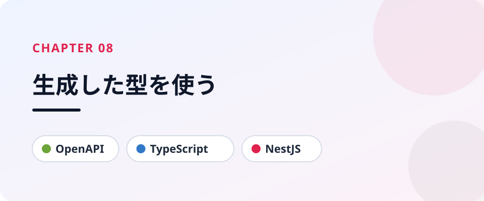

# 生成した型を使う



07 章で、`openapi.yaml` から `api/src/api/schema.d.ts` を作りました。この節では、API の型をこれに置き換えます。`openapi.yaml` の約束と API のコードがずれたら、**コンパイルのときに** 気づけるようにするのが目的です。

## メモの型を置き換える

::diff{file="api/src/notes/note.ts"}

### Note は生成した型にする

```ts
type Schemas = components['schemas'];
export type Note = Schemas['Note'];
```

これまで手で書いていた `interface Note` を消し、`openapi.yaml` の `Note` から作った型にします。サービスがメモを作るところ（`create`）では、オブジェクトがこの型に合っているかを TypeScript が確かめます。`openapi.yaml` の `Note` に項目を足せば、サービスでその項目を入れ忘れるとエラーになります。

### Zod のスキーマを約束と照らし合わせる

入力チェックの決まりは、これまでどおり Zod で書きます（`openapi.yaml` の型からは、実行時のチェックは作れないため）。代わりに、Zod のスキーマが約束と合っているかを、型で確かめます。

```ts
export const createNoteSchema = z.strictObject({
  title,
  body: body.default(''),
}) satisfies z.ZodType<unknown, Schemas['CreateNoteInput']>;
```

`z.ZodType<出力, 入力>` は「入力としてこの形を受け付けるスキーマ」という型です。`satisfies` は「この値は、この型に合っているか確かめる。ただし値の型は変えない」という TypeScript の書き方です。スキーマが受け付ける形（`z.input`）が、`openapi.yaml` の `CreateNoteInput` に合っていなければ、その場でエラーになります。

| スキーマの間違い | `satisfies` で |
|---|---|
| `title` が無い | エラーになる |
| `title` を `z.number()` にした | エラーになる |
| `openapi.yaml` に無い項目を必須にした | **見逃す** |
| `openapi.yaml` にある省略可能な項目を受け付けない | **見逃す** |

`satisfies` は「合っているか」を一方向にしか確かめないので、下の 2 つは見逃します。どちらも `z.strictObject` と組み合わさると、約束どおりのリクエストが `400` になってしまう、気づきにくい間違いです。

### ぴったり同じかを確かめる

見逃しを無くすため、「2 つの型がぴったり同じか」を確かめる型を用意します。

::diff{file="api/src/api/type-check.ts"}

`Equal<A, B>` は、A と B が同じなら `true`、違えば `false` になる型です（TypeScript の型の比べ方を使った、よく知られた書き方です）。`Expect<T>` は `true` しか受け付けないので、`Expect<Equal<A, B>>` は、A と B が違うとコンパイルエラーになります。

`note.ts` の最後で、作成・更新のスキーマが受け付ける形と `openapi.yaml` の形を比べています。

```ts
export type CreateNoteInputMatchesApi = Expect<
  Equal<z.input<typeof createNoteSchema>, Schemas['CreateNoteInput']>
>;
```

`export` しているのは、使っていない型として lint に注意されないためです。

## /me の型を付ける

`GET /me` の戻り値にも、`openapi.yaml` の `Me` の型を付けます。

::diff{file="api/src/app.controller.ts"}

返すオブジェクトに項目が足りなかったり、余分な項目があったりすると、エラーになります。

## 約束を変えたらどうなるか

試しに、`openapi.yaml` の `Note` と `CreateNoteInput` に、ピン留めを表す `pinned`（`boolean`）を足し、`Note` では必須にしてみます。

```yaml
    Note:
      ...
      required: [id, ownerId, title, body, pinned, createdAt, updatedAt]
      properties:
        pinned:
          type: boolean
```

型を作り直して、API をコンパイルします。

```bash
npm run generate:api
cd api
npx tsc --noEmit -p tsconfig.json
```

```text
src/notes/note.ts(39,3): error TS2344: Type 'false' does not satisfy the constraint 'true'.
src/notes/notes.service.ts(35,11): error TS2741: Property 'pinned' is missing in type '{ id: ...; ownerId: string; title: string; body: string; createdAt: string; updatedAt: string; }' but required in type '{ pinned: boolean; id: string; ... }'.
```

- `notes.service.ts` … 作るメモに `pinned` が無い
- `note.ts` … 作成のスキーマが `pinned` を受け付けない（`satisfies` だけなら見逃していた）

約束を変えると、直すべき場所をコンパイラが教えてくれます。確かめたら、`openapi.yaml` を元に戻して `npm run generate:api` を実行しておきます。

## 参考にした公式ドキュメント

この節は、次の公式ドキュメントをもとに書いています。

- [openapi-typescript: Introduction](https://openapi-ts.dev/introduction) … 作った型（`components["schemas"]`）の使い方
- [TypeScript 4.9: satisfies](https://www.typescriptlang.org/docs/handbook/release-notes/typescript-4-9.html) … `satisfies` 演算子
- [Zod](https://zod.dev/) … スキーマから型を取り出す `z.infer`

## この節を終えたときのディレクトリ

::tree

:::download
[この節を終えた状態をダウンロード](./project.zip)
:::

:::faq

### OpenAPI から Zod のスキーマを作れないの？

作る道具もあります（`openapi-zod-client` など）。このハンズオンでは、入力チェックの細かい決まり（前後の空白を取る・既定値を入れる）を Zod で書き、約束との食い違いを型で見つける形にしました。道具を増やさずに、どこで何を確かめているかが見えるからです。

### `npm run build` では型のエラーが出ない？

`nest build` も型を確かめるので、同じエラーで失敗します。`npx tsc --noEmit` は、ファイルを書き出さずに型だけを確かめたいときに使います。

### `Equal` の書き方が難しい

中身を覚える必要はありません。「`Expect<Equal<A, B>>` と書けば、A と B が違うときにエラーになる」という使い方だけ押さえておけば十分です。

:::
