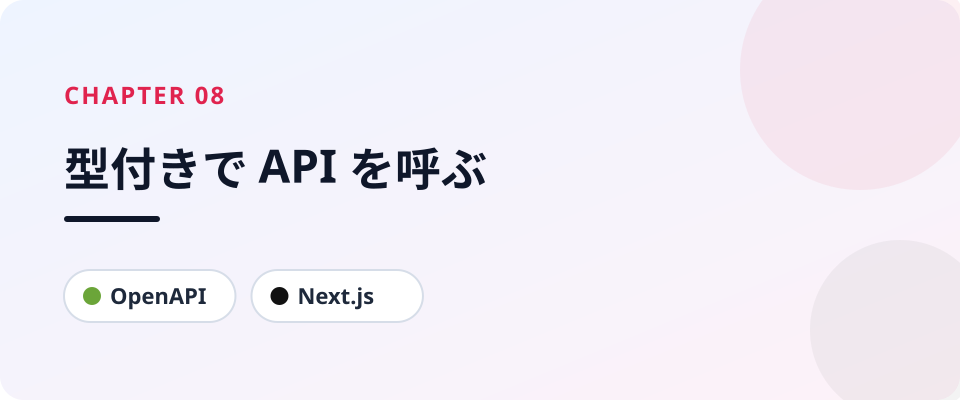

# 型付きで API を呼ぶ



UI の `lib/notes-api.ts` は、04 章から `fetch` で API を呼んでいます。URL を文字列で組み立て、`Note` の型も手で書いているので、パスや送る項目を間違えても気づけません。

この節では、**openapi-fetch** を使って、07 章で作った `ui/lib/api/schema.d.ts` の型どおりに API を呼ぶようにします。

## openapi-fetch を入れる

```bash
cd ui
npm install openapi-fetch
```

::diff{file="ui/package.json"}

openapi-fetch は、`fetch` を薄く包んだ小さなライブラリです。openapi-typescript が作った `paths` の型を渡すと、パス・パラメーター・本文・応答に型が付きます。

## クライアントを作る

::diff{file="ui/lib/api/client.ts"}

- `createClient<paths>({ baseUrl })` … `paths` の型を持つクライアントを作ります。`client.GET("/notes")` のように、メソッド名とパスで呼びます
- `authMiddleware` … openapi-fetch の **ミドルウェア** です。`onRequest` は、リクエストを送る前に毎回呼ばれます。ここで、06 章と同じくアクセストークンを `Authorization` ヘッダーに付けます
- `client.use(authMiddleware)` … ミドルウェアを登録します。これで、API を呼ぶ関数ごとにヘッダーを書かずに済みます

## API を呼ぶ関数を書き換える

`lib/notes-api.ts` を、クライアントを使う形に書き換えます。関数の名前と引数は変えないので、画面（`app/notes.tsx`）は変えずに済みます。

::diff{file="ui/lib/notes-api.ts"}

- `Note` と `CreateNoteInput` は、手で書かずに `components["schemas"]` から取ります
- `client.GET("/notes")` は `{ data, error }` を返します。`2xx` なら `data` に、それ以外なら `error` に、`openapi.yaml` に書いた型の値が入ります
- `if (error) throw ...` のあとでは、TypeScript は `data` があると分かるので、そのまま返せます
- `client.DELETE("/notes/{id}", { params: { path: { id } } })` … パスの `{id}` は文字列をつなげずに、`params.path` で渡します。openapi-fetch が URL に埋めてくれます
- `toError` … API のエラーの形（`openapi.yaml` の `Error`）が型で分かっているので、`message` が配列か文字列かで分けて、1 つの文字列にします

`fetch` で書いていたころの `ensureOk` や `authHeaders` は、要らなくなりました。

## 型が間違いを見つける

試しに、次のように書き間違えてみます。

```ts
await client.POST("/notes", { body: { titel: "x" } });
await client.GET("/note");
await client.DELETE("/notes/{id}");
```

`npm run build`（または VS Code の上）で、3 つともエラーになります。

```text
error TS2561: Object literal may only specify known properties, but 'titel' does not exist in type '{ title: string; body?: string | undefined; } & {}'. Did you mean to write 'title'?
error TS2554: Expected 2 arguments, but got 1.
error TS2554: Expected 2 arguments, but got 1.
```

- 1 つ目 … `title` の書き間違い。`openapi.yaml` の `CreateNoteInput` に無い項目なのでエラーになります
- 2 つ目 … `/note` というパスは `openapi.yaml` に無いので、どう呼んでも合いません
- 3 つ目 … パスに `{id}` があるのに、`params.path.id` を渡していません

VS Code では、`client.GET("` と打った時点で、`openapi.yaml` にあるパスが候補に出ます。

## 動かす

画面の見た目と動きは、前の節と同じです。サインインして、メモの追加・削除ができることを確かめてください。タイトルを空にして追加すると、これまでどおり API の入力チェックの結果が表示されます。

これで、`openapi.yaml` の約束から作った型を、UI（呼ぶ側）と API（受ける側）の両方で使うようになりました。約束を変えたら `npm run generate:api` を実行すれば、合わなくなった場所を、両方でコンパイラが教えてくれます。

## 参考にした公式ドキュメント

この節は、次の公式ドキュメントをもとに書いています。

- [openapi-fetch](https://openapi-ts.dev/openapi-fetch/) … 型どおりに API を呼ぶクライアント
- [openapi-fetch: Middleware & Auth](https://openapi-ts.dev/openapi-fetch/middleware-auth) … トークンを付ける middleware

## この節を終えたときのディレクトリ

::tree

:::download
[この節を終えた状態をダウンロード](./project.zip)
:::

:::faq

### `data` が `undefined` かもしれないと言われる

`if (error) throw ...` のように、先に `error` を確かめてから `data` を使ってください。`{ data, error }` のどちらか一方だけが入る、という型になっています。

### 204（本文なし）の応答はどうなる？

`DELETE` のように本文の無い応答では、`data` も `error` も `undefined` です。失敗したときだけ `error` に値が入ります。

### `npm audit` で high の脆弱性が出る

`npm audit` で出るのは、開発のときだけ使う依存（ESLint などが使う `picomatch`）についてです。ブラウザで動くコードに入る依存だけを見る `npm audit --omit=dev` では 0 件になります。この節で入れた openapi-fetch が増やしたものではありません。

:::
