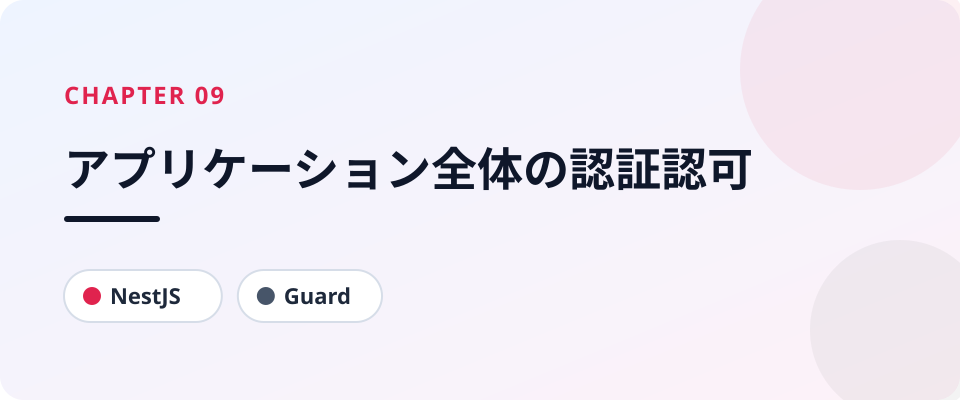

# アプリケーション全体の認証認可



06 章では、`@UseGuards(AuthGuard)` を、守りたいコントローラーやメソッドに 1 つずつ付けました。この書き方は「付け忘れたら、だれでも呼べる」という弱点があります。API が増えるほど、付け忘れが起きやすくなります。

この節では、考え方を逆にします。**AuthGuard をアプリ全体に掛けて、すべての API でトークンを必要にし、トークン無しで呼んでよいものだけに `@Public()` を付けます。** 付け忘れても「呼べない」側に倒れるので、安全です。

| 書き方 | 付け忘れたとき |
|---|---|
| 守るものに `@UseGuards` を付ける（06 章） | だれでも呼べてしまう |
| 全体に掛けて、公開するものに `@Public()` を付ける（この節） | だれも呼べない（すぐ気づく） |

## @Public() を作る

「このメソッドはトークン無しで呼べる」という印を付けるデコレーターを作ります。

::diff{file="api/src/auth/public.decorator.ts"}

`SetMetadata(キー, 値)` は、メソッドやクラスに **メタデータ**（コードの動きとは別に付けておく情報）を付けるデコレーターです。ここでは `isPublic: true` を付けます。

## Guard で @Public() を見る

AuthGuard の最初で、メタデータを読みます。

::diff{file="api/src/auth/auth.guard.ts"}

- `Reflector` … NestJS が用意している、メタデータを読むための部品です。コンストラクターで受け取ります
- `getAllAndOverride(IS_PUBLIC_KEY, [context.getHandler(), context.getClass()])` … 呼ばれるメソッドと、そのコントローラーの両方を見て、`isPublic` が付いていれば `true` を返します。メソッドに付けたものが優先されます
- `@Public()` なら、トークンを確かめずに `true` を返して通します

## アプリ全体に掛ける

`APP_GUARD` という名前で Guard を登録すると、アプリのすべてのルートに掛かります。登録する場所として、`AuthModule` を作ります。

::diff{file="api/src/auth/auth.module.ts"}

`AppModule` で読み込みます。

::diff{file="api/src/app.module.ts"}

## @UseGuards を外し、@Public() を付ける

メモのコントローラーからは `@UseGuards(AuthGuard)` を外します。アプリ全体の Guard が掛かるので、要らなくなりました。

::diff{file="api/src/notes/notes.controller.ts"}

`AppController` では、`/me` の `@UseGuards` を外し、02 章の練習用の 3 つ（`GET /`・`GET /greeting`・`POST /echo`）に `@Public()` を付けます。

::diff{file="api/src/app.controller.ts"}

コントローラーが Guard を直接使わなくなったので、テストの `overrideGuard` も要らなくなります。テストのモジュールには `APP_GUARD` を登録していないので、Guard は作られません。

::diff{file="api/src/app.controller.spec.ts"}

::diff{file="api/src/notes/notes.controller.spec.ts"}

## 動かす

```bash
curl -s -o /dev/null -w "%{http_code}\n" http://localhost:3001/
curl -s -o /dev/null -w "%{http_code}\n" http://localhost:3001/notes
curl -s -o /dev/null -w "%{http_code}\n" -X DELETE http://localhost:3001/notes/abc
```

```text
200
401
401
```

- `GET /` は `@Public()` なので、トークン無しで `200`
- `GET /notes` は、何も付けていないので `401`
- `DELETE /notes/abc` は、ID が UUID ではありませんが、`400` ではなく `401` です。入力チェック（Pipe）より Guard が先に動くからです。順番は次の節で詳しく見ます

画面からは、これまでどおりサインインすればメモを読み書きできます。

## この節を終えたときのディレクトリ

::tree

:::download
[この節を終えた状態をダウンロード](./project.zip)
:::

:::faq

### 新しい API を足したら 401 になった

アプリ全体に Guard が掛かっているので、正しい動きです。トークン無しで呼べるようにしたいときだけ、`@Public()` を付けてください。

### コントローラーごと公開したい

`@Public()` をクラス（`@Controller()` の上）に付けます。`getAllAndOverride` はコントローラーに付いた印も見るので、すべてのメソッドが公開になります。

### `@nestjs/authentication` にも `@Public()` がある？

あります。`@nestjs/authentication` は、アプリ全体に Guard を掛け、`@Public()` で外すという、この節と同じ考え方で作られています。

:::
