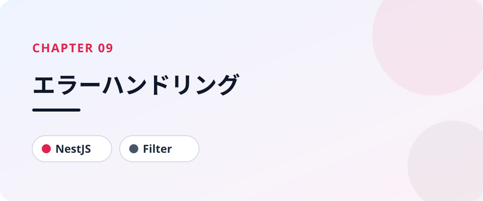

# エラーハンドリング



API のエラーの応答は、これまで NestJS の既定の形でした。

```json
{"message":["title: Too small: expected string to have >=1 characters"],"error":"Bad Request","statusCode":400}
{"message":"Note ... not found","error":"Not Found","statusCode":404}
```

`message` が、入力チェックのときは配列、それ以外は文字列です。画面の側では、どちらかを見分けて扱う必要がありました（04 章の `ensureOk`、08 章の `toError`）。

この節では **ExceptionFilter** で、すべてのエラーを 1 つの形にそろえます。

```json
{
  "statusCode": 400,
  "error": "Bad Request",
  "messages": ["title: Too small: expected string to have >=1 characters"],
  "path": "/notes",
  "timestamp": "2026-11-18T04:45:38.123Z"
}
```

- `messages` は、いつも文字列の配列
- どのパスで、いつ起きたか（`path`・`timestamp`）も入れる
- 思いがけない例外（`500`）では、中身を返さない

## 約束から変える

エラーの形は API の約束の一部なので、`openapi.yaml` の `Error` から変えます。

::diff{file="openapi.yaml"}

型を作り直します。

```bash
npm run generate:api
```

この時点で UI をビルドすると、`message` を使っていた場所がエラーになります。約束を変えると、直す場所をコンパイラが教えてくれます。

```text
lib/notes-api.ts(13,39): error TS2551: Property 'message' does not exist on type '{ statusCode: number; error: string; messages: string[]; path: string; timestamp: string; }'. Did you mean 'messages'?
```

いつも配列になったので、`toError` は短くなります。

::diff{file="ui/lib/notes-api.ts"}

## ExceptionFilter を作る

NestJS では、処理の途中で投げられた例外を **ExceptionFilter** が受け取って、応答を作ります。`@Catch()` に何も渡さないと、すべての例外を受け取ります。

::diff{file="api/src/common/all-exceptions.filter.ts"}

- `HttpException`（`BadRequestException`・`NotFoundException` など）なら、そのステータスを使います。それ以外の例外は `500` にします
- `error` は、Node.js の `STATUS_CODES`（`400` なら `Bad Request`）から作ります
- `toMessages` は、例外の中身から説明を取り出し、いつも配列にします。入力チェックの例外の中身は `{ message: string[] }`、`NotFoundException('...')` の中身は `{ message: string }` です
- `500` のときは、利用者には `Internal server error` とだけ返し、例外の中身（スタックトレース）はログに出します。データベースのエラーの文言などには、見せてはいけない情報が入ることがあるからです
- 応答の本文に `components['schemas']['Error']` の型を付けているので、`openapi.yaml` の形とずれるとコンパイルエラーになります
- `httpAdapter.reply` で応答を返します。Express の `Response` を直接使わないので、Fastify に変えても同じ filter が使えます

## アプリ全体に登録する

`APP_FILTER` で、アプリ全体に登録します。

::diff{file="api/src/app.module.ts"}

前の節の `AdminMiddleware` のように、middleware で投げた例外を受け取れるのは、アプリ全体に登録した filter だけです。コントローラーに `@UseFilters()` で付けた filter は、middleware の例外には使われません。

## テストで確かめる

filter の動きを、テストで確かめます。HTTP のアダプターをまねたものを渡し、`reply` に何が渡されたかを見ます。

::diff{file="api/src/common/all-exceptions.filter.spec.ts"}

`vi.fn()` は、呼ばれた引数を覚えておく「まねの関数」です。`vi.spyOn(Logger.prototype, 'error')` で、`500` のときにログが出たことも確かめています。

```bash
cd api
npm test
```

```text
 Test Files  4 passed (4)
      Tests  12 passed (12)
```

## 動かす

```bash
curl -s http://localhost:3001/notes
```

```json
{"statusCode":401,"error":"Unauthorized","messages":["Missing bearer token"],"path":"/notes","timestamp":"2026-11-18T04:45:38.123Z"}
```

`/admin` の middleware の `403` も、存在しないパスの `404` も、同じ形になります。

```json
{"statusCode":403,"error":"Forbidden","messages":["Admin only"],"path":"/admin/notes","timestamp":"..."}
{"statusCode":404,"error":"Not Found","messages":["Cannot GET /nope"],"path":"/nope","timestamp":"..."}
```

画面でタイトルを空にして追加すると、これまでどおり入力チェックの結果が表示されます。

## この節を終えたときのディレクトリ

::tree

:::download
[この節を終えた状態をダウンロード](./project.zip)
:::

:::faq

### `@Catch(HttpException)` と書くのと何が違う？

`@Catch(HttpException)` は、`HttpException` とその仲間だけを受け取ります。思いがけない例外（コードの間違いや、つながらない外部のサービス）は受け取らず、NestJS の既定の `500` の応答になります。形をそろえるには、`@Catch()` ですべてを受け取ります。

### 500 のエラーの中身を、開発中は画面で見たい

ログ（`podman compose logs api`）に、スタックトレースが出ています。応答に入れるのは、公開したときに中身が漏れる原因になるので避けます。

### エラーに独自のコード（`NOTE_NOT_FOUND` など）を入れたい

`openapi.yaml` の `Error` に `code` を足し、例外を投げるときに渡して、filter で取り出します。NestJS のドキュメントの「Machine-readable error codes」に書き方があります。

:::
