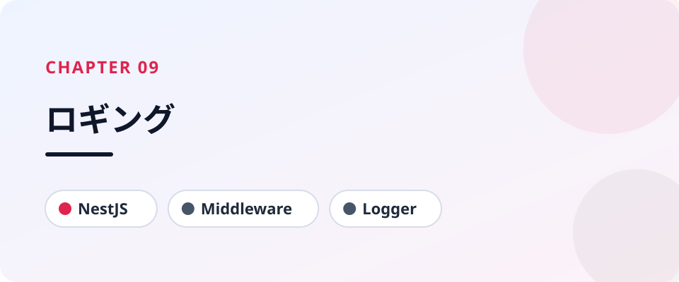

# ロギング



最後に、BFF に届いたリクエストをログに残す middleware を作ります。だれが、どの API を呼び、どうなったか（ステータスと、かかった時間）が分かると、困ったときに原因を探しやすくなります。

```text
LOG [HTTP] POST /notes 201 4ms user=7a1b2c3d-...
WARN [HTTP] GET /admin/notes 403 0ms user=-
```

ログはすべてのリクエストに残したいので、パスで掛けられる middleware が向いています。

## ロギング用の middleware を作る

::diff{file="bff/src/common/logging.middleware.ts"}

- `new Logger('HTTP')` … NestJS の `Logger` です。起動のときのログと同じ形で、`[HTTP]` という見出しを付けて出ます
- `res.on('finish', ...)` … 応答を返し終わったときに呼ばれます。ステータスコードは、このときに決まっています
- `req.user?.sub` … middleware が呼ばれた時点では、まだ Guard が動いていないので `req.user` はありません。でも `finish` のときには、Guard が入れた `req.user` があります。Guard を通らなかったリクエスト（`401` など）では `-` になります
- ステータスで、ログの重さを変えます。`5xx` は `error`、`4xx` は `warn`、それ以外は `log` です

## すべてのパスに掛ける

`AppModule` で、すべてのパスに掛けます。

::diff{file="bff/src/app.module.ts"}

`'{*splat}'` は「どんなパスでも（無くても）」です。`AppModule` に書いた middleware は、ほかのモジュールに書いた middleware（`AdminMiddleware`）より先に動きます。そのため `/admin` の下で `403` になったリクエストも、ログに残ります。

## 動かす

```bash
podman compose logs -f bff
```

画面でメモを追加したり、curl で呼んだりすると、次のように出ます。

```text
bff-1  | [Nest] 46  - 11/18/2026, 4:45:38 AM     LOG [HTTP] POST /notes 201 4ms user=7a1b2c3d-...
bff-1  | [Nest] 46  - 11/18/2026, 4:45:38 AM     LOG [HTTP] GET /notes 200 0ms user=7a1b2c3d-...
bff-1  | [Nest] 46  - 11/18/2026, 4:45:39 AM    WARN [HTTP] GET /notes 401 0ms user=-
bff-1  | [Nest] 46  - 11/18/2026, 4:45:39 AM    WARN [HTTP] GET /nope 404 0ms user=-
```

:::warning
ログに、トークンやパスワード、メモの本文のような中身は書かないでください。ログはいろいろな人や道具が読むので、だれでも見てよい情報だけにします。このハンズオンでは、だれかを表す `sub`（ユーザー ID）だけを残しています。
:::

## この節を終えたときのディレクトリ

::tree

:::download
[この節を終えた状態をダウンロード](./project.zip)
:::

:::faq

### ログを JSON で出したい

ログを集めるサービス（CloudWatch Logs など）に送るときは、JSON のほうが検索しやすくなります。NestJS の `ConsoleLogger` には JSON で出す設定（`json: true`）があり、`NestFactory.create(AppModule, { logger: new ConsoleLogger({ json: true }) })` のように使えます。

### ヘルスチェックのような、たくさん呼ばれる API はログに残したくない

`forRoutes` の前に `exclude()` で、外すパスを書けます。

### かかった時間が 0ms になる

メモはメモリ上にあるので、とても速く返せています。データベースや外部のサービスを呼ぶようになると、ここに時間が出てきます。

:::
