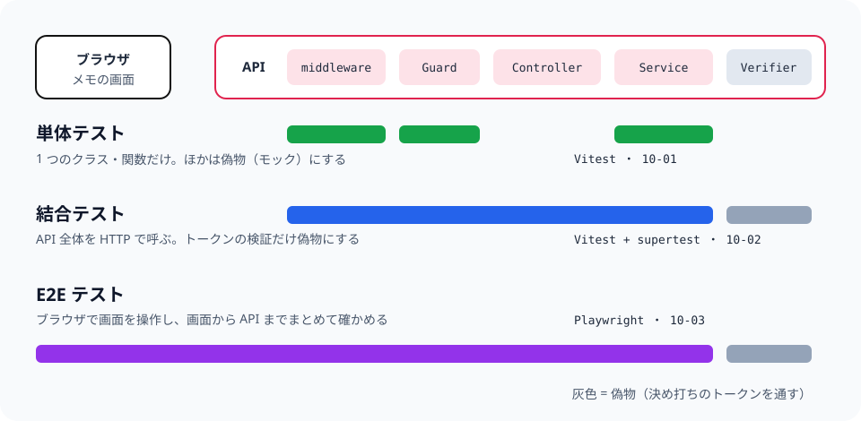

# 単体テスト


この章では、ここまで作ったアプリにテストを足します。テストには、確かめる範囲によって 3 つの種類があります。



| 種類 | 確かめる範囲 | 道具 | 速さ | 節 |
|---|---|---|---|---|
| 単体テスト | 1 つのクラス・関数 | Vitest | とても速い | この節 |
| 結合テスト | API 全体（HTTP で呼ぶ） | Vitest ＋ supertest | 速い | 10-02 |
| E2E テスト | 画面から API まで | Playwright | 遅い | 10-03 |

範囲が狭いテストほど、速く動き、こわれた場所をすぐ特定できます。範囲が広いテストほど、ユーザーが使うときに近い形で確かめられます。たくさんの単体テストと、要所を押さえた結合テスト・E2E テストを組み合わせるのが基本です。

この節では、API の **単体テスト** を書きます。

:::notice
API のテストには **Vitest** を使います。`nest new`（NestJS 12）が最初から入れている道具で、04 章からの `*.spec.ts` もすでに Vitest で動いています。書き方（`describe`・`it`・`expect`）は Jest とほぼ同じです。違いはこの節の最後の「よくある質問」にまとめました。
:::

## テストを動かす

`api/` で `npm test` を実行すると、`src/` の下の `*.spec.ts` がすべて動きます。

```bash
cd api
npm test
```

```text
 Test Files  4 passed (4)
      Tests  12 passed (12)
```

`npm run test:watch` にすると、ファイルを保存するたびに、関係するテストだけが動き直します。テストを書いている間は、こちらが便利です。

テストのファイルは、確かめるファイルの隣に `<名前>.spec.ts` で置きます。`nest g` もこの形で作ります。

## 関数のテスト

まずは、いちばん簡単な「引数を渡すと値が返る」関数から始めます。06 章で作った `isAdmin()` です。

::diff{file="api/src/auth/user.spec.ts"}

- `describe('isAdmin', ...)` … テストをまとめる箱です。何のテストかを書きます
- `it('...', () => { ... })` … テスト 1 つです。名前には「どうなるべきか」を書きます。テストが落ちたとき、この名前が表示されます
- `expect(値).toBe(期待する値)` … 値が期待どおりかを確かめます。違えばテストが落ちます

1 つのテストは「用意する → 実行する → 確かめる」の順で書きます。ここでは、ユーザーを用意し、`isAdmin()` を呼び、`true` か `false` かを確かめています。

`as User` は、テストに要る項目だけを持つユーザーを `User` として扱う書き方です。本物のトークンの中身にはもっとたくさんの項目がありますが、`isAdmin()` が見るのは `cognito:groups` だけです。

## 偽物（モック）で切り離す

次は `AuthGuard` です。`AuthGuard` はトークンの検証を `TokenVerifier` に任せていて、`TokenVerifier` は Cognito に問い合わせます。そのまま動かすと、Cognito が無いとテストできません。

単体テストでは、確かめたいクラスの **相手を偽物（モック）に差し替えて** 切り離します。偽物は「こう呼ばれたら、こう返す」をテストの中で決められ、どう呼ばれたかも記録します。

::diff{file="api/src/auth/auth.guard.spec.ts"}

- `vi.fn<TokenVerifier['verify']>()` … 偽物の関数を作ります。`vi` は Vitest の道具箱です。型を付けると、返す値の形を TypeScript が確かめてくれます
- `new AuthGuard(new Reflector(), { verify } as unknown as TokenVerifier)` … NestJS の DI を使わず、`new` で直接作ります。コンストラクターに偽物を渡すだけで差し替えられるのは、DI で相手を受け取る作りにしておいたおかげです
- `verify.mockResolvedValue(alice)` … 呼ばれたら `alice` を返す（`Promise` で）ように決めます。`mockRejectedValue()` は、例外を投げるように決めます
- `expect(verify).toHaveBeenCalledWith('Bearer good')` … 偽物が、この引数で呼ばれたかを確かめます。`not.toHaveBeenCalled()` は「呼ばれていない」です
- `beforeEach(() => verify.mockReset())` … テストごとに、偽物の記録と決めごとを消します。前のテストの影響を受けないようにするためです
- `contextFor()` … Guard が受け取る `ExecutionContext` のまねです。Guard が使う 3 つのメソッドだけを用意しています。`@Public()` の印はメソッドに貼られるので、`TestController` に印の付いたメソッドと付いていないメソッドを用意しました

`async` のメソッドを確かめるときは、`await expect(...).resolves` / `.rejects` を使います。`await` を忘れると、確かめる前にテストが終わってしまいます。

09 章の `AdminMiddleware` も、同じように `TokenVerifier` を偽物にして確かめます。

::diff{file="api/src/admin/admin.middleware.spec.ts"}

middleware は「次へ進める」ときに `next()` を呼びます。`next` も偽物にしておけば、進めたかどうかを `toHaveBeenCalledOnce()` / `not.toHaveBeenCalled()` で確かめられます。

```bash
npm test
```

```text
 Test Files  7 passed (7)
      Tests  22 passed (22)
```

## カバレッジを見る

テストがコードのどこを通ったかの割合を、**カバレッジ** と呼びます。

```bash
npm run test:cov
```

```text
-------------------|---------|----------|---------|---------|-------------------
File               | % Stmts | % Branch | % Funcs | % Lines | Uncovered Line #s
-------------------|---------|----------|---------|---------|-------------------
 src/auth          |    62.5 |    43.75 |   57.14 |   58.62 |
  auth.guard.ts    |     100 |    83.33 |     100 |     100 | 16
  ...n-verifier.ts |   15.38 |        0 |       0 |   15.38 | 6-12,21-37
 src/notes         |      85 |    85.71 |   61.53 |   85.71 |
  ...controller.ts |    37.5 |       50 |   16.66 |    37.5 | 29-63
  notes.service.ts |   96.29 |    91.66 |     100 |     100 | 50
```

`Uncovered Line #s` が、テストで一度も通らなかった行です。`api/coverage/index.html` をブラウザで開くと、ファイルごとに色付きで見られます（`coverage/` は `.gitignore` 済みです）。

`notes.controller.ts` と `token-verifier.ts` は、ほとんど通っていません。

- コントローラーは、HTTP のリクエストを受けてサービスを呼ぶのが仕事です。単体テストより、次の節の **結合テスト** で、HTTP で呼んで確かめるほうが向いています
- `token-verifier.ts` は Cognito と話す部分です。このハンズオンでは、テストでは偽物に差し替えます（次の節）

カバレッジは「テストが足りない場所を探す」ための目安です。100% を目指すより、間違えると困るところ（認可の判定など）を確かめることを大事にします。

## この節を終えたときのディレクトリ

::tree

:::download
[この節を終えた状態をダウンロード](./project.zip)
:::

:::faq

### Jest で書くとどう違う？

書き方はほとんど同じで、`vi` が `jest` になります。

| Vitest | Jest |
|---|---|
| `vi.fn()` | `jest.fn()` |
| `vi.spyOn()` | `jest.spyOn()` |
| `vi.mock('./x.js')` | `jest.mock('./x.js')` |
| `vitest.config.ts` | `jest.config.ts` |

NestJS 11 までの `nest new` は Jest を入れていました。このハンズオンの API は ESM（`package.json` の `"type": "module"`）なので、Jest で動かすには ESM と TypeScript の変換の設定が別に要ります。Vitest はそのまま動きます。

### `describe` や `expect` を import していないのに使える

`api/vitest.config.ts` の `globals: true` で、どのテストのファイルからも使えるようにしています。`api/tsconfig.json` の `"types": ["vitest/globals", "node"]` で、型も通っています。

### `Test.createTestingModule()` で作るのと、`new` で作るのはどう違う？

`Test.createTestingModule()` は、NestJS の DI を使ってクラスを作ります。依存がたくさんあるときや、モジュールの組み立てまで確かめたいときに使います（`notes.service.spec.ts` など）。依存が少なければ、この節のように `new` で作るほうが、何を渡しているかが見えて分かりやすくなります。

### テストを 1 つだけ動かしたい

`npm test -- auth.guard` のように、ファイル名の一部を渡します。テストの中で `it.only(...)` と書くと、そのテストだけが動きます（終わったら戻してください）。

:::
