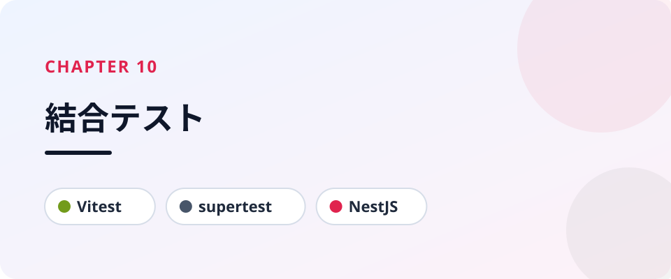

# 結合テスト



前の節の単体テストでは、クラスを 1 つずつ切り離して確かめました。でも、BFF はたくさんの部品が組み合わさって動いています。

- `AppModule` に、middleware・Guard・Pipe・コントローラー・Filter がそろっているか
- `@Public()` や `/admin` の middleware が、ちゃんとパスに掛かっているか
- エラーが、09 章でそろえた形で返るか

これは部品を 1 つずつ見ても分かりません。この節では、BFF を丸ごと起動して HTTP で呼ぶ **結合テスト** を書きます。HTTP で呼ぶのには、`nest new` が入れている **supertest** を使います。

## テストでの認証は「トークンの直書き」にする

BFF のほとんどの API は、Cognito のアクセストークンが無いと `401` を返します。でも、テストのたびに Cognito でサインインしてトークンを取るのは大変です。トークンは 1 時間で期限が切れ、テストが Cognito に左右されるようにもなります。

そこで、このハンズオンでは、テストでの認証を **トークンの直書き** にします。`alice-token` のような決め打ちの文字列をトークンとして送り、BFF の側ではトークンの検証（`TokenVerifier`）だけを、その文字列をユーザーに対応させる偽物に差し替えます。

| 送るトークン | ユーザー |
|---|---|
| `alice-token` | `alice` |
| `bob-token` | `bob` |
| `admin-token` | `admin`（`admin` グループ） |

:::warning
**本来は、テストの認証は別の仕組みで行います。** たとえば、テスト用のユーザープールとテスト用のユーザーを用意して実際にサインインする、テスト用の鍵で署名したトークンを作って本物の検証を通す、といったやり方です。このハンズオンでは、テストの書き方に集中するため、これらには触れません。

決め打ちのトークンでは、「Cognito が出した本物のトークンを、正しく検証できるか」は確かめられません。そこは 06 章のように、画面でサインインして手で確かめます。
:::

## 偽物の TokenVerifier

::diff{file="bff/src/auth/fake-token-verifier.ts"}

- `FAKE_TOKENS` … 決め打ちのトークンと、それが表すユーザーの対応表です。本物のトークンの中身のうち、認可で使う `sub` と `cognito:groups` だけを持たせています
- `implements Pick<TokenVerifier, 'verify'>` … 本物の `TokenVerifier` と同じ形の `verify()` を持つことを、TypeScript に確かめさせます。本物のほうの引数や戻り値を変えたら、ここで型エラーになります
- トークンが無い・形が違うときの `401` は、本物と同じ文言にしています

`src/` に置くのは、次の節の E2E テストで、起動した BFF からも使うためです。

## アプリの設定を 1 か所にまとめる

結合テストでは、`main.ts` を通らずにアプリを作ります。そのため、`main.ts` に書いた設定（CORS と入力チェックの Pipe）が、テストでは入りません。入力チェックが効かないまま、テストが通ってしまいます。

設定を関数に切り出して、`main.ts` とテストの両方から呼ぶようにします。

::diff{file="bff/src/app.setup.ts"}

::diff{file="bff/src/main.ts"}

## テストの名前と設定をそろえる

`nest new` は、HTTP で呼ぶテストを `test/app.e2e-spec.ts` という名前で作っていました。NestJS では、このテストを「e2e」と呼びます。このハンズオンでは、ブラウザから画面を操作するテスト（次の節）を E2E テストと呼ぶので、こちらは **結合テスト**（`integration`）という名前に変えます。

::diff{file="bff/test/app.e2e-spec.ts"}

::diff{file="bff/vitest.config.e2e.ts"}

::diff{file="bff/vitest.config.integration.ts"}

`include` で、`*.integration-spec.ts` だけを動かします。`npm test`（`*.spec.ts`）とは別に動かせるように、ファイル名の終わりを変えています。

::diff{file="bff/package.json"}

:::notice
`nest new` が作った `test/app.e2e-spec.ts` は、06 章から落ちていました（`npm run test:e2e`）。`AppModule` を作るときにトークンを検証するクラス（09 章からは `TokenVerifier`）が作られ、Cognito の ID の環境変数が無いとエラーになるからです。この節で、`TokenVerifier` を偽物に差し替えて直します。
:::

## 結合テストを書く

::diff{file="bff/test/app.integration-spec.ts"}

- `Test.createTestingModule({ imports: [AppModule] })` … 本物の `AppModule` を、そのまま組み立てます
- `.overrideProvider(TokenVerifier).useClass(FakeTokenVerifier)` … `TokenVerifier` だけを偽物に差し替えます。`AuthGuard` も `AdminMiddleware` も、DI で `TokenVerifier` を受け取っているので、両方に偽物が渡ります
- `createNestApplication({ logger: false })` … テストの間は、09 章のリクエストのログを出さないようにします
- `setupApp(app)` … `main.ts` と同じ設定を入れます
- `request(app.getHttpServer())` … supertest で、ポートを開かずに HTTP のリクエストを送ります
- `.set(as('alice-token'))` … `Authorization: Bearer alice-token` を付けます
- `.expect(201)` … ステータスコードを確かめます。本文は `res.body` で受け取って、`expect` で確かめます
- `beforeEach` でアプリを作り直すので、テストごとにメモが空の状態から始まります

テストの名前を「どうなるべきか」で書いておくと、そのまま BFF の決まりの一覧になります。

## 動かす

```bash
cd bff
npm run test:integration
```

```text
 ✓ test/app.integration-spec.ts (8 tests) 93ms

 Test Files  1 passed (1)
      Tests  8 passed (8)
```

Cognito の ID（`bff/.env`）が無くても動きます。試しに `bff/src/app.module.ts` の `forRoutes` の `admin{/*splat}` を `admin` に変えると、`/admin/notes は admin だけが呼べる` が落ちます。単体テストでは気づけない、組み合わせの間違いです（確かめたら戻してください）。

## この節を終えたときのディレクトリ

::tree

:::download
[この節を終えた状態をダウンロード](./project.zip)
:::

:::faq

### 単体テストと結合テストは、どちらを書けばいい？

両方です。判定のこまかい組み合わせ（ほかの人のメモ・admin・無いメモなど）は、速くて原因の分かりやすい単体テストで確かめます。結合テストでは、「部品がつながっているか」を、代表的な場面で確かめます。

### `npm test` で結合テストも一緒に動かしたい

`vitest.config.ts` の `include` に `'**/*.integration-spec.ts'` を足すと、一緒に動きます。この節では、あとで遅いテストが増えても分けて動かせるように、別にしています。

### ポートを開いて起動しなくていいの？

`request(app.getHttpServer())` は、まだ開いていないサーバーを受け取ると、空いているポートで一時的に開いて呼び、終わったら閉じます。`podman compose up` で BFF が 3001 番を使っていても、ぶつかりません。

:::
