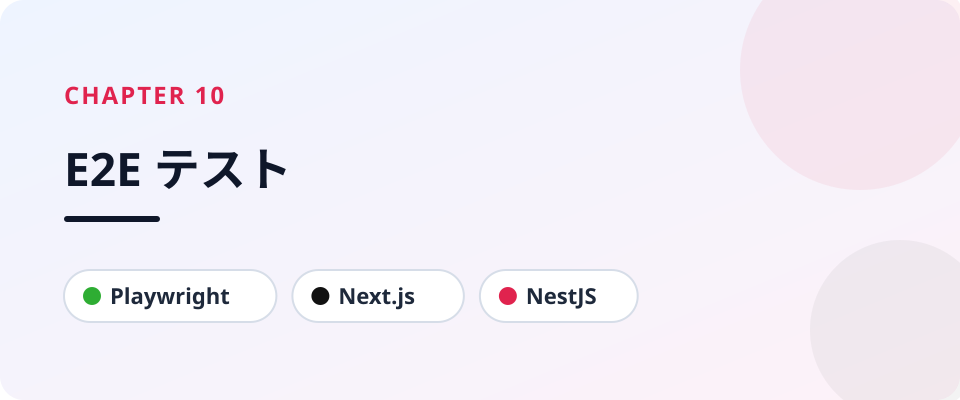
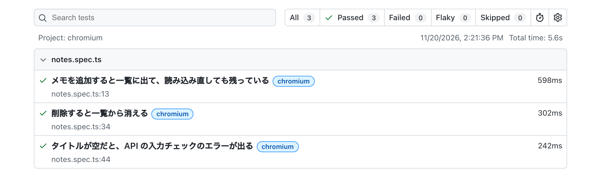

# E2E テスト



最後に、ブラウザで画面を操作して、画面から API までをまとめて確かめる **E2E（End to End）テスト** を書きます。道具は **Playwright** です。Playwright はブラウザ（Chromium・Firefox・WebKit）を動かし、人と同じように入力欄に文字を入れ、ボタンを押し、表示を確かめます。

この節では、次の 3 つを確かめます。

- メモを追加すると一覧に出て、読み込み直しても残っている
- 削除すると一覧から消える
- タイトルが空だと、API の入力チェックのエラーが画面に出る

## E2E テストでの認証も「トークンの直書き」にする

画面は、Cognito でサインインしないとメモの一覧を出しません。前の節と同じく、このハンズオンではテストの認証を **トークンの直書き** にします。

- 画面（UI）は、`NEXT_PUBLIC_FAKE_TOKEN` があれば、Cognito でのサインインを飛ばし、その値をトークンとして API に送る
- API は、`USE_FAKE_AUTH=true` のときだけ、前の節の `FakeTokenVerifier` を使う

どちらも Playwright がテスト用に起動するときだけ設定し、ふだんの `podman compose up` の動きは変わりません。

:::warning
**本来は、E2E テストの認証は別の仕組みで行います。** たとえば、テスト用のユーザーで本当にサインインし、そのときのブラウザの状態（`localStorage` のトークンなど）を保存して、各テストで使い回します（Playwright の「setup project」と `storageState`）。このやり方なら、サインインの画面や Cognito とのやり取りまで確かめられます。このハンズオンでは、テストの書き方に集中するため、これには触れません。
:::

## API を偽物の認証に切り替えられるようにする

`AuthModule` で、`TokenVerifier` として渡すクラスを、環境変数で選ぶようにします。

::diff{file="api/src/auth/auth.module.ts"}

- `{ provide: TokenVerifier, useClass: ... }` … 「`TokenVerifier` が欲しいところには、このクラスを作って渡す」という書き方です。`AuthGuard` と `AdminMiddleware` は `TokenVerifier` を受け取っているだけなので、中身が偽物になっても書き換えは要りません
- `process.env.USE_FAKE_AUTH === 'true'` … `true` という文字のときだけ偽物にします。書き忘れや書き間違いでは、本物のままです

偽物を使っているときは、起動のログに警告を出すようにします。

::diff{file="api/src/auth/fake-token-verifier.ts"}

```text
WARN [FakeTokenVerifier] 決め打ちのトークンで認証しています。テスト専用です
```

:::danger
`USE_FAKE_AUTH=true` のまま本番で動かすと、`alice-token` や `admin-token` を知っているだれもが、そのユーザーとして API を使えてしまいます。本番の環境変数には、決して書かないでください。
:::

E2E テストの画面は、ふだんと違うポート（3100）で動かします。そこからの呼び出しも許可できるように、CORS の許可先を環境変数で変えられるようにします。

::diff{file="api/src/app.setup.ts"}

## 画面を決め打ちのトークンで動かせるようにする

::diff{file="ui/app/auth.tsx"}

`NEXT_PUBLIC_FAKE_TOKEN` があれば、`Authenticator` を出さずに、そのまま中身（メモの一覧）を出します。

::diff{file="ui/lib/api/client.ts"}

API を呼ぶときも、`NEXT_PUBLIC_FAKE_TOKEN` があれば、Cognito のトークンの代わりにその値を `Authorization` ヘッダーに付けます。

`NEXT_PUBLIC_` の値は、ビルドのときに埋め込まれます。`ui/.env.local` に書かなければ、ふだんの画面や `npm run build` で書き出したファイルには入りません。

## Playwright を入れる

Playwright は、画面と API の両方を相手にするので、`my-app/` 直下に入れます。07 章で Redocly CLI などを入れた `package.json` です。

```bash
npm install -D @playwright/test
npx playwright install chromium
```

2 つ目のコマンドで、テストに使うブラウザ（Chromium）をダウンロードします。ブラウザは `node_modules/` ではなく、パソコンの共通の場所に入ります。

:::::platform
::::macos
入る場所は `~/Library/Caches/ms-playwright/` です。
::::
::::windows-linux
入る場所は `~/.cache/ms-playwright/` です（Windows では WSL2 の Ubuntu の中）。

Ubuntu では、ブラウザを動かすための部品が足りず、テストの起動でエラーになることがあります。そのときは `npx playwright install-deps chromium` で入れてください（中で `sudo` を使うので、パスワードを聞かれます）。
::::
:::::

`devDependencies` には `npm install` で `@playwright/test` が入ります。`scripts` の `test:e2e` は手で足します。

::diff{file="package.json"}

Playwright が作る結果とレポートは、Git に入れないようにします。

::diff{file=".gitignore"}

## Playwright の設定

::diff{file="playwright.config.ts"}

- `testDir: './e2e'` … テストは `e2e/` に置きます
- `use.baseURL` … `page.goto('/')` のように、パスだけで画面を開けるようになります
- `projects` … どのブラウザで動かすかです。この節では Chromium だけにしています
- `webServer` … テストの前に、API と画面を起動します。`url` に応答が返るまで待ってからテストを始め、終わったら止めます
  - API は `USE_FAKE_AUTH: 'true'` で偽物の認証にし、3101 番で起動します
  - 画面は `NEXT_PUBLIC_FAKE_TOKEN: 'alice-token'` で、`alice` として動かします
- `reuseExistingServer: !process.env.CI` … 手元では、そのポートでもう動いていれば、起動せずにそれを使います
- `trace: 'on-first-retry'` … 落ちたテストを動かし直すとき、操作の記録（トレース）を残します

ポートを 3100・3101 にしているのは、`podman compose up` の 3000・3001 とぶつからないようにするためです。同じポートだと、`reuseExistingServer` が、偽物の認証になっていないふだんの API をそのまま使ってしまいます。

## E2E テストを書く

::diff{file="e2e/notes.spec.ts"}

- `test('...', async ({ page }) => { ... })` … `page` は、Playwright が開いたブラウザのタブです。テストごとに新しいタブ（まっさらな状態）が用意されます
- `page.getByPlaceholder('タイトル')`・`page.getByRole('button', { name: '追加' })` … 画面の要素を、**利用者から見える手がかり**（文言・役割）で探します。CSS のクラス名で探すより、見た目を変えても壊れにくくなります
- `.fill()`・`.click()` … 文字を入れる・押す操作です。要素が表示されて操作できるようになるまで、自動で待ちます
- `getByRole('listitem').filter({ hasText: title })` … 一覧の項目のうち、そのタイトルを含むものに絞ります
- `await expect(locator).toBeVisible()` … 表示されるまで、決まった時間（既定は 5 秒）待ちながら確かめ続けます。API からの応答を待つための `sleep` は要りません
- `uniqueTitle()` … API のメモはメモリ上にあり、テストの間で共有されます。テストごとに違うタイトルにして、ほかのテストのメモと混ざらないようにしています

## 動かす

```bash
npm run test:e2e
```

```text
Running 3 tests using 1 worker

[1/3] [chromium] › e2e/notes.spec.ts:13:1 › メモを追加すると一覧に出て、読み込み直しても残っている
[2/3] [chromium] › e2e/notes.spec.ts:34:1 › 削除すると一覧から消える
[3/3] [chromium] › e2e/notes.spec.ts:44:1 › タイトルが空だと、API の入力チェックのエラーが出る
  3 passed (5.4s)
```

`npx playwright show-report` で、結果をブラウザで見られます。テストが落ちたときは、ここで、どこで止まったか・そのときの画面を確かめられます。



画面の動きを目で見たいときは、`npx playwright test --headed`（ブラウザを表示する）や `npx playwright test --ui`（1 つずつ動かして、操作と画面を見比べられる）を使います。

## この章でそろったテスト

| 種類 | コマンド | 場所 | 数 |
|---|---|---|---|
| 単体テスト | `cd api && npm test` | `api/src/**/*.spec.ts` | 22 |
| 結合テスト | `cd api && npm run test:integration` | `api/test/*.integration-spec.ts` | 8 |
| E2E テスト | `npm run test:e2e` | `e2e/*.spec.ts` | 3 |

どれも、Cognito の ID が無くても動きます。

## このハンズオンで作ったもの

これで、ハンズオンの最後の節です。最初の Hello World から、次のものを作りました。

- Next.js の静的書き出しの画面と、NestJS の API（02 章）
- Podman と compose で、1 つのコマンドで動く開発環境（03 章）
- 入力チェック付きのメモの API と、それを呼ぶ画面（04 章）
- Cognito のサインイン（05 章）と、API でのトークンの検証・認可（06 章）
- OpenAPI の約束と、そこから作った型による、画面と API のつながり（07・08 章）
- アプリ全体の Guard、パス単位の middleware、そろったエラー、ログ（09 章）
- 単体テスト・結合テスト・E2E テスト（10 章）

## この節を終えたときのディレクトリ

::tree

:::download
[この節を終えた状態をダウンロード](./project.zip)
:::

:::faq

### `npm init playwright@latest` は使わないの？

使っても構いません。設定ファイルと見本のテスト（`tests/example.spec.ts`）を作り、ブラウザも入れてくれます。この節では、何が入るのかが分かるように、1 つずつ入れて書いています。

### `Process from config.webServer was not able to start` と出る

Playwright が、画面か API を起動できませんでした。すぐ上の `[UI]`・`[API]` の行に理由が出ています。

- `Another next dev server is already running.` … 手元で `npm run dev` している UI があります。Next.js は、同じディレクトリで開発サーバーを 2 つは動かせません。止めてから動かし直してください（`podman compose up` の UI はコンテナの中で動いているので、ぶつかりません）
- `EADDRINUSE: address already in use :::3100` … 3100 番（または 3101 番）を、ほかのプログラムが使っています。`lsof -i :3100` で探して止めてください

### Firefox や Safari（WebKit）でも確かめたい

`npx playwright install firefox webkit` でブラウザを入れ、`projects` に `{ name: 'firefox', use: { ...devices['Desktop Firefox'] } }` などを足します。

:::
